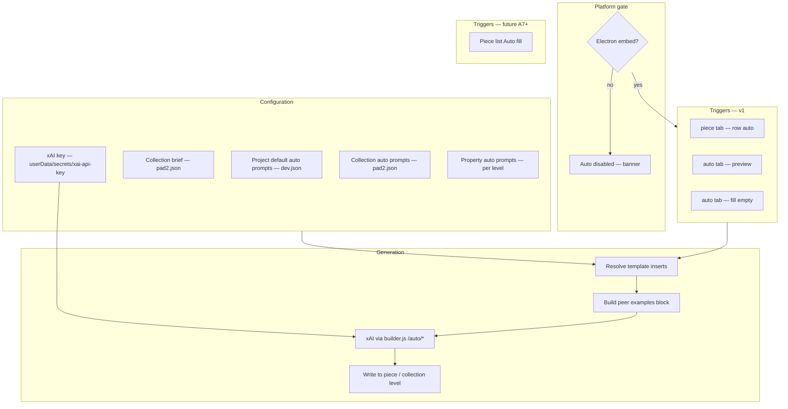
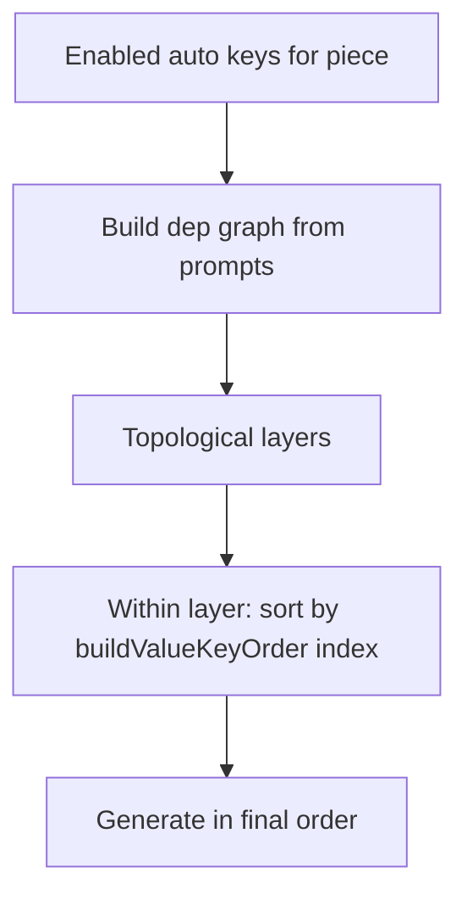
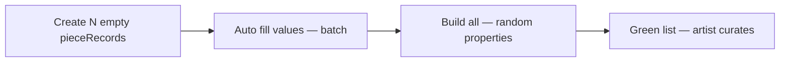

# Auto generation — design & implementation

**Status:** **v1 implemented (phases A1–A6)** — May 2026  
**Future (optional):** A7 **Auto fill**, A8 Properties **auto** tab, A9 **Create N** / bulk pipeline — see §15.2  
**Supersedes:** batch-generator approach in earlier drafts of [COLLECTION-GENERATOR-PLUGINS.md](./COLLECTION-GENERATOR-PLUGINS.md)  
**Related:** [VALUES-PANEL.md](./VALUES-PANEL.md), [PROPERTIES-PANEL.md](./PROPERTIES-PANEL.md), [COLLECTION-DESIGN-V2.md](./COLLECTION-DESIGN-V2.md), [PARAMETER-DRIVERS-DESIGN.md](./PARAMETER-DRIVERS-DESIGN.md)

Instead of a separate batch-generator panel, **auto generation** lives inside the existing Values and Properties panels. Each field can carry a short **auto prompt**; prompts compose via **`[values.key]`** / **`[properties.Name]`** inserts; a **collection brief** sets overall flavour. One **advBuilder-wide xAI key** (Electron secrets — same store as the xAI chat driver) powers all auto actions.

**Platform:** **Electron-only** for v1. Plain `node builder.js` / browser dev-ui without the Electron shell does not expose Auto / Auto fill (banner explains why). This matches secure key storage and userdata-backed driver memory ([PARAMETER-DRIVERS-DESIGN.md](./PARAMETER-DRIVERS-DESIGN.md) §5).

---

## 1. Intent

**Goals:**

- Generate **one value or property at a time**, or **fill all gaps** on a piece, from prompts defined next to the fields they produce.
- Store prompts at the same **levels** artists already use (`default`, `collection`, `piece`) — plus a read-only **`auto`** tab for prompt editing (not a merge level).
- Provide a **collection brief** (theme overview) in the Collections panel for high-level creative context.
- Support **template inserts** in prompts: `[values.theme_overview]`, `[properties.Theme]`, `[piece.num]`, etc.
- Single **xAI API key** for advBuilder in **Electron userData secrets** (not per-driver, not in `dev.json`, not in `localStorage`).
- **Per-field generate** on the Values **piece** tab (**auto** in the key/value grip column — overwrites piece level).
- **Preview** and **fill empty** on the Values **auto** tab (generate only when merged value is blank).
- **Auto fill** on the piece list — *(planned, phase A7)* — generate every enabled auto field that is still empty on the selected piece(s).
- **Peer examples** — when generating, include a block of existing values from other pieces in the same collection to keep flavour consistent (template configurable in collection **auto settings**).
- **Help (`?`)** — on Values **auto** tab prompt header and on collection **peer example template**; modals explain inserts and workflow.

**Motivation:**

> Collection pieces often need names and descriptions that match locked properties and a shared collection theme. Prompts for `name` and `description` should reference property locks and `[collection.brief]` — not a one-shot batch directive in a separate tool.

**Non-goals for v1:**

- Auto-build after generation (artist still **Build** when ready).
- Generating inside minified `output.*`.
- Browser-only auto generation (requires Electron app).
- Storing the xAI key in `localStorage` or `<project>/parameters/`.

---

## 2. Why this fits better than a batch panel

| Batch panel (previous doc) | Auto generation (this doc) |
|----------------------------|----------------------------|
| One big directive for N pieces | Per-field prompts reused across pieces |
| Regenerate whole set | Fill one field or one piece |
| Separate UI to learn | Extends Values / Properties artists already use |
| LLM emits many rows at once | LLM emits one string (or one catalog choice) per call |
| Grid combinatorics in host | Structure from property locks + piece list; creativity from auto |

Combinatorial structure (9 Theme × Mode pieces) still comes from **adding pieces** with `fixedProperties` set (manually, grid helper later, or import) — auto fills the **text values** per piece.

---

## 3. Architecture overview



**Pipeline for one field:**

1. Load merged **context** for the target piece (values result, properties result, collection brief).
2. Load **auto prompt** via level inheritance (§5.2).
3. **Resolve** `[values.*]`, `[properties.*]`, `[collection.*]`, `[piece.*]`, `[examples.*]` inserts.
4. Append **peer examples block** from other pieces when enabled (§5.4).
5. Call xAI with a fixed system contract (§11) + resolved user prompt.
6. Write result to **`piece`** level (values or properties) with `use: true`.
7. Orange piece if already built ([COLLECTION-DESIGN-V2.md](./COLLECTION-DESIGN-V2.md)).

---

## 4. UX model — configure vs generate

Two distinct modes, same Values panel:

| Mode | Level bar | What you see | What it does |
|------|-----------|--------------|--------------|
| **Configure** | **default** or **collection** + **auto** tab | Rows switch to **auto styling** (tinted background); **auto** ☑ + prompt fields (filled or blank) | Saves prompts for that level only |
| **Generate** | **piece** (one piece selected) | Normal value rows at **piece** level; per-row **auto** in grip column | Runs effective prompt → writes **piece** level value (can overwrite) |
| **Generate (safe)** | **auto** tab + piece selected | **preview**, **fill empty** per key | Preview resolved prompt; generate only if merged value is empty |
| **Generate (batch)** | Piece list **Auto fill** *(A7, not yet)* | — | Fill all empty enabled fields on selection |

```text
CONFIGURE (where prompts live)          GENERATE (where output lands)
─────────────────────────────          ────────────────────────────────
default  + auto  → dev.json             piece + row auto → pieceRecord.values
collection + auto → 01.json             auto tab fill empty → piece (if blank)
collection brief / autoSettings         Auto fill (A7) → all empty fields
```

**Flexible inheritance:**

- Set prompts at **default** + **auto** → applies to every collection unless overridden.
- Open collection **01** → **collection** + **auto** → blank or custom prompts replace default for that collection only.
- Select piece **0003** → **piece** level → **auto** on `description` (grip column) → generated string lands on **that piece**, using collection prompt (or default fallback).

**Visual feedback when configuring:**

- Switching to the **auto** tab changes row styling (e.g. subtle accent background on prompt rows) so it is obvious you are editing **generation rules**, not merge values.
- **auto** ☑ off → row muted; no generation for that key at this level.
- **auto** ☑ on, empty prompt → enabled but inherits or skips (collection defers to default if blank per §5.2).

**Piece level in v1:** used for **viewing and editing generated values** and as the target of per-row **auto** / **fill empty** — not for per-piece prompt overrides (deferred). Artist flow: configure at collection → select piece → generate into piece.

---

## 5. UI — Values panel

### 5.1 Level bar (extended)

Current merge levels: `default` → `collection` → `piece` → `override` → **`result`**

Add after **result**:

| Tab | Purpose | Editable |
|-----|---------|----------|
| **`auto`** | Per-key **auto enable** + **prompt** for the **currently selected merge level** | Yes (when that level is enabled) |

`auto` is **not** part of the value merge. It is prompt configuration keyed by the same level you were just editing.

```
default → collection → piece → override → result → auto
   ↑________________ edit prompts at this level when auto tab active ________↑
```

**How to edit prompts:**

1. Select merge level (**default** or **collection** — or **piece** later).
2. Switch to **auto** tab.
3. Rows show auto ☑ + prompt for that level only.

When **collection 01** is open, you typically set **collection** + **auto** for collection-specific prompts; **default** + **auto** holds project-wide fallbacks shared across collections.

When **auto** is active, each row shows:

| Column | Content |
|--------|---------|
| key | Same as other levels |
| **auto** ☑ | Enable generation for this key |
| prompt | Short multiline prompt (textarea); supports `[…]` inserts |
| **?** | Help control (§5.5) |
| *(optional)* hint | Max length from value catalog (e.g. description ≤ 200) |

Rows without **auto** ☑ are skipped by Auto / Auto fill.

Header row when **auto** tab active:

```text
[ key | auto | prompt                                    | ? ]
```

### 5.2 Project vs collection — where prompts live

**Decision: both, with inheritance.** Different collections should have different auto sections; the project provides shared defaults.

| Level | Stored in | When to use |
|-------|-----------|-------------|
| **`default`** | `dev.json` → `valueAutoLevels.default` | Prompts that apply to **any** collection unless overridden — generic patterns, max-length reminders, shared key list |
| **`collection`** | `collections/<pad2>.json` → `valueAutoLevels.collection` | **Per-collection flavour** — e.g. sci-fi names vs a minimal abstract collection |
| **`piece`** | `pieceRecord.valueAuto` | Rare one-off overrides (defer post-v1) |

**Effective prompt** for generating piece P's `name` (collection open):

1. `collection` entry if **enabled** (even if prompt text empty — treat empty as skip to next)
2. else `default` entry if **enabled**
3. else not auto-generatable

**UI cues when collection open:**

| Row state | Meaning |
|-----------|---------|
| Prompt only in **default** | Label: `inherits default` on collection **auto** view until you type a collection override |
| Prompt in **collection** | Collection override active — bold or `collection` badge |
| **Reset** control | Clears collection override for one key → falls back to default |

**Recommendation:** put `name` / `description` prompts at **collection** level on each `collections/<pad2>.json`. Keep **default** auto minimal (or empty) so a second collection is not forced to share the first collection's tone.

Same inheritance rules apply to **`propertyAutoLevels`** and **`autoBrief`** (collection-only — no project-level brief fallback except empty string).

### 5.3 Storage shape

```json
{
  "valueAutoLevels": {
    "default": {
      "description": { "enabled": true, "prompt": "Keep under 200 characters." }
    },
    "collection": {
      "name": { "enabled": true, "prompt": "Short title for [properties.Mode] [properties.Theme]. Theme: [collection.brief]" },
      "description": { "enabled": true, "prompt": "Max 200 chars. Primer for [values.name]. Match tone of [examples.description]. Theme: [collection.brief]" }
    }
  },
  "autoSettings": {
    "includePeerExamples": true,
    "peerExampleMax": 5,
    "peerExampleKeys": ["name", "description"]
  }
}
```

| Field | Location |
|-------|----------|
| `valueAutoLevels.default` | `dev.json` |
| `valueAutoLevels.collection` | `collections/<pad2>.json` |
| `autoSettings` | `collections/<pad2>.json` (collection-scoped) |
| `propertyAutoLevels.*` | Same split as values |

### 5.4 Peer examples

When generating a field for piece **P**, the host can attach **peer examples** — values already filled on **other** pieces in the same collection — so the model matches established flavour.

**Collection setting** (`autoSettings` on `<pad2>.json`):

| Field | Default | Purpose |
|-------|---------|---------|
| `includePeerExamples` | `true` | Master toggle |
| `peerExampleMax` | `5` | Cap examples (most recent or diverse — v1: first N by piece num excluding P) |
| `peerExampleKeys` | `["name", "description"]` | Which value keys must be non-empty for a piece to count as a peer |
| `peerExampleTemplate` | see below | Multiline template for **each** peer — same `[values.*]` / `[properties.*]` / `[piece.*]` inserts as prompts |
| `peerExampleIntro` | short intro line | Text before the peer blocks |
| `peerExampleOutro` | short outro line | Text after the peer blocks |
| `peerExampleSeparator` | `"---"` | Joins formatted peer blocks |

**Default `peerExampleTemplate`:**

```text
num: [values.num]
name: [values.name]
description: [values.description]
```

**Automatic block** (appended to LLM user message when enabled and ≥1 peer exists):

```text
Here are examples from other pieces in this collection (match this tone and style; do not copy verbatim):

num: 0001
name: Quiet Harbor
description: a layered field of light and motion in quiet geometry.
---
num: 0002
name: Sharp Echo
description: a sharp echo across a broken grid of signals.

Generate a new entry in the same spirit for the current piece.
```

**Rules:**

- Exclude **current piece** from peers.
- Only include peers where the **target key** is non-empty (for single-field generate), or where **any** `peerExampleKeys` value is non-empty (for Auto fill context).
- **No hardcoded property names** — include only what your template references (e.g. `[properties.Theme]` / `[properties.Mode]` when those properties exist; other projects omit those lines).
- Optional prompt token **`[examples.name]`** / **`[examples.description]`** — injects a compact inline list at that position instead of (or in addition to) the trailing block. If token present, still respect `peerExampleMax`.

**When no peers yet:** omit block; first piece in collection relies on brief + prompts only. Second piece onward benefits from examples.

**Privacy / size:** keep peer templates concise; truncate long values in the template if needed (future: per-key max length).

### 5.5 Help control (`?`)

Beside the prompt column header (and optionally per-row), a **`?`** button.

| Interaction | Content |
|-------------|---------|
| **Hover** (tooltip) | Short: *Enable auto ☑, write a prompt, use [values.key] and [properties.Name] for context. Click ? for full reference.* |
| **Click** | Modal / popover (**Auto generation help**) — scrollable, does not dismiss on accidental hover-away |

**Popup sections:**

1. **Quick start** — enable ☑, write prompt, select piece; use **preview** / **fill empty** on the **auto** tab, or **auto** on the **piece** tab to overwrite.
2. **Prompt levels** — **default** = project fallback; **collection** = overrides per collection.
3. **Insert reference** (table):

| Insert | Meaning |
|--------|---------|
| `[values.name]` | This piece's merged name |
| `[values.<key>]` | Any merged value key |
| `[properties.Theme]` | Merged property (locks + built) |
| `[properties.<name>]` | Any property — use exact PropMaster name |
| `[collection.brief]` | Collection brief textarea |
| `[collection.name]` | Collection display name |
| `[piece.num]` | Piece number (e.g. 0003) |
| `[piece.displayName]` | List label |
| `[examples.description]` | Inline list of peer descriptions (optional) |

4. **Peer examples** — explain automatic block from other pieces; link to collection `autoSettings`.
5. **Tips** — generate `name` before `description`; collection brief is shared context; prompts live at **collection** level for per-collection tone.
6. **Platform** — Auto generation requires the **advBuilder Electron app** (`npm start`); xAI key is stored in app userData, not the project repo.

Popup content is static HTML in `dev-ui.html` (or `/docs/auto-help.html`); no LLM.

### 5.6 Custom value keys for context

Artists can **Add** keys like `theme_overview` at **collection** level:

- The key participates in merge like any value (`use: true` → available as `[values.theme_overview]`).
- Its **auto** prompt generates the overview text once (collection level or first Auto fill).
- Other prompts reference it: `"Theme: [values.theme_overview]"`.

This replaces a dedicated “theme block” widget with a normal value key + collection-level auto prompt — optional **`collection.brief`** alias (§5) can mirror the same text for convenience.

---

## 6. UI — Collections panel (collection brief)

Below collection tabs, when a collection is **open**:

```
┌─ COLLECTIONS ─────────────────────────────┐
│  [01] [02]  [+]                             │
│  Brief (collection flavour)                 │
│  ┌────────────────────────────────────────┐ │
│  │ Night gardens — a 3×3 Theme / Mode     │ │
│  │ grid, short titles, minimal primers…   │ │
│  └────────────────────────────────────────┘ │
└─────────────────────────────────────────────┘
```

**Storage:** `collections/<pad2>.json`:

```json
{
  "autoBrief": "Transmigrants summoned through the veil…"
}
```

**Template alias:** `[collection.brief]` resolves to `autoBrief`. Equivalent to referencing a collection value if you also store it in `values.theme_overview`.

Patch via `PATCH /collections/:pad2` `{ "autoBrief": "…" }`.

---

## 7. UI — Properties panel

Same pattern: level bar gains **`auto`** after **result**.

Each property row (when **use** is on at collection or piece level, or when property is locked with a fixed value):

| Column | Content |
|--------|---------|
| property name | e.g. `Theme` |
| **auto** ☑ | Enable auto-selection for this property |
| prompt | e.g. `"Pick the choice that best matches [values.name] and [collection.brief]"` |

**Storage:** `propertyAutoLevels` in `dev.json` / `<pad2>.json` / `pieceRecord.propertyAuto` (same level rules as values).

**Generation output:** a single choice string from `allprops[propertyName]`. LLM must return `{ "value": "Calm" }` validated against catalog — not free text.

**v1 scope note:** Property auto is **lower priority** than value auto. A common first milestone is `name` + `description` values while categorical properties stay **fixedProperties** set at piece creation. Property auto helps when a property should be **chosen** not locked.

---

## 8. Template inserts

Prompts are plain text with **`[namespace.key]`** tokens resolved before the LLM call.

| Token | Resolves to |
|-------|-------------|
| `[values.name]` | Merged **result** for value key `name` on target piece |
| `[values.theme_overview]` | Same — any merged value key |
| `[properties.Theme]` | Merged **result** property (fixed + overrides + built) |
| `[properties.Mode]` | Same |
| `[collection.brief]` | `autoBrief` from `<pad2>.json` |
| `[collection.name]` | Collection display name |
| `[piece.num]` | `pad4` piece number |
| `[piece.displayName]` | List label |
| `[examples.<key>]` | Inline peer examples for value key (optional; see §5.4) |

**Rules:**

- Unknown token → leave literal or show warning in UI (configurable; v1: warn + highlight).
- **Circular deps** (A's prompt references B, B references A): detect at generate time; error with cycle path.
- **Generation order** for Auto fill (§10.2):
  - **Primary:** topological sort by `[values.*]` / `[properties.*]` insert dependencies (`extractPromptDependencies`, `detectValueAutoCycles`).
  - **Tie-breaker / no-deps case:** `buildValueKeyOrder` from Values panel row order ([VALUES-PANEL.md](./VALUES-PANEL.md)).
  - Keys in the same topological layer sort by `buildValueKeyOrder` index (stable, artist-controlled).
  - When no cross-deps exist between enabled keys, generation follows `buildValueKeyOrder` entirely.

**Example — `description` auto prompt at collection level:**

```text
Write a max-200-character piece primer.
Piece name: [values.name]
Style flavour (internal only): [properties.Theme] / [properties.Mode]
Collection theme: [collection.brief]
Match the tone of existing pieces: [examples.description]
```

---

## 9. xAI key (advBuilder-wide, Electron)

Stored in Electron main process userData as **`xai-api-key`**. **One key** powers auto generation and any project-specific xAI parameter drivers that use the same secrets store.

| Item | Spec |
|------|------|
| **Storage** | Electron main process: `<userData>/secrets/xai-api-key.txt` — **never** `dev.json`, never committed, never `localStorage` |
| **IPC** | `adv:storeSecret` / `adv:loadSecret` on preload ([`electron/preload.js`](../electron/preload.js)) |
| **Iframe bridge** | dev-ui runs at `http://127.0.0.1:<port>/?embed=1` — no direct preload access. Shell relays `advBuilder:storeSecret` / `advBuilder:loadSecret` via `postMessage` (same pattern as clipboard in [`electron/renderer/index.html`](../electron/renderer/index.html)) |
| **UI** | Status bar chip: **xAI key** → masked modal (“Stored on this machine; sent only to api.x.ai”) |
| **Usage** | Auto generation + xAI chat driver + organizer — all read the same secret |
| **Transport** | **`POST /auto/*`** on `builder.js`; Node loads key from Electron-injected env or IPC pipe for the session. Key does **not** persist in dev-ui JS or driver iframe `localStorage` in Electron mode |
| **Browser-only** | No key UI for auto; feature disabled |

### 9.1 Why Electron-only

| Concern | Browser-only | Electron |
|---------|--------------|----------|
| API key | `localStorage` on localhost origin — readable by any script on that origin | userData secrets via main process |
| dev-ui context | Embedded iframe cannot use preload | Shell bridges secrets + platform flag |
| xAI chat memory | Was in `<project>/parameters/*.memory.json` (repo-adjacent) | userData driver-stores ([PARAMETER-DRIVERS-DESIGN.md](./PARAMETER-DRIVERS-DESIGN.md) §5.6) |

---

## 10. Triggers

### 10.1 Per-field generate *(implemented — A5/A6)*

| Control | Where | Behaviour |
|---------|-------|-----------|
| **auto** | Values **piece** tab — grip column between key and value | Generate **one** field for the selected piece; **overwrites** piece-level value. Shown only for keys with an effective auto prompt (Electron, single piece, not frozen). |
| **preview** | Values **auto** tab — per key row | Resolve prompt + peer block for the selected piece; modal shows full LLM user message. No API call. |
| **fill empty** | Values **auto** tab — per key row | Same as generate but **skips** if merged value is non-empty (`onlyIfEmpty` on server). |
| **?** | Values **auto** tab (prompt header) | Auto generation help modal. |
| **?** | Collections panel — peer example template | Collection auto settings help (peers, inserts, eligibility rules). |

| Precondition | Behaviour |
|--------------|-----------|
| Collection open, **one piece** selected | Required for generate / preview / fill empty |
| Not Electron embed | Auto tab and generate controls hidden |
| No xAI key | Prompt to set key (Electron modal) |
| Frozen collection | Generate disabled |

**Flow (generate):**

1. Load effective auto prompt for the key.
2. Resolve inserts against **that piece's** merged context; append peer block when enabled.
3. LLM → write to **`piece`** level with `use: true`.
4. Refresh Values UI; orange piece if already built.

**Collections panel (A3):** collapsible **Brief** and **Auto settings** — `autoBrief`, `includePeerExamples`, `peerExampleMax`, `peerExampleKeys`, `peerExampleTemplate` (see §5.4). Autosave does not trigger a full preview rebuild.

**Note:** An early design placed **Auto** on the centre divider between piece list and preview; that was **not shipped**. Per-row **auto** on the piece tab replaced it.

### 10.2 Piece list — **Auto fill** *(future — A7)*

*Not implemented. Kept here as the spec for a possible follow-up.*

Add to `.piece-list-toolbar` next to **Build**:

```
[Build all] [Build] [Auto fill] [+] [Del]
```

| Selection | Behaviour |
|-------------|-----------|
| **One piece** selected | Fill all enabled auto keys/properties that are **empty** on that piece |
| **Multiple** selected | Same, per piece sequentially (show progress) |
| **None** selected | Fill all pieces in collection (confirm dialog if >10) |

**Empty** definition for values: no `use: true` at piece level AND merged result is blank / whitespace / placeholder (configurable list: `"Piece 0001"`, `"200 char placeholder…"`).

**Generation order:**

1. Collection-level auto keys on `<pad2>.json` (e.g. `theme_overview`) if empty — **once per collection**, not per piece.
2. Per piece, topological sort of enabled piece-targeting prompts by `[values.*]` / `[properties.*]` deps.
3. Within each topological layer (or when keys have no cross-deps): sort by **`buildValueKeyOrder`** from the Values panel ([VALUES-PANEL.md](./VALUES-PANEL.md)).
4. Typical outcome: `name` before `description` when description references `[values.name]` (via deps) or when the artist has placed `name` above `description` in the Values list.



Show progress: `Auto fill 0003 — description (3/9)`.

---

## 11. LLM contract (per call)

**System (fixed):**

```text
You generate a single field for an advBuilder art piece.
Return ONLY JSON: { "value": "<string>" }
No markdown. No extra keys.
Respect max length if given in the user message.
For property picks, value MUST be exactly one of the listed choices.
```

**User message (assembled):**

```text
Field: values.description
Max length: 200
Allowed choices: (omit for free text)

Context:
- collection.brief: …
- values.name: Quiet Harbor
- properties.Theme: Calm
- properties.Mode: Bright

Here are examples from other pieces in this collection (match tone; do not copy):
0001 "Quiet Harbor" — a layered field of light and motion…
  (Theme: Calm, Mode: Bright)

Task:
<prompt after template resolution>
```

Parse JSON; validate length and catalog; write to piece level.

---

## 12. Example walkthrough (structured grid)

### Setup (once per project / collection)

1. **xAI key** in advBuilder settings (Electron).
2. Open a collection → Values → select **collection** level → **auto** tab:
   - `name`: prompt referencing locked properties and `[collection.brief]`.
   - `description`: short primer; `[values.name]`; peer examples or automatic peer block.
3. Set **Brief** in Collections panel (`autoBrief`).
4. Optionally enable/configure peer examples in collection settings (default on).
5. **default** + **auto** — generic hints only (e.g. max length); collection-specific tone stays on **collection**.

### Create pieces (structure)

Add pieces with `fixedProperties` for each combination you need (manual, JSON import, or future grid helper). Leave generated value fields empty until auto fill.

### Fill content

- First piece (no peers): **Auto fill** uses brief + prompts only.
- Later pieces: peer block includes earlier values → consistent flavour.
- Or select one piece → **auto** (piece tab) or **fill empty** (auto tab) per field.

### Build

**Build all** when orange pieces look correct.

### Two collection strategies

| Strategy | Structure | Auto role | Example |
|----------|-----------|-----------|---------|
| **Structured grid** | Many pieces with **`fixedProperties`** (property combinatorics) | Fills **values** only (names, descriptions) | 9-piece property grid |
| **Exploratory bulk** | Many pieces, **no** per-piece fixed props — random DNA at build | **Create N** → optional **Auto fill** → **Build all** → curate | 100-piece explore run |

Project-specific walkthroughs belong in that art project's `docs/` folder.

See §12.1 for the bulk / first-pass workflow.

---

## 12.1 Bulk first-pass generation (“Create N pieces”)

Auto generation + collection build enables a **first-pass factory** workflow: spawn many pieces with random properties (overrides only), populate values in batch, build everything, then **curate** by hand.

### One-click pipeline

**UI:** piece list or Collections panel → **Create N pieces…** (dialog: count, options) → confirm.

Default pipeline for “Create me 100 pieces”:



| Step | What happens |
|------|----------------|
| **1. Create** | Append N `pieceRecord`s: empty values, **no** `fixedProperties`, random five-digit seeds (`performance.now()`-based) when N > 1; single add uses `num * 1000`. Collection **`propertyOverrides`** apply; Properties **override** panel (when configured) is snapshotted per build ([COLLECTION-DESIGN-V2.md](./COLLECTION-DESIGN-V2.md) §5.0 mode A). |
| **2. Auto fill** | **Auto fill** (whole collection): every enabled auto key on every piece, dependency order + peer examples accumulating piece-by-piece. Optional skip if no prompts configured. |
| **3. Build all** | Queue N builds; each piece gets **full random** PropMaster roll except overrides in `fixedMap`. Progress on visualiser overlay: `Building: '0005 Name' (5 of 100)` + **Cancel** on piece list. |
| **4. Curate** | Artist reviews green list (see below). |

**Dialog options (v1 defaults in bold):**

| Option | Default | Notes |
|--------|---------|-------|
| Count N | 100 | Max `9999 - pieceCount` |
| **Auto fill values before build** | on | Off = placeholder names until artist runs Auto fill later |
| **Build after create** | on | Off = orange list only; artist builds when ready |
| Use collection overrides only | on | No per-piece `fixedProperties` — matches “no fixed properties, just overrides” |

**HTTP sketch:** `POST /collections/:pad2/bulk-create` `{ count, autoFill, build, seedBase? }` → streams progress via existing collection build WS.

### Property behaviour (no fixed props)

At first build each piece uses **mode A** merge ([COLLECTION-DESIGN-V2.md](./COLLECTION-DESIGN-V2.md) §5.0):

```javascript
// Override panel snapshotted before each build
pieceRecord.overrideProperties = snapshotOverrideProperties(dev.propertyLevels.override);

fixedMap = {
  ...collection.fixedProperties,      // usually empty
  ...piece.fixedProperties,           // empty for bulk create
  ...flatUseTrue(collection.propertyOverrides),  // e.g. debug off
  ...flatUseTrue(pieceRecord.overrideProperties),
};
SetRandomProperties(piece.seed, fixedMap);
// → full random DNA except override locks
```

Each of 100 pieces gets **different** wire/iris/chaos unless overrides pin groups. Collection-level **`propertyOverrides`** (e.g. `colours: off` for whole run) still apply to all.

### Curation loop (after first pass)

The first pass is **volume**, not perfection. Artist workflow:

| Action | When |
|--------|------|
| **Scroll piece list + preview** | Spot patterns that clash (same chaos_core too often, weak name/description pairing) |
| **Reshuffle** (visualiser) | Visual DNA wrong — re-roll **unlocked** properties for that piece ([COLLECTION-DESIGN-V2.md](./COLLECTION-DESIGN-V2.md) §6.10) |
| **Random** (Properties panel) | Same intent from panel — re-roll ticked unlocked props |
| **auto** (piece tab) | Regenerate **one value** (name/description) — overwrites piece level; peer examples include siblings |
| **Auto fill** (selection) | Re-fill **empty** fields only on selected pieces — does not clobber existing unless key cleared first |
| **Manual edit** | Values / Properties at piece level — fine-tune locks, rename, tweak overrides |
| **Clear + Auto** | Delete piece-level `name` value → **Auto** again for a fresh name |

Nothing prevents editing a **green** piece — it goes **orange** until rebuilt. **Build** selected when happy.

### Structured vs exploratory (same tooling)

| | Structured grid (e.g. 9 pieces) | 100-piece explore |
|--|-------------------|-------------------|
| Piece creation | 9 rows with **fixed** Theme/Mode | **Create N** — no fixed props |
| Property diversity | Combinatorial grid | Random at build |
| Auto fill | Names/primers per combo | Names/primers per random DNA |
| Peer examples | Strong consistency | Still helps tone across 100 |
| Curation | Light (grid is intentional) | Heavy (reshuffle + re-auto) |

Same **auto** prompts at collection level; different **creation** step.

### Practical limits

| Topic | Guidance |
|-------|----------|
| **N = 100 builds** | Already specced batch queue + cancel; expect minutes, not seconds |
| **N = 100 Auto fill** | 100 × M fields LLM calls — show progress; allow **Cancel**; consider “Auto fill names only” subset |
| **Cost** | Artist chooses N; auto fill is optional in dialog |
| **Names before build** | Recommended — metadata/canvases get real names on first build; build-first uses placeholders |
| **Freeze** | Bulk create disabled when collection frozen |

### Piece list toolbar (extended)

```text
[Create N…] [Build all] [Build] [Auto fill] [+] [Del]
```

**Create N…** opens dialog; on success selects first new piece or clears selection for list review.

### Minimizing API calls (bulk Auto fill)

Naive **Auto fill** (one field × one piece × one call) scales poorly: 100 pieces × 2 auto keys ≈ **200 calls**. Use a **tiered batch planner** instead.

#### Call budget (examples)

| Strategy | 9 pieces (name + desc) | 100 pieces (name + desc) |
|----------|------------------------|---------------------------|
| Naive (1 field, 1 piece) | 18 | 200 |
| **Per piece** (all fields for 1 piece) | 9 | 100 |
| **Chunked** (K pieces, all fields per call) | **1** | **7–10** (chunk size 10–15) |
| **Structured grid** (skeleton list in one prompt) | **1** | N/A (use chunked) |

#### Tier 1 — Never call the LLM

| Target | How |
|--------|-----|
| `num`, `seed`, `tag` | `defaultPieceValues()` / templates — no API |
| Fields with empty auto prompt + no enable | Skip |
| Pure template values | `resolvePrompt()` only — e.g. `"Piece [piece.num]"` if artist wants |

#### Tier 2 — One call per piece (multi-field)

Group all **enabled auto keys for one piece** that share the same dependency closure into a **single request**:

```json
{
  "values": {
    "name": "Quiet Harbor",
    "description": "a layered field of light and motion…"
  }
}
```

System contract becomes: return `{ "values": { "<key>": "<string>", … } }` for the listed keys only.

- Respects dependency order **within** the piece (`name` before `description` is same call — model sees both tasks).
- Cuts calls by ~×**number of auto keys** (2 keys → half the calls).

**Divider Auto** (single field) stays on the single-field contract — no batching.

#### Tier 3 — Chunked multi-piece (bulk default)

For **Auto fill** / **Create N** with auto, the planner batches **K pieces per call** (default **K = 10**, tuned to output token budget).

Each chunk request includes:

```text
Generate values for pieces 0021–0030. Return JSON array:
[
  { "num": "0021", "values": { "name": "…", "description": "…" } },
  …
]

Shared context: collection.brief, auto prompts (resolved once per chunk).
Per row: piece.num, properties.* (if built), seed — no values yet.

Peer examples: up to 5 from pieces already filled before this chunk.
```

After chunk 1 (0001–0010), chunks 2+ include 0001–0010 as peer examples → flavour still accumulates, but only **⌈N/K⌉** calls per dependency **layer**.

100 pieces, K=10, 2 layers (name+desc batched per piece): **~10 calls** (one layer if multi-field per piece) vs 200.

**Chunk size rule:**

```text
chunkSize = min(15, floor(maxOutputTokens / estimatedBytesPerPiece))
estimatedBytesPerPiece ≈ sum(maxLength[key] + 40) for enabled keys
```

Cap output (~4k tokens safe); shrink K if prompts or peer block is large.

#### Tier 4 — Single-shot structured (small N)

When **N ≤ chunkSize** and skeleton is known upfront (structured property grid):

- One call with full skeleton array (properties pre-filled) → model returns 9 complete `values` objects.
- **1 API call** total for the whole collection content pass.

Use when piece count is small or structure is explicit in the prompt.

#### Tier 5 — Dependency layers (when fields cannot merge)

If key B must not be generated until key A exists **across the batch** (rare):

1. **Layer 1:** chunked calls for all `name`s (⌈N/K⌉ calls).
2. **Layer 2:** chunked calls for all `description`s with names in context (⌈N/K⌉ calls).

Still **2⌈N/K⌉** instead of **N×fields**. Prefer Tier 2 (multi-field per piece) when descriptions only need **that row's** name.

#### Exploratory bulk: build order affects batching

For **Create 100** with **no fixed properties**:

| Order | Pros | Cons |
|-------|------|------|
| Auto fill → Build | Names before first visual | `[properties.*]` empty in prompts |
| **Build → Auto fill** | Full property context in each row; **fewer regen passes** | Placeholder names on first build |

**Recommendation for 100-piece explore:** **Build first** (no LLM), then **one chunked Auto fill pass** with built `properties` in each row — better prompts, same call count, avoids generating names blind to DNA.

Dialog option: **Auto fill after build** (default for N > 20).

#### Planner pseudocode

```js
function planBulkAutoFill(pieces, autoKeys, opts) {
  const layers = topologicalLayers(autoKeys); // usually 1 layer if batched per piece
  const jobs = [];
  for (const layer of layers) {
    const empty = pieces.filter(p => layer.some(k => isEmpty(p, k)));
    for (const chunk of chunks(empty, opts.chunkSize)) {
      jobs.push({ type: 'chunk', pieceIds: chunk.map(p => p.id), keys: layer });
    }
  }
  return jobs; // e.g. 10 jobs for N=100, K=10, 1 layer
}
```

On parse failure: retry **single piece** only (1 call), not whole chunk.

#### Settings (`autoSettings` on `<pad2>.json`)

| Field | Default | Purpose |
|-------|---------|---------|
| `bulkChunkSize` | `10` | Pieces per LLM call |
| `bulkMultiField` | `true` | Tier 2 — all keys per piece in one call |
| `bulkFillAfterBuild` | `true` when N > 20 | Exploratory order |
| `bulkMaxCalls` | optional cap | Artist safety limit with confirm |

#### What not to do

| Approach | Why |
|----------|-----|
| 200 parallel single-field calls | Same cost as sequential; rate limits; no savings |
| One call for 100 pieces without chunking | Output truncation, quality drop, parse failures |
| Skip peer examples entirely to save tokens | Saves input tokens, not call count; keep peers, truncate to 120 chars |

**Single-field generate** (piece-tab **auto**) always uses 1 call — correct for curation, not for bulk.

---

## 13. Persistence summary

| Data | Location |
|------|----------|
| xAI key | Electron `<userData>/secrets/xai-api-key.txt` |
| `valueAutoLevels.default` | `dev.json` |
| `valueAutoLevels.collection` | `collections/<pad2>.json` |
| `propertyAutoLevels.default` | `dev.json` |
| `propertyAutoLevels.collection` | `collections/<pad2>.json` |
| `autoBrief` | `collections/<pad2>.json` |
| `autoSettings` | `collections/<pad2>.json` |
| Generated values | `pieceRecord.values` (piece level, `use: true`) |
| Generated properties | `pieceRecord.fixedProperties` or property level bags |

---

## 14. API

| Method | Path | Status | Purpose |
|--------|------|--------|---------|
| `POST` | `/auto/resolve` | **Implemented** | Preview resolved prompt + peer block (no LLM) |
| `POST` | `/auto/generate` | **Implemented** | `{ key, pieceId?, onlyIfEmpty? }` → generate one value → piece level |
| `PATCH` | `/collections/:pad2` | **Implemented** | `{ autoBrief, autoSettings, valueAutoLevels, … }` |
| `POST` | `/buildValues` | **Implemented** | Value levels + `valueAutoPatch` / `valueAutoLevels` |
| `POST` | `/auto/fill` | *Future (A7)* | `{ pad2, pieceIds?, keys? }` → batch generate empties |
| `POST` | `/collections/:pad2/bulk-create` | *Future (A9)* | `{ count, autoFill?, build? }` |
| `POST` | `/propertyLevels` | *Future (A8)* | extend to persist `propertyAutoLevels` patches |

**xAI transport:** `builder.js` `/auto/*` routes call xAI server-side; Electron injects the key at process start (env `ADVBUILDER_XAI_KEY_PATH` or one-shot IPC handoff). Dev-ui never holds the key on disk or in `localStorage`.

| Response shape | When |
|----------------|------|
| `{ "value": "<string>" }` | Per-field generate (§11) — **implemented** |
| `{ "value": "<string>" }` (multi-key) | Tier 2 — multi-field per piece (§12.1) — *future / A7* |
| `[ { "num": "0021", "values": { … } }, … ]` | Tier 3 — chunked multi-piece (§12.1) — *future / A9* |

---

## 15. Implementation guide

### 15.1 Prerequisites

Collection v2 piece list + Values/Properties collection/piece levels (V2.1+) — in place.

Electron app (`npm start`) for auto generation; xAI key in userData secrets.

### 15.2 Phase status

| Phase | Status | Deliverable | Notes |
|-------|--------|-------------|-------|
| **A1** | **Done** | Electron secrets IPC, xAI key modal, `auto_resolve.js` | `platform_secrets.js`, `loadAdvBuilderXaiKey()` |
| **A2** | **Done** | `valueAutoLevels` + Values **auto** tab + **?** help | default / collection prompt levels |
| **A3** | **Done** | `autoBrief` + `autoSettings` in Collections panel | Collapsible brief / auto settings; peer template |
| **A4** | **Done** | `auto_context.js`, peer block builder | Configurable `peerExampleTemplate`; `POST /auto/resolve` |
| **A5** | **Done** | `auto_generate.js`, `POST /auto/generate` | grok-3-mini; writes piece level |
| **A6** | **Done** | Per-field generate UX | Row **auto** (piece tab), **preview** + **fill empty** (auto tab) — not centre divider |
| **A7** | *Future* | **Auto fill** + dependency order | Piece-list toolbar; `POST /auto/fill`; progress UI |
| **A8** | *Future* | Properties **auto** tab | `propertyAutoLevels`; catalog picks via prompt |
| **A9** | *Future* | **Create N pieces…** + bulk pipeline | Chunked multi-piece LLM; optional auto fill after build |

Phases **A7–A9** are optional follow-ups — v1 is usable for per-piece name/description auto generation without them.

### 15.3 Key files (A1–A6)

| File | Role |
|------|------|
| **`auto_resolve.js`** | `resolvePrompt`, `buildPeerExamplesBlock`, cycle detection |
| **`auto_context.js`** | Effective prompts, peer collection, `buildResolvedAutoPrompt` |
| **`auto_generate.js`** | xAI call, JSON contract, max length |
| **`builder.js`** | `/auto/resolve`, `/auto/generate`; meta-only PATCH skips full broadcast |
| **`collection_fs.js`** | `autoBrief`, `autoSettings`, `normalizeAutoSettings` |
| **`collection_ui.js`** | Brief / auto settings panel, collapsible sections |
| **`dev-ui.html`** | Values auto tab, generate controls, help modals, spellcheck off |
| **`electron/main.js`** | Secrets path, IPC |

Unit tests: `auto_resolve.test.js`, `auto_context.test.js`, `auto_generate.test.js`, `collection_auto_settings.test.js` — run via `npm run test:param` in `.advBuilder`.

### 15.4 Tests (smoke)

```bash
cd .advBuilder
npm run test:param
node auto_context.test.js
node auto_generate.test.js
```

---

## 16. Related docs

- [VALUES-PANEL.md](./VALUES-PANEL.md) — merge levels (auto is **not** a merge level)
- [PROPERTIES-PANEL.md](./PROPERTIES-PANEL.md) — property levels and catalogs
- [COLLECTION-DESIGN-V2.md](./COLLECTION-DESIGN-V2.md) — piece records, orange on edit
- [COLLECTION-GENERATOR-PLUGINS.md](./COLLECTION-GENERATOR-PLUGINS.md) — **superseded** by this doc
