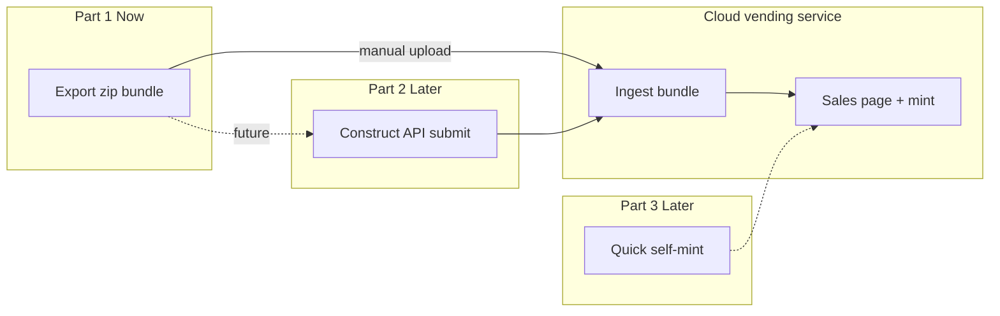

# Cloud minting — Parts 2 & 3 (future integration)

**Status:** Design proposal — future work; requires schema + security pass  
**Part 1 (active):** [MINT-READY-BUNDLE.md](./MINT-READY-BUNDLE.md) — offline export; no online services  
**Related:** [COLLECTION-DESIGN-V2.md](./COLLECTION-DESIGN-V2.md), [METADATA-BUILDER.md](./METADATA-BUILDER.md), [CORE.md](./CORE.md) §9

**Source:** Design session spec (2026-06-21). This document covers **Construct ↔ cloud** integration only. The canonical handoff artifact is the mint-ready bundle defined in Part 1.

---

## 1. Three-part roadmap

| Part | Scope | Construct² | When |
|------|--------|------------|------|
| **[1 — Mint-ready bundle](./MINT-READY-BUNDLE.md)** | Export zip + marketing materials; manual upload to cloud vending service | Offline only | **Now** |
| **2 — Cloud vending integration** | API submit, sales page hosting, on-demand mint, policy vault | Auth + HTTP client | Later |
| **3 — Quick self-mint** | Mint prepared collection to artist wallet from Construct | Mint job UI + polling | Much later |



---

## 2. Part 2 — Cloud vending integration (future)

### 2.1 Goal

Artist exports a [mint-ready bundle](./MINT-READY-BUNDLE.md) locally, then **Construct submits it via API** (or uploads to a pre-signed URL) instead of manual handoff. Cloud validates, pins images to IPFS, injects `image` into metadata, hosts the sales page, and mints on buyer demand.

### 2.2 Authentication

- Email magic link: artist enters email → one-time code → short-lived **API token**.
- Construct stores token in Electron `userData/secrets/` (same pattern as xAI key in [AUTO-GENERATION.md](./AUTO-GENERATION.md) §9).
- All requests: `Authorization: Bearer <token>`.

### 2.3 API endpoints (Part 2)

| Method | Endpoint | Purpose |
|--------|----------|---------|
| POST | `/auth/magic-link` | Request login code |
| POST | `/auth/verify` | Verify code → API token |
| GET | `/policies` | List artist policies (cloud vault) |
| POST | `/policies` | Register policy (credentials sent once) |
| POST | `/collections` | Submit mint-ready bundle (multipart or pre-signed upload) |
| GET | `/collections` | List submitted collections |
| GET | `/collections/:id` | Collection detail + validation status |
| PATCH | `/collections/:id` | Update marketing (title, description, YouTube, image CIDs after cloud pin) |

**Bundle format:** Cloud validates against [MINT-READY-BUNDLE.md](./MINT-READY-BUNDLE.md). Construct may upload the **same zip** Part 1 produces, or stream equivalent multipart parts.

**On submit success:**

- Cloud pins `preview.png` + `marketing/*` → injects `ipfs://` into token metadata
- Cloud archives `sources.zip` + records `sourceHash`
- Construct sets `cloudSubmission` on local collection JSON (see §5)
- Construct auto-freezes collection (`POST /collections/:pad2/freeze`)

### 2.4 Media handling (Part 2)

| Asset | Part 1 bundle | Part 2 cloud |
|-------|---------------|--------------|
| Piece previews | `preview.png` files | Cloud pins → `image` in metadata |
| Marketing images | Local PNG in `marketing/` | Cloud pins → sales page + optional metadata |
| Video | YouTube URL in `sales.json` | Cloud embeds only — no video hosting |

Construct-side IPFS upload is **optional** in Part 2 only if cloud API accepts raw files instead of CIDs; default is **cloud pins on ingest**.

### 2.5 Policy management (Part 2)

| Party | Responsibility |
|-------|----------------|
| **Cloud** | Secure storage and signing |
| **Construct** | UI to list/register policies; select policy when submitting |

Construct **must not** persist policy credentials after registration handoff.

### 2.6 Collection locking (Part 2)

On successful API submit → local `frozen: true`. Manual unfreeze warns if local `sourceFingerprint` ≠ `cloudSubmission.sourceHash`.

---

## 3. Part 3 — Quick self-mint (future)

Later than Part 2. Artist mints a prepared collection to **their own wallet** without a public vending page.

**Flow:**

1. Mint-ready bundle already submitted (Part 2) or exported + uploaded
2. Artist selects policy (cloud list) and enters recipient address
3. Clicks **Mint to My Wallet**
4. `POST /collections/:id/mint` → poll `GET /collections/:id/mint-jobs/:jobId`

See [Appendix A.4](#appendix-a4-mint-jobs-part-3) for job schema.

**Not in Part 3 scope initially:** public sales page, buyer checkout, vending inventory.

---

## 4. Critical review (Parts 2–3)

### 4.1 Strengths

- Part 1 bundle decouples release prep from cloud availability
- Clear split: Construct prepares; cloud executes chain + hosting
- Policy keys never stored locally long-term
- Source archive aligns with `_source/` + `sourceFingerprint`

### 4.2 Gaps to resolve before Part 2 implementation

| Area | Issue | Recommendation |
|------|--------|----------------|
| **API contracts** | Original spec listed endpoints only | [Appendix A](#appendix-a-proposed-api-schemas) |
| **Metadata model** | Art in `files[].src` utf8; cloud adds `image` IPFS | Dual-field policy; preserve Cardano split ([`cardano_metadata_split.js`](../cardano_metadata_split.js)) |
| **`mint` block drift** | `mint.policy` vs Values `policy` | Part 1 `mint_preflight.js` already validates |
| **Freeze UX** | Backend exists; UI missing | Ship with Part 1 export (P1.5) |
| **Vending economics** | No pricing / royalties in bundle | Cloud product config post-ingest |
| **Policy onboarding** | Credential shape vague | `PolicyRegistration` in Appendix A.2 |
| **Security** | Source zip may contain secrets | Scan/strip before upload in Part 2 client |

### 4.3 Metadata injection policy (recommended)

| Field | Source | On-chain |
|-------|--------|----------|
| `files[].src` | Part 1 bundle (utf8link) | Yes — generative art |
| `image` | Cloud pins `preview.png` | Yes — marketplace thumbnail |

Cloud merges into Construct's `metadata.json` without breaking `721` structure or 64-byte chunking.

---

## 5. Collection JSON extensions (Part 2)

After successful API submit, add to `collections/<pad2>.json`:

```json
{
  "cloudSubmission": {
    "id": "col_cloud_abc123",
    "submittedAt": "2026-06-21T12:00:00.000Z",
    "sourceHash": "sha256:…",
    "route": "vending",
    "policyRef": "pol_abc123",
    "status": "submitted"
  }
}
```

Part 1 offline export does **not** write this block.

---

## 6. Environment variables (Part 2)

| Variable | Purpose |
|----------|---------|
| `ADVBUILDER_CLOUD_MINT_BASE_URL` | Cloud API base URL |

Token: `<userData>/secrets/cloud-mint-api-token.txt`

IPFS pinning env vars apply to **cloud service** ingest, not Part 1 Construct export.

---

## 7. Construct² readiness (Parts 2–3)

| Capability | Status |
|------------|--------|
| Mint-ready bundle export | **Part 1** — see [MINT-READY-BUNDLE.md](./MINT-READY-BUNDLE.md) |
| Cloud HTTP client + auth | Missing |
| Mint job status UI | Missing |
| Policy registration UI | Missing |
| Per-piece CIP-25 + utf8link | **Implemented** (feeds Part 1 bundle) |

---

## 8. Open decisions

| Topic | Notes |
|-------|-------|
| CIP-25 inline HTML vs CIP-68 reference NFT | Affects cloud mint tx template |
| Cloud trusts bundle metadata verbatim vs re-builds | Re-build adds drift risk |
| Construct uploads zip vs pre-signed URL | Bandwidth + resumable uploads |
| Part 3 before or after public vending GA | User preference: Part 2 first |
| [PROJECT-DATABASE.md](./PROJECT-DATABASE.md) mint gates | Design-only; optional preflight extension |

---

## 9. Relationship to existing docs

| Document | Relationship |
|----------|--------------|
| [MINT-READY-BUNDLE.md](./MINT-READY-BUNDLE.md) | **Canonical bundle format** — Part 1 |
| [COLLECTION-DESIGN-V2.md](./COLLECTION-DESIGN-V2.md) §1, §15.7 | On-chain/IPFS deferred → Part 1 bundle + Part 2 integration |
| [METADATA-BUILDER.md](./METADATA-BUILDER.md) | Artifacts inside bundle `pieces/` |

---

## Appendix A. Proposed API schemas

All times ISO 8601 UTC. Errors: `{ "error": "code", "message": "…" }`.

**Part tags:** `[P2]` = Part 2 vending integration · `[P3]` = Part 3 self-mint

### A.1 Auth `[P2]` `[P3]`

**POST `/auth/magic-link`**

```json
{ "email": "artist@example.com" }
```

→ `{ "ok": true, "expiresInSeconds": 600 }`

**POST `/auth/verify`**

```json
{ "email": "artist@example.com", "code": "123456" }
```

→ `{ "token": "eyJ…", "expiresAt": "…", "artistId": "art_abc123" }`

---

### A.2 Policies `[P2]` `[P3]`

**GET `/policies`** → `{ "policies": [{ "id", "policyId", "label", "createdAt" }] }`

**POST `/policies`** — credentials sent once:

```json
{
  "label": "Main collection policy",
  "policyId": "a1b2c3…",
  "credentials": { "type": "policy_key", "payload": "…" }
}
```

---

### A.3 Collections `[P2]`

**POST `/collections`**

Upload Part 1 mint-ready bundle (zip or multipart mirroring [MINT-READY-BUNDLE.md](./MINT-READY-BUNDLE.md) layout):

| Part | Content |
|------|---------|
| `bundle` | Full zip **or** individual parts below |
| `bundle.manifest.json` | From bundle root |
| `collection.json` | Snapshot |
| `sources` | ZIP |
| `pieces` | ZIP of piece dirs |
| `marketing` | Folder / ZIP |

→

```json
{
  "id": "col_cloud_abc123",
  "status": "received",
  "sourceHash": "sha256:…",
  "validation": { "ok": true, "pieceCount": 144, "warnings": [] }
}
```

Idempotency: `Idempotency-Key: <uuid>` header.

**GET `/collections`**, **GET `/collections/:id`**, **PATCH `/collections/:id`** — marketing updates after cloud IPFS pin (CIDs in PATCH body).

---

### A.4 Mint jobs `[P3]`

**POST `/collections/:id/mint`**

```json
{
  "policyRef": "pol_abc123",
  "recipientAddress": "addr1…",
  "options": { "cardanoNetwork": "mainnet" }
}
```

→ `{ "jobId": "mint_job_xyz789", "status": "queued", "pieceCount": 144 }`

**GET `/collections/:id/mint-jobs/:jobId`**

```json
{
  "jobId": "mint_job_xyz789",
  "status": "in_progress",
  "summary": { "total": 144, "confirmed": 114, "failed": 0 },
  "pieces": [
    { "num": 1, "assetName": "Collection00001", "status": "confirmed", "txHash": "abc…" }
  ]
}
```

**POST `/collections/:id/mint-jobs/:jobId/cancel`** — cancel queued pieces only.

Construct polls every 2–5 s while mint UI is open.

---

### A.5 Error codes

| Code | HTTP | Meaning |
|------|------|---------|
| `validation_failed` | 400 | Bundle failed ingest checklist |
| `unauthorized` | 401 | Missing or expired token |
| `policy_not_found` | 404 | Invalid `policyRef` |
| `collection_frozen_remote` | 409 | Cloud collection locked |
| `mint_in_progress` | 409 | Duplicate mint job |
| `rate_limited` | 429 | Too many requests |

---

*Last updated: 2026-06-21 — Parts 2–3 cloud integration (future). Part 1: [MINT-READY-BUNDLE.md](./MINT-READY-BUNDLE.md).*
