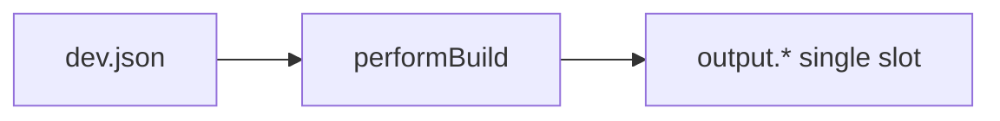
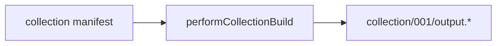

# Collection builder mode — design examination (v1)

**Status:** design / not implemented — **superseded for new work by [COLLECTION-DESIGN-V2.md](./COLLECTION-DESIGN-V2.md)** (on-disk `collections/`, piece records, Collections panel)  
**Related:** [COLLECTION-DESIGN-V2.md](./COLLECTION-DESIGN-V2.md), [VISUALISER.md](./VISUALISER.md), [UTF8LINK-METADATA.md](./UTF8LINK-METADATA.md), [SAVED-PIECES-DESIGN.md](./SAVED-PIECES-DESIGN.md)

This document captures requirements, trade-offs, open questions, and a phased path for a **Collection** visualiser mode in advBuilder (v1). It is intended for review and simplification before implementation. Prefer v2 for the collections editor direction described in project notes (May 2026).

---

## 1. Intent

A new way to work on **many pieces** that share one collection (Cardano policy, collection name, size, etc.) but differ per piece in seed, properties, metadata name, and outputs.

**Goals:**

- New preview mode **Collection** (alongside Full, Min, UTF8, Metadata, Analysis).
- Create / view / edit / **batch-build** N pieces without overwriting the single root `output.*` slot.
- Optional **collection-wide** property (and later parameter) overrides.
- Optional **injected** names and descriptions (CSV first; xAI batch later).
- Optional **batch screenshots** at custom resolution / “hyperspeed” render.

**Non-goals for v1:**

- On-chain minting or IPFS upload.
- Replacing the existing single-piece workflow (it remains the default).

---

## 2. How the builder works today

| Topic | Current behaviour | Key code |
|--------|-------------------|----------|
| Piece index | `values.piece.num` is always **1** in advBuilder | [`builder.js`](../builder.js) `getBuildValues` |
| Collection size | Placeholder `collection.size: 186` in build values | `getBuildValues` |
| Per-piece name | `values.piececollection.name` **or** `collection.name + " " + piece.num_pad3` | [`builder.pmaster_process.js`](../builder.pmaster_process.js) ~716–717 |
| Outputs | One set: `../<project>/output.*` | `performBuild` → `fileSave` list |
| Uniqueness helpers | `Seed_To_Properties`, `existingPropertiesArray` in `ArtBuilder` | `builder.pmaster_process.js` |
| Screenshot path | `output_screenshot` when `do_screenshot: true` | `ArtBuilder`; **not** written by advBuilder today |
| Runtime params | `paramValues` → iframe only; **not** passed into `ArtBuilder` | [PARAM-SPEC.md](./PARAM-SPEC.md) |



Collection mode introduces a **manifest** and **per-piece output directories** without removing single-piece mode.



---

## 3. User experience (from notes)

### 3.1 Visualiser becomes the collection screen

When **Collection** is selected, the right pane is no longer a single artwork iframe by default. Instead:

- **Piece count** numeric field + **Create** (allocate N piece slots in the manifest).
- **Build collection** (or **Build selected**) — runs the batch pipeline.
- **Piece list or grid** — each entry shows at least **metadata name** (or `piececollection.name`); richer detail on hover or selection.

### 3.2 Layout options

| Layout | Description | Pros | Cons |
|--------|-------------|------|------|
| **A. Grid** | Count field + grid of cards | Whole-collection overview | Uneven card heights; weak per-piece editing |
| **B. Master–detail** | List on left of visualiser, preview on right | Aligns with existing left **Properties** panel; one piece in focus | Less “wall of pieces” at a glance |
| **C. Hybrid** | Narrow list + large preview + optional compact grid toggle | Balances overview and focus | More UI and state |

**Recommendation:** **B or C for v1**; pure grid as a later optional view.

**Hover behaviour (grid variant):** default cell shows **name only**; hover shows thumbnail, mini preview iframe, or build status badge (built / stale / error).

### 3.3 Left panel in collection mode

The existing **Properties** panel (with merge levels — see [PROPERTIES-PANEL.md](./PROPERTIES-PANEL.md)) and **Parameters** section should edit the **currently selected piece** in the manifest, not the anonymous single-piece `dev.json` workspace—or both must be clearly labelled. Per-piece state should use the same `propertyLevels` shape as single-piece mode.

| Approach | Behaviour |
|----------|-----------|
| **Selected piece only** | `state.collection.pieces[i].properties` drives UI; changes persist to manifest |
| **Dual workspace** | Single-piece mode = today’s `dev.json`; Collection mode = manifest only |

**Recommendation:** **Selected piece only** in Collection mode; avoid silently copying collection edits into the single-piece slot.

### 3.4 Leaving Collection mode (open question)

> “Going back to full or min — should it restore the properties the user had open before collection view?”

| Option | Description |
|--------|-------------|
| **Snapshot workspace** | On enter Collection, save `{ seed, props, paramValues }` to `state.singlePieceWorkspace`; on exit, restore |
| **Independent state** | `state.collection` and single-piece fields never overwrite each other |
| **Warn on switch** | If manifest or single-piece workspace is dirty, confirm |

**Recommendation:** **Independent state** plus optional **“Restore previous single-piece workspace”** button on exit—not automatic restore (avoids surprise, still supports your workflow).

---

## 4. Data model (draft)

### 4.1 Where it lives

| Option | Pros | Cons |
|--------|------|------|
| **`dev.json` → `state.collection`** | One file; WS `update` already ships full state | Large JSON; merge conflicts |
| **`collection.json`** beside `dev.json` | Clear separation; easier to `.gitignore` | Second load/save path; sync with dev-ui |

**Recommendation:** start with **`state.collection` inside `dev.json`** for v1; split file if manifests exceed ~1–2 MB.

### 4.2 Manifest shape (draft)

```json
{
  "collection": {
    "name": "50 char placeholder …",
    "size": 186,
    "description": "…",
    "policy": "000…000"
  },
  "pieces": [
    {
      "num": 1,
      "seed": 42,
      "properties": { "Mode": "Calm", "Theme": "Warm" },
      "locks": {},
      "paramValues": {},
      "piececollection": { "name": "Mind00001" },
      "buildStatus": "none",
      "lastBuiltAt": null
    }
  ],
  "globalOverrides": {
    "properties": {},
    "paramValues": {}
  },
  "injection": {
    "enabled": false,
    "rows": []
  },
  "selectedPieceNum": 1
}
```

**Merge rule on build:**  
`effectiveProperties = { ...globalOverrides.properties, ...piece.properties }`  
(same idea for `paramValues` when/if params participate in batch preview).

### 4.3 Output paths

Do **not** overwrite root `output.*` during collection batch (keeps single-piece preview stable).

Suggested layout:

```
<project>/
  collection/
    001/
      output.metadata.json
      output.output_min.html
      …
    002/
      …
```

Use `piece.num_pad3` for folder names. Store relative paths in manifest `pieces[i].outputDir` after build.

---

## 5. Backend: batch build

### 5.1 `performCollectionBuild(options)`

Pseudo-flow:

1. Load manifest; validate `pieces.length` ≤ `collection.size`.
2. For each target piece (all or subset):
   - Merge global + per-piece properties and collection/piece values.
   - Set `values.piece.num`, `values.piece.seed`, `values.piececollection`.
   - Call `PMasterProcess.ArtBuilder(...)` (same as `performBuild`).
   - Apply project `postMetaDataFn` if present (legacy hook — prefer `metadata.js` today).
   - Write outputs under `collection/<pad3>/`.
   - Update `buildStatus`, `lastBuiltAt`, errors[].
   - `broadcastCollectionProgress({ piece, index, total, percent })`.
3. Optionally refresh `state.lastBuild` from **selected** piece only (policy choice).

### 5.2 Issues and mitigations

| Issue | Detail | Possible solution |
|-------|--------|-------------------|
| **Duration** | N × full minify (tens of seconds each at scale) | Progress WS; build queue; “build selected only”; skip metadata in fast pass |
| **Duplicate property combos** | `existingPropertiesArray` exists for uniqueness | Policy: auto-increment seed; or reject duplicate; or allow duplicates for test collections |
| **Stale pieces** | Source edit invalidates some built outputs | `buildStatus: stale` when `files` hash ≠ hash at build time |
| **Errors** | One piece fails mid-batch | Continue vs stop; per-piece `errors.json` |
| **HxDNA post-process** | Root build replaces `[HxDNA]` in strings | Run same post-step per piece output |
| **paramValues** | Not in ArtBuilder today | v1: per-piece params only affect preview of **selected** piece via iframe; batch metadata may ignore params unless canvas reads them at build time |

### 5.3 Collection-wide overrides (notes)

- **Properties:** merge `propertyLevels`-style bags — `globalOverrides` ≈ **override** layer, per-piece ≈ **piece** layer (see [PROPERTIES-PANEL.md](./PROPERTIES-PANEL.md)); document merge order when implemented.
- **Names / descriptions:** `injection.rows[]` or CSV import keyed by `piece.num`:
  - Maps to `piececollection.name`, `metadata.description`, etc.
  - Hook: extend or parameterise `postMetaDataFn` per piece instead of hardcoding in `builder.js`.

### 5.4 xAI batch (future)

- Optional `POST /collection/generate-copy` with prompt template + piece list.
- **Security:** API key in `settings` or env, never committed; rate limits; human review before build.
- **Simplification:** manual CSV injection in **C4** before any LLM integration.

---

## 6. Batch screenshots (notes)

**Today:** `ArtBuilder` can emit `output_screenshot` (minified art with screenshot directives active). advBuilder does not save it.

| Approach | Speed | Fidelity | Complexity |
|----------|-------|----------|------------|
| **A. PMaster screenshot path only** | Fastest | Canvas resolution via existing `On(scale)` | Low; may differ from browser |
| **B. Headless browser** (Puppeteer / Playwright) | Slower | Pixel match to Run tab | High; Electron packaging |
| **C. Hyperspeed flag** | Fast if art cooperates | Needs canvas PARAM/directive to skip animation | Medium; project-specific |

**“Hyperspeed”** implies a build-time or runtime flag (e.g. `PARAM` or property) so generative animation completes in one frame—coordinate with art source, not advBuilder alone.

**Recommendation:** **A for v1** screenshots inside batch; **C** as art-side enhancement; **B** only if PMaster output is insufficient.

---

## 7. HTTP / WebSocket API (sketch)

| Method | Path | Purpose |
|--------|------|---------|
| `GET` | `/collection` | Return manifest |
| `POST` | `/collection` | Replace or patch manifest |
| `POST` | `/collection/pieces` | `{ count }` create N slots |
| `PATCH` | `/collection/piece/:num` | Update one piece (props, seed, name) |
| `POST` | `/collection/build` | `{ all?: true, pieces?: [1,2,3] }` |
| `GET` | `/collection/piece/:num/outputs/:file` | Serve built artifact |

**WebSocket:**

| Event | Payload |
|-------|---------|
| `collectionBuildStart` | `{ total }` |
| `collectionBuildProgress` | `{ piece, index, total, percent }` |
| `collectionBuildDone` | `{ results: [...] }` |

Visualiser route: `GET /visualise?mode=collection` → shell HTML (new `renderCollectionViewer` in `visualise_views.js`).

---

## 8. Phasing (recommended)

| Phase | Scope | Outcome |
|-------|--------|---------|
| **C1** | Manifest CRUD + Collection mode UI + select piece + preview selected (`output_min` from piece dir or live build) | Artist can navigate N pieces |
| **C2** | `performCollectionBuild` → `collection/NNN/output.*` + progress WS | Batch outputs |
| **C3** | `globalOverrides.properties` + UI | Tweak all pieces’ shared props |
| **C4** | CSV / table injection for names & descriptions | Metadata copy without xAI |
| **C5** | Screenshots + optional xAI | Production extras |

---

## 9. Open questions

1. **Grid vs master–detail** — which is default in v1?
2. **Restore single-piece workspace** on exit — automatic, button, or never?
3. **Overwrite `lastBuild`** after batch — never, only selected piece, or always last built piece?
4. **Seed assignment** for new slots — sequential, random, or artist picks per row?
5. **Uniqueness** — enforce unique property tuples across collection?
6. **Collection folder in git** — commit `collection/` outputs or gitignore?
7. **paramValues in batch metadata** — are params compile-time, runtime-only, or both for this project?

---

## 10. Recommendations (summary)

| Topic | Recommendation |
|-------|----------------|
| UI layout | Master–detail (list + preview); optional grid later |
| State | Independent collection manifest; optional restore on exit |
| Outputs | `collection/<pad3>/output.*`; keep root `output.*` for single-piece mode |
| Overrides | `globalOverrides` + per-piece; CSV injection before xAI |
| Screenshots | PMaster `output_screenshot` first; hyperspeed flag in art source later |
| First implementation | **C1 + C2** — navigation and batch build without xAI/screenshots |

---

## 11. Related files (implementation touch list)

| File | Change (future) |
|------|-----------------|
| [`builder.js`](../builder.js) | `performCollectionBuild`, routes, WS |
| [`dev-ui.html`](../dev-ui.html) | Collection radio, manifest-driven props panel |
| [`visualise_views.js`](../visualise_views.js) | `renderCollectionViewer` |
| [`builder.pmaster_process.js`](../builder.pmaster_process.js) | Optional: expose `output_screenshot` in advBuilder `fileSave` |
| [`electron/main.js`](../electron/main.js) | Long batch jobs, native folders (optional) |

---

*Next step:* simplify scope to **C1–C2**, resolve open questions 1–3, then implement manifest + batch build.
