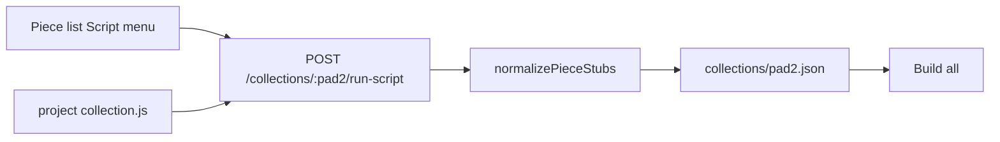

# Collection build scripts (`collection.js`)

Programmatically replace the open collection’s `pieceRecords[]` from a project-owned Node module — same ownership model as [`metadata.js`](./METADATA-BUILDER.md). After a script runs, use **Build all** to generate art, metadata, and rolled properties.

See also: [COLLECTION-DESIGN-V2.md](./COLLECTION-DESIGN-V2.md) (collection manifest and build flow), [VALUES-PANEL.md](./VALUES-PANEL.md) (Values merge at build time).

## Pipeline



1. User opens a collection and picks a script from the **Script ▾** menu in the piece list toolbar.
2. If the collection already has pieces, Construct² asks for confirmation (built outputs will be discarded).
3. advBuilder `require()`s `<project>/collection.js`, calls the named function with current `pieceRecords`, full collection JSON, and a `ctx` helper object.
4. The script returns a new piece list (stubs). advBuilder assigns sequential `num`, fresh `id`s, `buildStatus: unbuilt`, deletes the disposable build tree, and writes `<pad2>.json`.
5. User clicks **Build all** — existing collection build (Values merge, PMaster, `CreateMetadata`, per-piece outputs).

Scripts do **not** run during art build and are **not** injected into the HTML bundle. If `collection.js` contains `//import<>` tags, those imports are included in the builder watch graph, param/value scans, collection fingerprint, and `_source/` snapshot (the `collection.js` file itself is synced/watched but is not one of the seven canonical files hashed in `sourceFingerprint`).

## File contract

**Path:** `<project>/collection.js` (e.g. `art/MyProject/collection.js`)

**Export:**

```javascript
const CollectionScripts = {
  MyScript(pieceRecords, collection, ctx) {
    return [ /* piece stubs */ ];
  },
};

module.exports = { CollectionScripts };
```

advBuilder clears the `require` cache before each load so edits apply on the next script run.

## Function signature

```javascript
(pieceRecords, collection, ctx) => PieceStub[] | { pieceRecords: PieceStub[], collectionPatch?: object }
```

| Argument | Type | Contents |
|----------|------|----------|
| `pieceRecords` | `pieceRecord[]` | Current pieces in the open collection (may be empty) |
| `collection` | object | Full `collections/<pad2>.json` body |
| `ctx` | object | Read-only project helpers (below) |

**Return:** array of piece stubs that **replaces** the entire `pieceRecords[]` (not append). Optional `collectionPatch` shallow-merges into collection metadata (`name`, `values`, `propertyOverrides`, `fixedProperties`, `mint`, `autoBrief`).

### `ctx` helpers

| Helper | Purpose |
|--------|---------|
| `ctx.projectPath` | Absolute path to project root |
| `ctx.pad2` | Open collection id (`"01"`, …) |
| `ctx.readJson(relativePath)` | Parse JSON from project root |
| `ctx.capitalize(s)` | `"calm"` → `"Calm"` |
| `ctx.randomSeed()` | Random piece seed (00000–99999) |
| `ctx.newPieceRecord(num, opts)` | Build a full `pieceRecord` (used internally after normalize) |

## Piece stub format

Minimal stub (recommended):

```javascript
{
  displayName: "Aurora",
  values: {
    name: { value: "Aurora", use: true },
    description: { value: "a layered field of light and motion…", use: true },
  },
  fixedProperties: { Theme: "Calm", Mode: "Bright" },
  seed: 7458, // optional
}
```

Use `fixedProperties` and Values `{ value, use }` bags — not `fixedProps` or flat strings. Collection-level keys (`collection_name`, `craft`, `policy`, …) belong on the collection `values` object in the Values panel; they merge at build time.

Maximum **9999** pieces per collection (`MAX_PIECES`).

## Replace semantics

When a script succeeds:

1. Blocked if collection `frozen: true`.
2. Confirm in UI if `pieceRecords.length > 0`.
3. Sequential `num` 1…N; new UUID per piece; all `unbuilt`.
4. Delete entire `collections/<pad2>/` build tree (same as piece reorder).
5. Select first piece; no root `performBuild()`.

## UI

- **Script ▾** — piece list toolbar (visible when `collection.js` exports at least one function).
- Click or right-click opens a context menu of script names (sorted).
- Frozen collections disable script actions.

## HTTP API

| Method | Path | Body | Response |
|--------|------|------|----------|
| `GET` | `/collection-scripts` | — | `{ ok, scripts: string[], hasFile: bool }` |
| `POST` | `/collection/create-default` | — | Write template if missing |
| `POST` | `/collections/:pad2/run-script` | `{ scriptName }` | `{ ok, collection, pieceCount, scriptName, state }` |

`state.collectionScriptNames` is included in WebSocket `update` broadcasts.

## Missing `collection.js`

- **Script ▾** button hidden.
- `POST /collection/create-default` writes [templates/collection.js.default](../templates/collection.js.default) (includes `ShufflePieces` example).

## Example project script

See [templates/projects/cc-v3-collection/collection.js](../templates/projects/cc-v3-collection/collection.js) for a minimal **`ShufflePieces`** example. Project-specific batch builders (e.g. lore-driven piece lists) belong in `<project>/collection.js` and may be documented under that project's `docs/` folder.

## Relation to piece generators (HTML)

[COLLECTION-DESIGN-V2.md](./COLLECTION-DESIGN-V2.md) originally described `<project>/pieceGenerators/*.html` for interactive/LLM piece creation. **`collection.js`** is the Node-side approach for deterministic batch builders. HTML generators remain a valid future option for interactive workflows.

## Implementation

| File | Role |
|------|------|
| [collection_loader.js](../collection_loader.js) | Load/list/default template |
| [collection_scripts.js](../collection_scripts.js) | Run script, normalize, replace |
| [collection_ui.js](../collection_ui.js) | Script menu UI |
| [builder.js](../builder.js) | HTTP routes, `state.collectionScriptNames` |

## Verification checklist

1. Project with `collection.js` — **Script ▾** lists exported function names.
2. Run script on empty collection — piece list fills; all orange.
3. Run script on collection with built pieces — confirm dialog; build tree deleted; all orange.
4. **Build all** after script — green pieces; metadata per piece.
5. Frozen collection — scripts disabled; API returns error.
6. Rename/delete `collection.js` — button hidden; `GET /collection-scripts` returns `scripts: []`.
