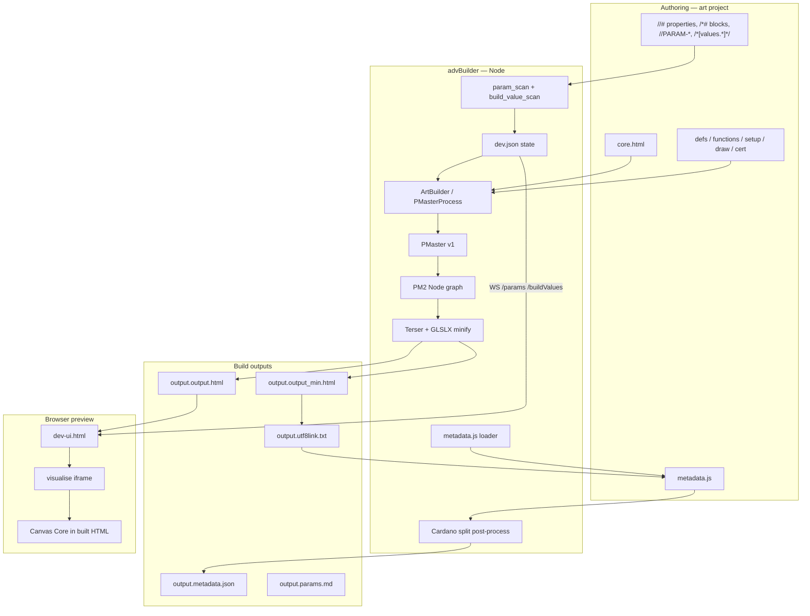

# CC3 Core — Canvas Core, PropMaster, and advBuilder

This document is the **single architecture reference** for the CC3 generative-art toolchain: the **Canvas Core** runtime, the **PropMaster (PMaster)** build compiler, and **advBuilder** (the current dev shell).

For deep dives on individual features, see the [documentation index](./README.md). Inventories of the running app: [`_audit/`](./_audit/README.md).

---

## 1. What this system is

CC3 is a **single-file HTML delivery** pipeline for generative canvas art, aimed at on-chain or size-budgeted distribution (UTF-8 data URLs, Cardano CIP-25 metadata, sub–14 KB minified targets depending on art weight).

Three layers stack together:

| Layer | Location | Role |
|-------|----------|------|
| **Canvas Core** | `<project>/core.html` **or** shared `construct2/runtimes/*` (see §6.1.1) | Browser runtime: canvas loop, math/colour/RNG library, animation driver, optional cert canvas, parameter bridge |
| **PropMaster (PMaster)** | `construct2/builder.pmaster*.js` | Node compile-time: splices art modules, resolves property branches, directives, value inserts, minification |
| **advBuilder** | `construct2/` | Dev server, Electron shell, dev-ui panels, visualiser, collections, parameter tooling |

**Classic `.builder/`** is an older sibling fork with partial parity. **advBuilder** is the active development path; see [STAGING.md](../STAGING.md) §7 for reconciliation notes.

---

## 2. Repository layout

```
CC3_Projects/
├── construct2/               ← active builder (run from here; formerly `.advBuilder/`)
│   ├── builder.js              CLI + HTTP/WebSocket dev server
│   ├── project_runtime.js      Runtime selection + effective core resolution
│   ├── builder.pmaster_process.js   ArtBuilder orchestration
│   ├── builder.pmaster.v1.js   PMaster: inserts, directives, v1 props
│   ├── builder.pmaster.v2.js   PM2 graph: parse, validate, randomize, build
│   ├── dev-ui.html             Parameters | Values | Properties | Collections UI
│   ├── runtimes/               Shared canvas cores (cc-v3.23, cc-v3.22)
│   ├── runtimes/cc-v3.23.html  shared Canvas Core (fallback when no project core)
│   ├── collection_*.js         Collection v2 filesystem + build helpers
│   ├── param_*.js              //PARAM-* scanner, colour, persist, drivers
│   ├── visualise_*.js          Preview shell (UTF8, Metadata, Analysis)
│   ├── electron/               Multi-root workspace + embedded dev-ui
│   └── docs/                   Feature specs (this file + index)
├── .builder/                   ← classic builder (production fallback)
└── art/                        ← optional sibling project folder (templates, your pieces)
    └── <Project>/
        ├── core.html           optional project canvas (used when “Project core” selected)
        ├── defs.js, functions.js, setup.js, draw.js, cert.js
        ├── metadata.js         CreateMetadata(values, properties, artSrc)
        ├── dev.json            dev server state (seed, levels, lastBuild, …)
        ├── project.json        scaffold metadata incl. `runtime` selection
        ├── parameters/         custom param drivers (e.g. xaiChat.html)
        ├── collections/        Collection v2 on-disk data
        └── output.*            last single-piece build artifacts
```

**Run advBuilder for a project:**

```bash
npm install
node builder.js --project-path path/to/your-project   # opens http://localhost:3100 (or ADVBUILDER_PORT)
npm start                                            # Electron: project picker + embedded dev-ui
```

Projects resolve via [`project_resolve.js`](../project_resolve.js): `--project-path`, `ADVBUILDER_PROJECT_PATH`, or a name under the default art root when this checkout sits next to `art/` in a genart tree.

---

## 3. End-to-end architecture



**Mental model:** authors write **valid JavaScript** interleaved with **build-time markers**. The browser never interprets those markers; advBuilder strips or resolves them and emits one self-contained HTML file plus metadata sidecars.

---

## 4. Canvas Core

The Canvas Core is a **self-contained HTML document** with inline `<script>` (and optional `<style>`). Builds use the **effective core** (§6.1.1): a shared file from `construct2/runtimes/` (default [`cc-v3.23.html`](../runtimes/cc-v3.23.html)) or the project’s `core.html`. Projects may ship their own `core.html` (often at **`cc_version = "3.23"`**) or use a shared runtime from `construct2/runtimes/`.

### 4.1 Boot sequence

1. **`BEGIN` / `requestAnimationFrame`** — fixed-FPS loop (`FPS`, `frame`, `time`, `dt`).
2. **`CONTEXT`** — array of `[canvas, ctx2d]` for every `<canvas>` in the document (front art + optional cert/back canvas when `//#<<Debug>cert:on>`).
3. **`ART()`** — creates `RN = RNG(SEED)`, prepares context, runs inserts in order: **`defs` → `functions` → `setup`**, then defines per-frame **`draw`** and optional cert UI.
4. **`cc_Update()`** each tick — calls art draw until it returns “done”; optionally draws cert layer.

Artwork must call **`Canvas(w, h, border)`** in `setup` to establish coordinate space (`PX`, `PY`, `HX`, `HY`).

### 4.2 Compile-time surface (Builder only)

These markers are **not** special browser syntax — advBuilder interprets them at build time:

| Marker | Example | Purpose |
|--------|---------|---------|
| Insert region | `//insert<setup>` … `//end<setup>` | Splice project `.js` / `.html` modules |
| Property (v2 grouped) | `//#<<Hex DNA>chaos_core:iAA>` | PropMaster branch selection |
| Property (legacy) | `//#<Mode:Calm>` | Same, **base** group |
| Property block (v1) | `/*#<<Debug>res:1000x1000>` … `//#*/` | Comment-wrapped branches |
| Conditional | `/*#IF[values.flag]` … `//#*/` | Enable block when expression truthy (build `eval`) |
| Value insert | `0/*[values.seed]*/` | Replace with merged Values expression (build `eval`) |
| Minify island | `//PROCESS<minify>` … `//PROCESS_END<minify>` | Terser pass; sibling `minifyGL` for shaders |
| Import | `//import<path>` | Inline file at build time; paths relative to project root; chained; watched |
| External params | `//PARAM-FLOAT:["mouthOpen",0,1,0.05]` | Scanned to schema; stripped from min output |

**File imports (`//import`)** — pull extra source into any canonical file or codeblock **before** insert splice and property parsing:

```text
//import<colour_factory.js>
//import<colours/palette.js>
```

| Rule | Detail |
|------|--------|
| Path | Relative to **project root** (`art/<Project>/`); no `..` traversal |
| Fallback | If missing in project, resolve from **`construct2/lib/`** (same relative path) |
| Chaining | Tags inside imported files are expanded in later passes until none remain |
| Cycles | Circular imports → build error (comment placeholder left in output) |
| Watch | Transitive import graph added to chokidar; edits trigger rebuild like `defs.js` |
| Scan | `//PARAM-*`, value inserts, and build-value keys in imported files are discovered |
| Fingerprint | Collection `sourceFingerprint` hashes imported file contents (sorted by path) |
| Persistence | Expanded code is **not** stored in `dev.json`; only raw sources are saved |

Implementation: [`import_resolve.js`](../import_resolve.js) (`expandImports`, `discoverImportGraph`); canonical file list and startup inspect inventory in [`source_inventory.js`](../source_inventory.js).

**Note:** Legacy `//include<path>` exists in PMaster v1 but is **not** wired into the build pipeline; use `//import` instead.

Standard insert names expected by the pipeline:

`defs`, `functions`, `setup`, `draw`, `cert` (plus any extras declared in `core.html`).

### 4.3 Runtime library (selected APIs)

| Category | Examples |
|----------|----------|
| Canvas shorthands | `CBP`, `CFR`, `CST`, `CFS`, `CDI`, … (`C` + two-letter codes bound to `ctx`) |
| Drawing helpers | `RECT`, `TXT`, `ELI`, `Circle`, `Layer`, `LayerGL` |
| Math / curves | `Lerp`, `Clamp`, `Ease`, `Ev_*` envelopes, `Math.*` copied to `GLOBAL` |
| Colour | `CT_HSV`, `CT_Palette`, `HEX_to_RGB`, `HSV_to_RGB`, … |
| Fields | `Perlin`, `FlowField`, `DrawFlowGrid` |
| Vectors | `V2`, `V3`, `VecDist` |
| RNG | `RNG(s)`, `SEED` from `/*[values.seed]*/` at build |
| Params | `OnParam(fn)`, `SendParams(map)` → `parent.postMessage` in advBuilder builds |
| Debug / cert | `MakeCert`, `SetCertVisibility`, mouse/touch when `canvas_input:on` |

Full API inventory: [`_audit/RUNTIME-cc-v3.23.md`](./_audit/RUNTIME-cc-v3.23.md).

### 4.4 Parameter bridge (advBuilder)

Built HTML includes **`cc_onParam`** glue so hosts can push live values without rebuild:

- **Inbound:** dev-ui / drivers → `postMessage` → `OnParam` callbacks.
- **Outbound:** art → `SendParams({ key: val })` → parent dev-ui (patched to `WINDOW.parent` by `param_sendparams_patch.js`).

Authoring contract: [PARAM-SPEC.md](./PARAM-SPEC.md).

---

## 5. PropMaster (PMaster)

PropMaster is the **compile-time property and assembly engine**, split across three modules:

| Module | Export / role |
|--------|----------------|
| [`builder.pmaster.v1.js`](../builder.pmaster.v1.js) | **`PMaster` class** — `replaceInserts`, `PM_DoImports`, `PM_DoDirectives`, `PM_DoValueInserts`, `//PROCESS` tag extraction, `getResult()` (normalizes `"` → `'`) |
| [`builder.pmaster.v2.js`](../builder.pmaster.v2.js) | **`PM_Node` graph** — parse `//#` / `/*#` trees, validate, `SetRandomProperties(seed, fixed)`, `Build()`, export `allprops` / `activeprops` / groups |
| [`builder.pmaster_process.js`](../builder.pmaster_process.js) | **`ArtBuilder()`** — orchestrates full pipeline, metadata, UTF-8 link, errors |
| [`import_resolve.js`](../import_resolve.js) | **`//import`** path resolve, chained expand, transitive graph for watch / fingerprint / scanners |
| [`source_inventory.js`](../source_inventory.js) | **Canonical source list** — shared `CANONICAL_SOURCE_NAMES`, builder extras (`collection.js`), startup inspect file list, effective-core loading |

### 5.1 Property graph (v2)

Properties are **comment-delimited branches** in source. At build time exactly one choice per property name is active; inactive branches are removed.

**Grouped syntax** (preferred):

```text
//#<<Hex DNA>chaos_core:iAA>
//#<<Debug>canvas_input:off>
//#<<BG_Field>base_field:exp4> {"prob":8}
```

**Optional JSON options** on the same line as a property opener set weighted-random **`prob`** (default `1`) and other PM2 options. Works on grouped, legacy, and v1 block openers:

```text
//#<<BG_Field>base_field:exp4> {"prob":8}
//*#<quant:smooth> {"prob": 8}
```

**Legacy** (still parsed, lands in **base** group):

```text
//#<Mode:Calm>
//#<Palette_accent:warm>
```

Build output includes:

```json
{
  "allprops": { "Mode": ["Calm", "Bright", "…"], "accent": ["warm", "…"] },
  "activeprops": { "Mode": "Calm", "accent": "warm" },
  "propertyGroups": { "accent": "Palette", "Mode": null },
  "propertyGroupOrder": ["Hex DNA", "Debug"],
  "propertyGroupFlags": {
    "Debug": { "pinOnRandom": true, "lockUi": true },
    "Hex DNA": { "contributesToHxDna": true }
  }
}
```

**Random / fixed behaviour:** locked or “use” properties in dev-ui become **`values.properties`** fixed map; PM2 fills the rest from **`values.piece.seed`**. Debug group properties stay pinned on Random.

Details: [PROPERTIES-PANEL.md](./PROPERTIES-PANEL.md).

### 5.2 Directives and value inserts

- **`/*#IF[expr]`** — `expr` evaluated in Node (`eval`) against merged `values`; block kept or dropped.
- **`/*[values.tag]*/`** — expression evaluated to string and inlined (e.g. seed, metadata placeholders in cert UI).
- **`/[values.name]/`** — string placeholder replaced during build.

**Security note:** `eval` runs in the build process on author-controlled projects. Acceptable for solo work; sandbox if loading third-party projects in Electron.

### 5.3 ArtBuilder pipeline (ordered steps)

1. Load **`project.canvas`** — effective core from runtime selection (§6.1.1) or project `core.html` — and **codeblocks** (`setup.js`, `defs.js`, …).
2. Expand **`//import<path>`** tags inline (chained; paths relative to project root).
3. **`new PMaster(canvas)`** → **`replaceInserts`** with project file contents.
4. **`new PM2_Node(PM.code)`** → parse property graph → **`SetRandomProperties(seed, fixed)`** → **`Build(true)`**.
5. Apply directives and value inserts on assembled string.
6. **`getResult()`** — final HTML string (quote normalization).
7. Optional **`//PROCESS<minify>`** / **`minifyGL`** via Terser / GLSLX.
8. Build **utf8link** from minified HTML (escape `%`, space, `#`).
9. Call project **`CreateMetadata(values, properties, artSrc)`** → Cardano split → write outputs.

Imported files are watched by advBuilder the same as core and insert modules; edits trigger rebuild.

---

## 6. advBuilder dev shell

### 6.1 Entry point — `builder.js`

[`builder.js`](../builder.js) is the advBuilder fork of classic `builder.js`. Responsibilities:

- Load / persist **`../<project>/dev.json`**
- Watch source files with **chokidar** (debounced rebuild)
- HTTP server (default port **3100**, env **`ADVBUILDER_PORT`**) + **WebSocket** broadcast
- **`performBuild()`** → `ArtBuilder` → write **`output.*`** + update `state.lastBuild`
- REST endpoints for params, build values, property levels, metadata settings, analysis, collections, **runtimes** (`GET /runtimes`, `POST /project/runtime`)

**Source files watched:**

Seven **canonical** codeblocks — `core.html`, `setup.js`, `defs.js`, `functions.js`, `draw.js`, `cert.js`, `metadata.js` — plus optional **`collection.js`** (builder sync only; scanned for `//import` tags but not hashed as a canonical file in `sourceFingerprint`), plus any files reached **transitively** via **`//import<path>`** (discovered after each sync/build). List authority: [`source_inventory.js`](../source_inventory.js).

When a **shared runtime** is selected, edits to on-disk `core.html` do not trigger rebuild until the user switches to **Project core**; the active shared runtime file under `construct2/runtimes/` is watched instead.

#### 6.1.1 Runtime selection (effective core)

Projects may use a **shared runtime** from `construct2/runtimes/` or their own **`core.html`** (“Project core”). Selection is stored in `project.json.runtime` and `dev.json.settings.selectedRuntime`.

| Selection | Build canvas source | `core.html` on disk |
|-----------|---------------------|---------------------|
| Manifest id (e.g. `cc-v3.23`) | `runtimes/<file>` via `resolveEffectiveCoreContent()` | Unchanged |
| `project-core` | `<project>/core.html` | Used as-is |

[`project_runtime.js`](../project_runtime.js) implements detection, API state, and `setProjectRuntime()` (metadata only — no file copy). [`builder.js`](../builder.js) uses `getEffectiveSourceFiles()` for builds, param/value scans, collection fingerprinting, and `_source/` snapshots.

See [PROJECTS-STARTUP-DESIGN.md](./PROJECTS-STARTUP-DESIGN.md) §4.9–§6.6.

### 6.2 Dev UI — `dev-ui.html`

Layout: **`#left`** (controls) | **`#divider`** (draggable; hover/drag uses accent colour) | **`#right`** (preview).

**Left column** — single scrollable stack (`#left-scroll.thin-scroll`) of collapsible sections:

| Section | State keys | Doc |
|---------|------------|-----|
| **Parameters** | `paramSchema`, `paramValues`, `paramScanErrors` | [PARAM-SPEC.md](./PARAM-SPEC.md) |
| **Values** | `buildValueLevels` | [VALUES-PANEL.md](./VALUES-PANEL.md) |
| **Properties** | `propertyLevels`, `props.locks`, `props.current` | [PROPERTIES-PANEL.md](./PROPERTIES-PANEL.md) |
| **Collections** | `collectionSession`, on-disk `collections/*.json` | [COLLECTION-DESIGN-V2.md](./COLLECTION-DESIGN-V2.md) |

**`#seed-zoom-row`** (below `#topbar`): `.seed-control` (seed + number), viewport **BG** control — checkbox + fill/alternate swatches (Full/Min only — [VIEWPORT-BACKGROUND.md](./VIEWPORT-BACKGROUND.md)), **`#runtime-select`**, `.zoom-control` (− / % / + for left-panel zoom). Releasing the column divider calls `reflowValuesPanelLayout()` so the Values key column stays within bounds.

**`#topbar` (Electron embed):** **Projects** tab (`▶`) + **Close** + project folder + title; **`#status-bar`** with compact **xai** key button. Offline badge lives in `#vis-area`, not the top bar.

**Right column:** `#vis-toolbar` — `#visselect` mode tabs, `#metasize`, `.vis-view-controls` (pan/zoom, reset, fullscreen — [VIEW-NAVIGATION-CONTROLS.md](./VIEW-NAVIGATION-CONTROLS.md), Full/Min only), `#theme-toggle` — then `#vis-area` with `#vis` iframe loading **`/visualise?mode=…`** — Full, Min, UTF8, Metadata, Analysis ([VISUALISER.md](./VISUALISER.md)). Section toolbars (left) include **?** help overlays; Properties toolbar also has **Random** (`#btn-props-random`).

See [PROJECTS-STARTUP-DESIGN.md](./PROJECTS-STARTUP-DESIGN.md) §4.9–§4.10 and [NEXT-WORK-PLAN.md](./NEXT-WORK-PLAN.md) Track B.

### 6.3 Electron (workspace + dev shell)

| Component | Role |
|-----------|------|
| `electron/main.js` | Multi-root workspace, legacy convert, spawn `node builder.js --project-path`, IPC (`adv:*`), window state persistence + work-area clamp on restore |
| `electron/preload.js` | Secure `window.advBuilder` API |
| `electron/renderer/index.html` | Start picker + projects rail + iframe dev-ui (`?embed=1`); themed in-app `<dialog>` elements |
| `electron/renderer/app_dialog.js` | `showAppConfirm()` — shell confirm dialogs (not native `confirm()`) |
| `electron/renderer/project_tree.js` | Unified project tree (search, pins, context menus) |
| `electron/renderer/project_details.js` | Details panel incl. **Active runtime**, Explorer actions on source files |

Full IPC surface: [PROJECTS-STARTUP-DESIGN.md](./PROJECTS-STARTUP-DESIGN.md) §4.7.

Env: `ADVBUILDER_NO_OPEN`, `ADVBUILDER_NODE`, `ADVBUILDER_PORT`, `ADVBUILDER_VERBOSE`, `ADVBUILDER_POLL_WATCH`, `ADVBUILDER_PROJECT_PATH`, `ADVBUILDER_USER_DATA`.

### 6.4 Build outputs (single-piece)

Written to `<project>/`:

| File | Contents |
|------|----------|
| `output.output.html` | Full assembled HTML |
| `output.output_min.html` | Minified HTML |
| `output.utf8link.txt` | Escaped data-URL payload |
| `output.metadata.json` | Pretty-printed primary metadata (`metadata.json` from `CreateMetadata`) |
| `output.metadata_min.json` | Minified primary metadata after Cardano split (when enabled) |
| `output.<name>.json` | Additional metadata outputs, e.g. `output.metadata.readable.json` |
| `output.errors.json` | PropMaster / build errors |
| `output.params.md` | Human-readable param schema |

`state.lastBuild` in `dev.json` mirrors much of this for the dev-ui (can make `dev.json` large — see audits).

---

## 7. Worked example — art project layout

A typical CC3 project under `art/<Project>/` follows the module roles below. Use [`templates/projects/`](../templates/projects/) when scaffolding a new piece.

### 7.1 Module roles

| File | Role |
|------|------|
| `core.html` | Canvas Core; dual canvas when cert on; param hooks |
| `defs.js` | Property-driven defs, palette DNA, optional click-to-reroll |
| `functions.js` | Shared library (geometry, fields, colour) |
| `setup.js` | Art factory, layers, systems; calls `Canvas(w, h, border)` |
| `draw.js` | Per-frame draw loop (often thin wrapper around setup) |
| `cert.js` | Cert/back hook (stub or custom UI) |
| `metadata.js` | Cardano CIP-25 `CreateMetadata` |

Example property usage in `setup.js`:

```javascript
//#<<Debug>toggle:off>
//#<<Debug>toggle:on>
Canvas(1000, 1000, 0);
```

Example metadata builder:

```javascript
function CreateMetadata(values, properties, artSrc) {
  const tokenId = values.collection_name + PadLeft(values.num, 5, "0");
  const inner = {
    name: values.name,
    description: values.description,
    files: [{ mediaType: "text/html", name: PadLeft(values.num, 5, "0"), src: artSrc }],
    properties: {
      style: `${properties.Theme || "Unset"}-${properties.Mode || "Unset"}`,
    },
  };
  const root = { 721: { [values.policy]: { [tokenId]: inner } } };
  return {
    "metadata.json": root,
    "metadata.readable.json": root,
  };
}
```

See [METADATA-BUILDER.md](./METADATA-BUILDER.md) for the full contract.

### 7.2 Parameters and drivers

Projects define runtime params in source (`//PARAM-*` in `setup.js` / `draw.js` / `defs.js`). Custom drivers live under `<project>/parameters/<driver>.html` and send values via **`ParamMessenger.send()`**.

See [PARAMETER-DRIVERS-DESIGN.md](./PARAMETER-DRIVERS-DESIGN.md), [PARAM-SPEC.md](./PARAM-SPEC.md).

### 7.3 Collections (v2 — partial)

On-disk layout under `<project>/collections/`:

```
collections/
  01.json                 ← manifest: pieceRecords[], mint, values, fixedProperties
  01/
    _source/              ← frozen source snapshot (canonical + //import graph) at last build pass
    0001/                 ← built piece outputs (when built)
      full.html, min.html, metadata.json, metadata.readable.json, values.json, properties.json, pieceRecord.json
```

Collection manifests hold piece records with per-piece **values**, **propertyOverrides**, and **fixedProperties**. advBuilder modules `collection_fs.js`, `collection_runtime.js`, `collection_ui.js`, and `source_inventory.js` implement create/open/build flows per [COLLECTION-DESIGN-V2.md](./COLLECTION-DESIGN-V2.md).

**Merge at piece build:**

```javascript
buildValues = { ...default, ...collection, ...piece, ...override };
fixedProperties = { ...collection.fixed, ...piece.fixed, ...viewer locks };
// PM2 randomizes only non-fixed properties
```

### 7.4 Saved snapshots

Ad-hoc HTML snapshots may live in `<project>/saved/` (design: [SAVED-PIECES-DESIGN.md](./SAVED-PIECES-DESIGN.md)). Distinct from collection piece directories.

---

## 8. State — `dev.json`

Per-project dev state (can grow large when it embeds **`lastBuild`** HTML/metadata cache).

| Key | Purpose |
|-----|---------|
| `project` | `{ name, path }` |
| `seed` | RNG seed for builds (toolbar) |
| `props.current` | Last built active property choices |
| `props.locks` | Legacy lock map (still used) |
| `propertyLevels` | `{ viewer, collection, piece, override }` with `{ value, use }` per property (legacy key `default` → `viewer` on load). **Override** applies to collection piece builds only. |
| `buildValueLevels` | Same shape for flat value inserts |
| `paramSchema` / `paramValues` / `paramScanErrors` | External parameters |
| `settings` | `analysisSamples`, `cardanoMetadataSplit`, `viewportBgSolid` / `viewportBgSolidColor` / `viewportBgCheckerAltColor` (dev preview only), analysis UI flags, … |
| `collectionSession` | `{ openPad2, selectedPieceId, … }` (legacy; see `collectionContext`) |
| `collectionContext` | `{ pad2, selectedPieceIds }` — open collection session |
| `collectionPieceBuildMeta` | Latest built piece property tree for Properties panel when one piece selected |
| `collectionPreview` | `{ pad2, pad4, pieceId, built }` — routes visualiser to piece dir |
| `lastBuild` | Cached outputs for dev-ui preview |
| `lastAnalysis` | Property distribution sampler results |

**Values vs Properties vs Parameters:**

| Concept | When applied | Storage |
|---------|--------------|---------|
| **Values** | Build-time inserts + metadata | `buildValueLevels` |
| **Properties** | Build-time code branches | `propertyLevels` + PM2 |
| **Parameters** | Runtime preview only (not in min schema by default) | `paramValues` |

---

## 9. Metadata and on-chain delivery

1. **Values panel** merges flat keys → passed to `CreateMetadata`.
2. **ArtBuilder** minifies art → **utf8link** string.
3. **`<project>/metadata.js`** returns full `"721"` root; artist places `artSrc` in `files[].src`.
4. **`finalizeMetadataForBuild`** ([`cardano_metadata_split.js`](../cardano_metadata_split.js)) optionally splits long strings for Cardano 64-byte limits.

Toggle: dev-ui **Cardano split** → `settings.cardanoMetadataSplit`.

Details: [METADATA-BUILDER.md](./METADATA-BUILDER.md), [UTF8LINK-METADATA.md](./UTF8LINK-METADATA.md).

**Mint-ready handoff:** Part 1 (now) — export an offline bundle for upload to a separate cloud vending service ([MINT-READY-BUNDLE.md](./MINT-READY-BUNDLE.md)). Parts 2–3 (later) — Construct ↔ cloud API for vending and quick self-mint ([CLOUD-MINTING-INTERFACE.md](./CLOUD-MINTING-INTERFACE.md)).

---

## 10. Visualiser and analysis

| Mode | URL | Purpose |
|------|-----|---------|
| Full | `/visualise?mode=full` | Live built HTML |
| Min | `mode=min` | Minified output |
| UTF8 | `mode=utf8` | Data URL viewer + pool.pm link |
| Metadata | `mode=metadata` | JSON preview + Cardano split toggle |
| Analysis | `mode=analysis` | Property distribution sampler |

Property analysis API: `POST /analyze` — see [PROPERTY-ANALYSIS.md](./PROPERTY-ANALYSIS.md).

**Rebuild overlay:** see [VISUALISER.md](./VISUALISER.md) — `Building...` during solo builds; `Building: '0001 Name' (i of N)` during collection batches.

**Viewport background:** dev-only solid/checker behind Full/Min preview ([VIEWPORT-BACKGROUND.md](./VIEWPORT-BACKGROUND.md)); does not modify export HTML.

**Collection source invalidation:** `maybeInvalidateCollectionsOnSourceChange()` compares per-collection `sourceFingerprint` to current art files (effective `core.html` included). Root viewer rebuilds alone do **not** orange collection pieces. See [COLLECTION-DESIGN-V2.md](./COLLECTION-DESIGN-V2.md) §6.8.

---

## 11. Authoring checklist (new project)

1. **New project:** use Electron **New project…** or `node scripts/new-project.js` — scaffolds from `templates/projects/` with `project.json.runtime` and optional `core.html` copy.
2. Or create folder under `art/` manually and copy **`core.html`** from `runtimes/cc-v3.23.html` or another template project.
3. Add **`setup.js`**, **`draw.js`**, optional **`defs.js`**, **`functions.js`**, **`cert.js`**.
4. Add **`metadata.js`** exporting `CreateMetadata`.
5. Run `node builder.js --project-path <abs>` → creates **`dev.json`** on first save/build.
6. Pick **runtime** in dev UI if experimenting with shared cores vs project core (§6.1.1).
7. Set Values **default** level placeholders (`policy`, `name`, `description`, …).
8. Mark properties with `//#<<Group>name:choice>` in JS sources.
9. Optional: `parameters/<driver>.html` for custom param UIs.
10. Optional: `collections/<pad2>.json` for batch minting ([COLLECTION-DESIGN-V2.md](./COLLECTION-DESIGN-V2.md)).

---

## 12. Classic `.builder` vs advBuilder

| Feature | advBuilder | classic `.builder` |
|---------|------------|-------------------|
| `//PARAM-*` + `/params` | Yes | No |
| Values / Properties level panels | Yes | Partial / legacy |
| Grouped `//#<<Group>…>` | Yes | Split Hex DNA / Debug panels |
| Visualiser modes + analysis | Yes | No |
| Collections v2 | Yes | No |
| Runtime selection | Yes | No |
| Electron shell | Yes | No |
| Parameter drivers | Yes | No |

Run **one** builder consistently per project session so `dev.json` stays aligned ([STAGING.md](../STAGING.md) §7).

---

## 13. Tests and tooling

```bash
cd construct2
npm run test:param          # param_scan, colour, coerce, persist, sendparams patch
npm run test:project-runtime
node property_parse.test.js
```

---

## 14. Document map

| Topic | Document |
|-------|----------|
| **This overview** | CORE.md (this file) |
| Parameters | [PARAM-SPEC.md](./PARAM-SPEC.md), colour plans |
| Values panel | [VALUES-PANEL.md](./VALUES-PANEL.md) |
| Properties panel | [PROPERTIES-PANEL.md](./PROPERTIES-PANEL.md) |
| Metadata | [METADATA-BUILDER.md](./METADATA-BUILDER.md) |
| Mint-ready bundle | [MINT-READY-BUNDLE.md](./MINT-READY-BUNDLE.md) |
| Cloud minting (Parts 2–3) | [CLOUD-MINTING-INTERFACE.md](./CLOUD-MINTING-INTERFACE.md) |
| Visualiser | [VISUALISER.md](./VISUALISER.md) |
| Collections | [COLLECTION-DESIGN-V2.md](./COLLECTION-DESIGN-V2.md) |
| Param drivers | [PARAMETER-DRIVERS-DESIGN.md](./PARAMETER-DRIVERS-DESIGN.md) |
| Staging / parity | [STAGING.md](../STAGING.md) |
| Canvas Core inventory | [_audit/RUNTIME-cc-v3.23.md](./_audit/RUNTIME-cc-v3.23.md) |
| App / docs inventory | [_audit/README.md](./_audit/README.md) |

---

## 15. Known constraints and invariants

1. **Insert contract** — `core.html` insert names must match files the builder loads; `runtimes/cc-v3.23.html` must stay in sync when core evolves.
2. **Determinism** — same seed + fixed properties + same core version → same PM2 choices (unless art changes `SEED` at runtime).
3. **Quote normalization** — `PMaster.getResult()` converts `"` to `'` globally; do not rely on double quotes surviving outside minify islands.
4. **`Map` name** — core’s `Map` is a custom array helper, not `Array.prototype.map`.
5. **`dev.json` size** — embedding full `lastBuild` is convenient for dev-ui but heavy for git; consider slimming in future (see audits).
6. **Global scope** — all inserts share one JS global scope after assembly; module patterns are by convention only.

---

*Last updated: 2026-06-21 — reflects advBuilder collections v2 partial implementation.*
