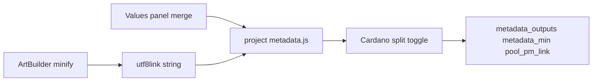

# Project metadata builder (`metadata.js`)

Cardano CIP-25 metadata is built by each **project’s** `<project>/metadata.js`, not by hardcoded logic in advBuilder. advBuilder minifies the art, builds the `utf8link`, merges **Values** panel fields, calls your `CreateMetadata(values, properties, artSrc)`, then **post-processes** for Cardano string limits when **Cardano split** is on (default).

See also: [UTF8LINK-METADATA.md](./UTF8LINK-METADATA.md) (escaping and `utf8link`), [VALUES-PANEL.md](./VALUES-PANEL.md) (flat `values` keys), [MINT-READY-BUNDLE.md](./MINT-READY-BUNDLE.md) (Part 1 export — `pieces/*/metadata.json` in bundle), [CLOUD-MINTING-INTERFACE.md](./CLOUD-MINTING-INTERFACE.md) (Parts 2–3 cloud integration, future).

## Pipeline



1. Terser produces `output_min`; `%`, space, and `#` are escaped into `utf8link` (see UTF8LINK-METADATA).
2. `values` — flat object from the Values panel (enabled keys only) plus fields ArtBuilder adds (below). Placeholder strings live in the Values **default** level, not in `metadata.js`.
3. `CreateMetadata(values, properties, artSrc)` returns one or more CIP-25 metadata roots (see Return value). You assign `artSrc` where you want (typically `files[].src` for on-chain HTML).
4. advBuilder runs [`finalizeMetadataForBuild`](../cardano_metadata_split.js): fills **empty** `text/html` `src` from `utf8link` only as a fallback, then applies Cardano string splitting when **Cardano split** is on (default).
5. advBuilder sets `metadata_min`, `metadata_size`, `pool_pm_link`, `metadata_outputs`, and writes output files (see Return value).

## Cardano split toggle

- **UI:** Metadata visualiser toolbar — checkbox **Cardano split** (default checked).
- **Storage:** `dev.json` → `settings.cardanoMetadataSplit` (default `true`).
- **API:** `POST /metadata/settings` with `{ "cardanoMetadataSplit": true|false, "rebuild": true }`.

When **on** (post-process rules):

| Target | Rule |
|--------|------|
| Map keys under `721` | Never modified (policy id, asset name) |
| `files[n].src` | Fixed 64 **UTF-8 byte** chunks (no word boundaries) |
| Other leaf strings in the asset record | Word-aware segments if longer than 64 bytes; tokens longer than 64 bytes without spaces are hard-split; short strings stay a single string |
| `properties` trait values | Same word-aware rule |

Implementation: [`cardano_metadata_split.js`](../cardano_metadata_split.js) (`injectUtf8ArtSrc` for empty `src` only, `applyCardanoMetadataSplit`, `finalizeMetadataForBuild`).

When **off**, `metadata_min` is the JSON from `CreateMetadata` unchanged (useful for non-Cardano or off-chain experiments).

## File contract

**Path:** `<project>/metadata.js` (e.g. `art/AsciiCore/metadata.js`)

**Export:**

```javascript
function CreateMetadata(values, properties, artSrc) {
  const root = { "721": { /* … */ } };
  return {
    "metadata.json": root,
    "metadata.readable.json": root,
  };
}
module.exports = { CreateMetadata };
```

advBuilder loads the file with `require()` and clears the require cache on each build so edits apply on the next build.

## Arguments

### `values` (object)

Flat map passed into your function. Sources:

| Source | Examples |
|--------|----------|
| Values panel (merge levels, `use` checked) | `policy`, `name`, `description`, `artist`, `num`, `seed`, `tag`, `website`, `collection_*`, custom keys |
| ArtBuilder fallbacks (when key not enabled in Values merge) | `collection_name`, `token_name`, `name` (display), `num`, `piece`, `hash`, `authNFT` |

Any key with **use** checked in the Values panel (including **override**) replaces the ArtBuilder fallback for metadata and canvas inserts.

Use `values.policy` for the policy id under `721`. A common **asset name key** pattern:

```javascript
const assetKey = values.collection_name + PadLeft(values.num, 5, "0");
```

### `properties` (object)

Active property choices from the Properties panel after PM2 resolves the build — e.g. `{ Theme: "Calm", Mode: "Bright", … }`. Use for on-chain traits (`style`, etc.). Empty `{}` when no visible properties.

advBuilder passes this as the **second** argument (not inside `values`).

### `artSrc` (string | string[])

Full `utf8link` string from advBuilder (preferred), or a legacy pre-chunked array. **You** place it in metadata — typical pattern:

```javascript
files: [{ mediaType: "text/html", name: PadLeft(values.num, 5, "0"), src: artSrc }]
```

You can use `artSrc` in multiple files, transform it, or omit `src` on a `text/html` entry; advBuilder only auto-fills **empty** `src` from the build `utf8link`. When **Cardano split** is on, advBuilder chunks each `files[].src` (fixed 64-char segments) without changing where you attached it.

## Return value

Return a plain object in one of two shapes:

**Single file (legacy):** return the CIP-25 root directly (must include `"721"`). Treated as `metadata.json`.

```javascript
return { "721": { /* … */ } };
```

**Multiple files:** return an object whose keys are target filenames and values are CIP-25 roots:

```javascript
return {
  "metadata.json": { "721": { /* on-chain / encoded */ } },
  "metadata.readable.json": { "721": { /* human-readable */ } },
};
```

Keys must end with `.json`. Each value is post-processed independently (utf8link injection + Cardano split when enabled). Outputs are written as:

| Build | Primary (`metadata.json`) | Additional files |
|-------|---------------------------|------------------|
| Dev / root | `output.metadata.json` (pretty), `output.metadata_min.json` (minified) | `output.<filename>` (minified), e.g. `output.metadata.readable.json` |
| Collection piece | `metadata.json` | `<filename>` in the piece dir, e.g. `metadata.readable.json` |

The Metadata visualiser shows a **File** dropdown when more than one output exists. `lastBuild.metadata_outputs` holds every file (`pretty`, `min`, `size` per key); `metadata` / `metadata_min` mirror the primary `metadata.json` entry for backward compatibility.

**Legacy single root** — still supported; treated as `metadata.json` only:

```javascript
return { "721": { /* … */ } };
```

Example (minimal multi-file):

```javascript
const assetKey = values.collection_name + PadLeft(values.num, 5, "0");
const inner = {
  name: values.name,
  description: values.description,
  files: [{ mediaType: "text/html", name: PadLeft(values.num, 5, "0"), src: artSrc }],
};
const root = { 721: { [values.policy]: { [assetKey]: inner } } };
return {
  "metadata.json": root,
  "metadata.readable.json": root,
};
```

If `CreateMetadata` throws or returns a non-object, the build records an error (art HTML/utf8 may still be produced).

## Missing `metadata.js`

- Build **continues** for HTML / utf8link; `lastBuild.metadata_builder_missing` is true; no `metadata_min` / pool.pm link.
- **Metadata** visualiser mode shows a setup card instead of JSON preview.
- Button **Create default builder: `<project>/metadata.js`** calls `POST /metadata/create-default`, writes the template from [templates/metadata.js.default](../templates/metadata.js.default), syncs sources, and triggers a rebuild.

## Example (multi-file metadata)

See [templates/metadata.js.default](../templates/metadata.js.default) and [templates/projects/cc-v3-collection/metadata.js](../templates/projects/cc-v3-collection/metadata.js) for starter patterns. Projects may return **`metadata.json`** (on-chain) and **`metadata.readable.json`** (plain text), encode text fields conditionally based on property flags, or attach custom traits from `properties`.

## Migration from `postMetaDataFn`

Previously, advBuilder built `metadata_inner`, wrapped it in `721`, then ran a hardcoded `postMetaDataFn` in `builder.js`. That hook is **removed**. Move all shaping into `CreateMetadata`:

| Old location | New location |
|--------------|--------------|
| Inner fields (name, files, description, …) | `CreateMetadata` return value |
| `postMetaDataFn` tweaks | Inside `CreateMetadata` |
| Cardano string chunking | advBuilder Cardano split (default on) |
| `postprocessingmetadata` eval | Prefer `CreateMetadata` (eval path deprecated) |

`lastBuild.metadata_inner` is still populated when possible by parsing the first asset under `721` (for older tooling).

## Verification checklist

1. Project with `metadata.js` — build writes `output.metadata.json`, `output.metadata_min.json`, and any extra outputs (e.g. `output.metadata.readable.json`); Metadata mode shows Raw + Preview + pool.pm + **File** dropdown when multiple outputs exist.
2. **Cardano split** on — `description` and `files[0].src` are arrays when long; toggle off and rebuild — long `src` stays one string.
3. Rename `metadata.js` — Metadata mode shows create-default UI; button creates file and rebuilds.
4. Values panel — enable `policy` / `name` / `num`; metadata JSON reflects changes; **override** + **use** on `name` wins over ArtBuilder display name.
5. Invalid `CreateMetadata` (throw) — error appears in build errors; check `output.errors.json`.
