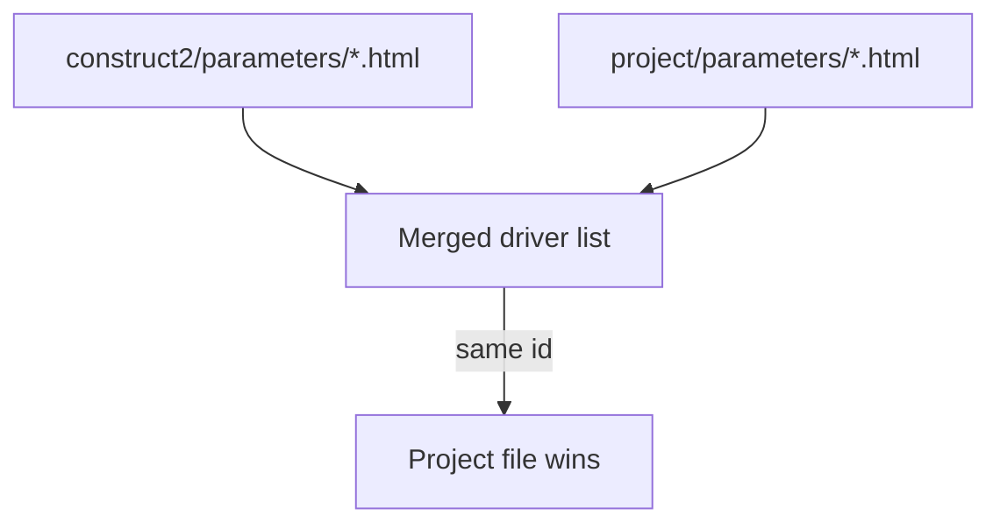
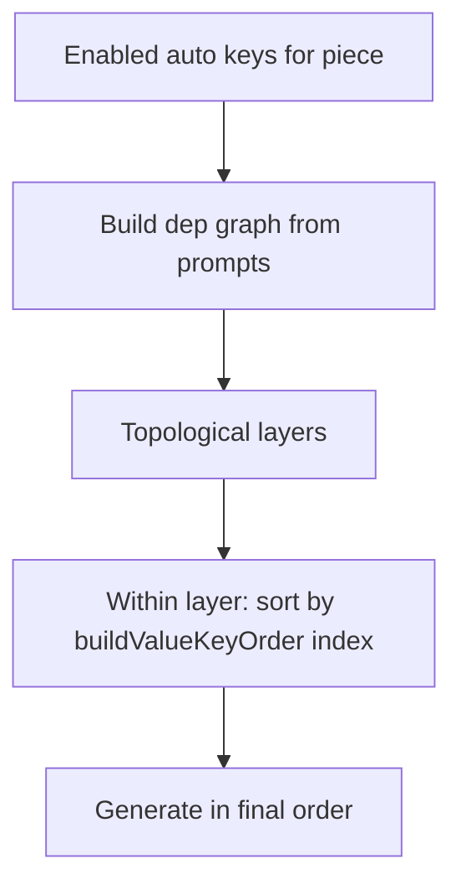

# Construct² minor upgrades

**Status:** implemented  
**Related:** [PARAMETER-DRIVERS-DESIGN.md](./PARAMETER-DRIVERS-DESIGN.md), [VALUES-PANEL.md](./VALUES-PANEL.md), [AUTO-GENERATION.md](./AUTO-GENERATION.md), [PROPERTIES-PANEL.md](./PROPERTIES-PANEL.md)

Three independent advBuilder improvements — all shipped.

| # | Feature | Primary doc |
|---|---------|-------------|
| 1 | Global parameter drivers | [PARAMETER-DRIVERS-DESIGN.md](./PARAMETER-DRIVERS-DESIGN.md) §6.1.1 |
| 2 | Drag-reorder value keys | [VALUES-PANEL.md](./VALUES-PANEL.md) |
| 3 | Debug group first in Properties | [PROPERTIES-PANEL.md](./PROPERTIES-PANEL.md) |

---

## 1. Global parameter drivers

### Intent

Ship a **basic driver library** under `construct2/parameters/` available to **all projects**, while keeping project-specific drivers in `<project>/parameters/`.

Drivers are discovered from `construct2/parameters/` first, then `<project>/parameters/` (`param_drivers.js`).

### Layout

```
construct2/
  parameters/
    README.txt          → maintainer notes (optional)
    spamTester.html     → generic schema stress test (global)
<project>/
  parameters/
    DRIVERS_README.txt  → project authoring reference (auto-seeded, unchanged)
    xaiChat.html        → project-specific drivers stay here
  dev.json              → paramDrivers: merged id list (backward compatible)
```

### Discovery and precedence



| Rule | Spec |
|------|------|
| Scan order | 1) `construct2/parameters/` 2) `<project>/parameters/` |
| ID collision | **Project overrides global** — one dropdown entry; HTTP serves project HTML |
| Dropdown order | Global drivers first (sorted), then project-only drivers (sorted) |
| Invalid IDs | Unchanged: `^[a-zA-Z0-9_-]+$`; skip invalid basenames |
| `DRIVERS_README.txt` | Stays **project-local** (auto-seeded as today) |
| Driver store | **Unchanged** — per `(projectName, driverId)` in userData; global drivers do not share store across projects |
| File watch | Add `construct2/parameters/*.html` to lightweight rescan (same debounce as project drivers) |

### HTTP route

`GET /parameters/:id.html`:

1. Resolve `<project>/parameters/:id.html` if present
2. Else resolve `construct2/parameters/:id.html`
3. Else 404

Store routes (`/parameters/:id/store`) unchanged — always project-scoped.

### State shape

`state.paramDrivers` — merged id list for the mode dropdown (backward compatible with flat string array in `dev.json`).

Optional enrichment for dev-ui labels (implementation detail):

```json
[
  { "id": "spamTester", "source": "global" },
  { "id": "xaiChat", "source": "project" }
]
```

If enriched, persist flat ids only in `dev.json` for compatibility.

### Initial global drivers

| Driver | Rationale |
|--------|-----------|
| `spamTester.html` | Generic schema spam / stress test driver (ships under `construct2/parameters/` or project copy) |

**Keep project-local:** custom voice/chat drivers and other project-specific panels under `<project>/parameters/`.

### Implementation checklist

- [x] `param_drivers.js` — `globalParametersDir()`, merged `scanParamDrivers()`, `driverHtmlPath()` fallback
- [x] `builder.js` — HTTP route fallback; watch `construct2/parameters/*.html`
- [x] `construct2/parameters/` — `spamTester.html`
- [x] `param_drivers.test.js` — global merge, project override path
- [ ] `dev-ui.html` — dropdown source labels (optional enrichment — not shipped)

### Manual verification

1. Open advBuilder for a project with no local `spamTester.html` — mode dropdown lists global `spamTester`.
2. Add `<project>/parameters/spamTester.html` with distinct content — dropdown still shows one entry; iframe loads project version.
3. Add a project-only driver — appears after global drivers in dropdown.
4. Edit global driver HTML — rescan updates list without full art rebuild.

---

## 2. Drag to reorder value keys

### Intent

Let artists control **row order** in the Values panel so **future batch Auto fill** (A7) can generate fields in a sensible sequence — e.g. `name` before `description` when prompts reference earlier keys.

Row order is persisted in `buildValueKeyOrder` (`dev.json`) and applied via `build_value_order.js` on server and client.

### Data model

New `dev.json` field:

```json
{
  "buildValueKeyOrder": ["name", "description", "tag", "artist", "num", "seed"]
}
```

| Aspect | Spec |
|--------|------|
| Persistence | `buildValueKeyOrder: string[]` in `dev.json` |
| Display | **All levels** (`default`, `collection`, `piece`, `override`, `result`, **auto** tab) render rows in this order |
| Editing | Drag-reorder **only when active level is `default`**; other levels use same order read-only |
| Drag handle | **Key name cell** (`.values-key` span) — cursor `grab` / `grabbing`; not the `<>` column-resize grip |
| New keys | Appended to end when added via scan or **Add** |
| Removed keys | Removed from order array |
| Migration | If missing: initialize once from current alphabetical `buildValueSchema` |

### Ordering algorithm (shared server + client)

```javascript
function orderBuildValueKeys(allKeys, keyOrder) {
  const order = Array.isArray(keyOrder) ? keyOrder : [];
  const known = new Set(allKeys);
  const sorted = order.filter((k) => known.has(k));
  for (const k of allKeys) if (!sorted.includes(k)) sorted.push(k);
  return sorted;
}
```

Apply in `recomputeBuildValueSchema()`, `updateValuesUI()`, and `renderValueAutoPanel()`.

### API

Extend existing `POST /buildValues`:

```json
{
  "reorderKeys": ["name", "description", "tag", "artist"],
  "activeLevel": "default"
}
```

- Validates: same member set as current schema, no duplicates
- Only accepted when `activeLevel === "default"` (or omitted → default)
- Persists `buildValueKeyOrder`; returns updated `buildValueSchema` order
- Does **not** trigger rebuild unless `rebuild: true`

### Auto generation contract

See [AUTO-GENERATION.md](./AUTO-GENERATION.md) §8 / §10.2. Summary:



| Case | Order source |
|------|----------------|
| Explicit deps (`[values.name]` in `description` prompt) | Topological sort (`extractPromptDependencies`, `detectValueAutoCycles`) |
| No deps between keys | `buildValueKeyOrder` (UI order) |
| Same topo layer | `buildValueKeyOrder` as stable tie-breaker |
| Cycles | Error with cycle path (unchanged) |

**Note:** A7 **Auto fill** is not implemented yet — this upgrade defines the ordering contract batch auto will consume.

### Implementation checklist

- [x] `build_value_order.js` — shared ordering helpers + tests
- [x] `builder.js` — `buildValueKeyOrder` state, migration, `POST /buildValues` `reorderKeys`
- [x] `dev-ui.html` — drag reorder on default level; shared row order on all levels
- [ ] `auto_resolve.js` / A7 planner — tie-break from `buildValueKeyOrder` when A7 ships

### Manual verification

1. Open Values → **default** — drag `name` above `description`; reload — order persists.
2. Switch to **collection**, **piece**, **override**, **result**, **auto** — same row order; no drag cursor on non-default levels.
3. Add custom key — appears at end of list.
4. Remove custom key — disappears from order array.

---

## 3. Debug group first in Properties

### Intent

In the Properties section, the **Debug** group appears **first at the top** for faster dev access.

UI render order in `updatePropsUI()`: **Debug → base → remaining groups** (scan `propertyGroupOrder` unchanged in build output).

### Display order (UI-only)

Do **not** change build scan output — `propertyGroupOrder` in build JSON stays first-seen for compatibility. Normalize only at render time in `updatePropsUI()`:

1. **`Debug`** group (if any Debug properties exist)
2. **`base`** group (ungrouped properties)
3. Remaining groups in **`propertyGroupOrder`** scan order, excluding `Debug`

```javascript
function displayPropertyGroupOrder(groupOrder) {
  const rest = (groupOrder || []).filter((g) => g !== "Debug");
  const hasDebug = rest.length < (groupOrder || []).length;
  return hasDebug ? ["Debug", ...rest] : rest;
}
// render: Debug block, then base, then rest
```

### Unchanged behaviours

- Debug flags: `pinOnRandom`, `lockUi` — unchanged
- Property Analysis “Hide Debug group” — unchanged
- `[HxDNA]` insert still sorted by property **name** within Hex DNA — unrelated to UI group order
- Random / shuffle: Debug remains non-shuffleable

### Follow-up (optional)

Apply same Debug-first ordering in property analysis grid if it iterates groups (`visualise_analysis_client.js`).

### Implementation checklist

- [x] `dev-ui.html` — `updatePropsUI()` render order: Debug → base → rest
- [ ] (optional) `visualise_analysis_client.js` — Debug-first parity in analysis grid

### Manual verification

1. Build a project with Debug and Hex DNA groups — Properties panel shows **Debug** accordion first.
2. **base** properties (e.g. `Mode`) appear after Debug, before Hex DNA.
3. Debug lock / Random behaviour unchanged.

---

## 4. Parameter driver hides with section collapse *(bugfix)*

### Problem

Collapsing the **Parameters** section hid the built-in PARAM rows but left the **driver iframe** and **readout** visible. Cause: `#section-params.is-driver-mode .dev-section-body { display:block }` overrode `.dev-section.collapsed .dev-section-body { display:none }`.

### Fix (`dev-ui.html` CSS)

- Driver-mode body expansion applies only when the section is expanded: `#section-params.is-driver-mode:not(.collapsed) .dev-section-body`
- Explicit `#section-params.collapsed .dev-section-body { display:none !important; }` so collapse always wins

The mode dropdown toolbar remains visible when collapsed (unchanged).

### Checklist

- [x] CSS fix in `dev-ui.html`

---

## 5. Parameter driver resize drag *(bugfix)*

### Problem

Dragging the driver bottom resize handle only moved a few pixels — the drag appeared to "lose lock". The driver **iframe** sits directly above the 5px handle; once the pointer crossed into the iframe, it captured events and `document` `mousemove` stopped firing.

### Fix (`param_driver_host.js`, `dev-ui.html`)

- Use **pointer events** with `setPointerCapture` on the handle (same pattern as `#divider`)
- Set `pointer-events: none` on the iframe (and readout wrap) for the duration of the drag
- `touch-action: none` on `.param-v-resize`

### Checklist

- [x] Pointer capture + iframe shield in `param_driver_host.js`
- [x] `touch-action: none` on `.param-v-resize`

---

## 6. Driver height + xAI Chat compose bar *(bugfix / UX)*

### Problem

The driver iframe was capped at **220px** (CSS `max-height` + JS clamp). xAI Chat already had a manual **Type message… / Send** row at the bottom of `xaiChat.html`, but it was clipped off-screen.

### Fix

| Area | Change |
|------|--------|
| `param_driver_host.js` | `clampDriverHeight()` — min 120px, max ~65% of `#left-scroll` (280–560px); default 280px |
| `dev-ui.html` | Remove `max-height:220px` on `#param-driver-wrap` |
| `xaiChat.html` | Pin compose bar outside scroll region; middle content scrolls |
| `builder.js` / dev-ui | Default `paramDriverHeight` 280 (persist cap still 600) |

After restart, drag the driver bottom edge to ~400px+ to comfortably see transcript + text input.

### Checklist

- [x] Raised resize limits
- [x] xAI Chat layout — compose bar always visible at bottom of iframe

---

## Cross-feature notes

All three upgrades are independent:

| Feature | Est. touch surface |
|---------|-------------------|
| Global drivers | `param_drivers.js`, `builder.js`, tests, new `construct2/parameters/` |
| Value order | `builder.js`, `dev-ui.html`, A7 consumer when implemented |
| Debug first | `dev-ui.html` (+ optional analysis client) |

No changes to minified `output.*` or production art bundles.
