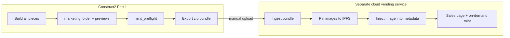

# Mint-ready collection bundle — Part 1 (offline export)

**Status:** Active spec — initial implementation target  
**Part of:** 3-part minting roadmap — see [CLOUD-MINTING-INTERFACE.md](./CLOUD-MINTING-INTERFACE.md) for Parts 2–3 (future cloud integration)  
**Related:** [RELEASE-FEATURES-PLAN.md](./RELEASE-FEATURES-PLAN.md) covers installer and GitHub release packaging. This document retains the **cloud ingest contract** (§7) and preflight rules (§3).

---

## Amendment (2026-06-21) — aligned with FINAL-LAUNCH-PREP §4

| Topic | This doc (original) | Current design |
|-------|---------------------|----------------|
| Marketing source | `<project>/marketing/` + `sales.json` | `collections/<pad2>/_bundle/text/*.txt\|md` + `images/` |
| Export destination | Save dialog / arbitrary path | `<project>/collections/<Project>.<pad2>.bundleNN.zip` |
| Activation | Implicit on export | Explicit **Activate bundle** on collection |
| Sales authoring | JSON primary | **Text/md files primary**; JSON compiled at export |
| Recreation payload | `sources.zip` + pieces | + `project.json`, `collection.json`, full `sources/` |
| Fingerprints | `sourceFingerprint` only | **Dual:** `sourceFingerprint` (collection) + `bundleFingerprint` (staging) |
| Mint readiness | `preflight` block in manifest | Full **`validation.json`** checklist in zip; `mintReady` flag |
| Bundle freeze | Not specified | **Auto-freeze on export;** review-only UI; **Unfreeze** to edit |

---

## 1. Purpose and boundary

Construct² exports a **mint-ready collection bundle** — a folder or `.zip` — containing everything a **separate cloud vending service** needs to host a sales page and mint on demand.

| In scope (Part 1) | Out of scope (Part 1) |
|-------------------|------------------------|
| Built piece artifacts (`metadata.json`, `min.html`, `utf8.txt`, …) | Magic-link auth, API tokens |
| Frozen source snapshot (`sources.zip` from `_source/`) | Construct-side IPFS pinning |
| Static preview images (`preview.png` per piece) | Policy key storage or registration |
| Marketing copy + images for sales page (`marketing/`) | `cloudSubmission` on collection JSON |
| Pre-export validation (`mint_preflight.js`) | Wallet connect, transaction submit |
| Optional freeze on export | Cloud HTTP client |

**Handoff model:** Artist runs **Export mint-ready bundle…** in Construct² → uploads the zip manually to the cloud vending service (web UI, SFTP, or ops pipeline). No Construct network calls.



Parts 2 and 3 (Construct ↔ cloud API, quick self-mint) are documented in [CLOUD-MINTING-INTERFACE.md](./CLOUD-MINTING-INTERFACE.md).

---

## 2. Bundle layout

Default export name: `<project>-<collection-pad2>-bundle.zip` (e.g. `MyProject-01-bundle.zip`).

```text
<collection-slug>-bundle/
  bundle.manifest.json       # bundle metadata — see §2.1
  collection.json            # snapshot of collections/<pad2>.json at export time
  sources.zip                # collections/<pad2>/_source/ + import graph manifest
  pieces/
    0001/
      metadata.json
      metadata.readable.json   # optional, when project emits it
      min.html
      utf8.txt
      preview.png              # static marketplace preview — see §4
    0002/
      …
  marketing/
    sales.json                 # sales page copy — see §5
    hero.png                   # optional
    banner.png                 # optional
    gallery/                   # optional extra images
      …
```

### 2.1 `bundle.manifest.json`

```json
{
  "bundleVersion": 1,
  "bundleType": "vending",
  "construct2Version": "0.x.y",
  "exportedAt": "2026-06-21T12:00:00.000Z",
  "project": {
    "name": "MyProject"
  },
  "collection": {
    "pad2": "01",
    "num": 1,
    "name": "DemoCollection",
    "pieceCount": 144,
    "sourceFingerprint": "sha256:…"
  },
  "build": {
    "cardanoMetadataSplit": true
  },
  "fingerprints": {
    "collection": "sha256:…",
    "bundle": "sha256:…"
  },
  "mintReady": true,
  "validation": {
    "passed": 16,
    "failed": 0,
    "warnings": 1
  },
  "policyId": "a1b2c3d4…",
  "sourcesSha256": "sha256:…",
  "preflight": {
    "ok": true,
    "warnings": ["missing preview: 0042"]
  },
  "minimalBundle": false
}
```

| Field | Purpose |
|-------|---------|
| `bundleVersion` | Schema version for cloud ingest |
| `bundleType` | Always `"vending"` for Part 1 exports |
| `sourceFingerprint` | Must match hash of art sources inside export `sources/` |
| `fingerprints.collection` | Same as `sourceFingerprint` — art/canonical sources only |
| `fingerprints.bundle` | Hash of `_bundle/` staging (text, images, previews) — detects marketing-only changes |
| `mintReady` | `true` only when `validation.json` has zero error-severity failures |
| `validation` | Summary counts; full checklist in `validation.json` at zip root |
| `policyId` | Informational — from merged Values / metadata; cloud uses its own policy vault |
| `sourcesSha256` | SHA-256 of `sources.zip` bytes |
| `preflight` | Result of last `mint_preflight` run embedded at export |
| `minimalBundle` | `true` when `marketing/` omitted intentionally |

### 2.2 Piece artifacts

Copied from `collections/<pad2>/<pad4>/` after a successful build ([`collection_runtime.js`](../collection_runtime.js)):

| File | Required | Notes |
|------|----------|-------|
| `metadata.json` | yes | CIP-25 root; primary mint payload |
| `min.html` | yes | Minified on-chain art |
| `utf8.txt` | yes | Escaped data-URL payload |
| `metadata.readable.json` | no | Human-readable twin when `metadata.js` returns it |
| `preview.png` | recommended | PNG; cloud pins and sets marketplace `image` |

Construct does **not** embed `ipfs://` URIs in Part 1 bundles. The cloud vending service pins `preview.png` and marketing images on ingest.

### 2.3 `sources.zip`

Contents mirror `collections/<pad2>/_source/`:

- All canonical files per [`source_inventory.js`](../source_inventory.js) (`core.html`, `defs.js`, `setup.js`, `draw.js`, `functions.js`, `cert.js`, `metadata.js`, …)
- Transitive `//import` modules at preserved relative paths
- Optional `import-manifest.json` listing resolved import graph (export module may add)

Cloud stores and hashes for recovery and verification against `bundle.manifest.json` `sourceFingerprint`.

---

## 3. Pre-export validation (`mint_preflight.js`)

Run before export (and before enabling **Export bundle** in UI). Returns `{ ok, errors[], warnings[] }`.

### 3.1 Errors (block export)

- Collection not open or pad2 invalid
- Any piece not **green** (built) — `buildStatus !== "built"` or missing piece output dir
- Missing `metadata.json`, `min.html`, or `utf8.txt` for any piece
- No `policyId` derivable from collection Values or first piece metadata
- Inconsistent `policyId` across piece metadata roots (when detectable)
- `collection.mint.size` set and `!== pieceRecords.length`

### 3.2 Warnings (allow export)

- Local `sourceFingerprint` ≠ current project art fingerprint (sources stale vs live project)
- Missing `preview.png` for one or more pieces
- Missing or empty `marketing/` (set `minimalBundle: true` in manifest if intentional)
- Cardano split disabled while cloud expects split metadata (document in `build.cardanoMetadataSplit`)
- Large metadata size approaching Cardano limits

### 3.3 Policy ID resolution

Check order:

1. Merged collection-level Values `policy` (when `use: true`)
2. `collection.mint.policy` in `collections/<pad2>.json`
3. First piece `metadata.json` → `721.<policyId>` key

All resolved IDs must match when more than one source is present.

---

## 4. Preview images

Marketplaces need a static **`image`**; generative HTML in `files[].src` is not enough for thumbnails. Part 1 ships **PNG files** in the bundle; the cloud service pins them and injects CIDs into metadata at ingest.

### 4.1 Sources (priority order)

1. **Auto-capture** — Construct batch job runs each built piece in visualiser, waits for completion, saves `pieces/<pad4>/preview.png` (P1.6)
2. **Manual** — `<project>/marketing/previews/<pad4>.png` copied into bundle at export
3. **Missing** — preflight warning; cloud may reject or use placeholder

### 4.2 Completion signal (for auto-capture)

Art should expose one of:

- `Animate()` returns `"done"` when visual is stable (existing CC3 pattern)
- Optional `//PARAM-BOOL` e.g. `readyForCapture` set to `1` when composition is complete
- Fallback: fixed delay after load (configurable per project; last resort)

Spec for capture dimensions: default **1024×1024** PNG; configurable in export options.

---

## 5. Marketing folder (`<project>/marketing/`)

Edited in the project repo before export. Copied into bundle `marketing/` as-is (plus normalized `sales.json`).

```text
<project>/marketing/
  sales.json
  hero.png
  banner.png
  gallery/
    detail-1.png
  previews/              # optional manual piece previews
    0001.png
```

### 5.1 `sales.json`

```json
{
  "title": "Demo Collection",
  "description": "Long-form sales page copy.",
  "shortDescription": "One-line tagline for cards.",
  "youtubeUrl": "https://www.youtube.com/watch?v=…",
  "images": {
    "hero": "hero.png",
    "banner": "banner.png"
  },
  "gallery": ["gallery/detail-1.png"],
  "notes": "Optional artist notes for cloud ops — not shown on public page"
}
```

**Video:** YouTube URL only — cloud embeds player; no video files in bundle.

**Pricing / mint economics:** Out of Part 1 bundle schema — configured on cloud vending service after ingest.

---

## 6. Export workflow (UX spec)

1. Open collection in Collections panel.
2. **Build all** if any piece is orange.
3. (Optional) **Capture previews** — batch job for missing `preview.png`.
4. Edit `<project>/marketing/sales.json` and images.
5. **Export mint-ready bundle…**
   - Runs `mint_preflight.js`
   - On errors: show list; block export
   - On warnings: confirm dialog
   - Choose output path (Electron save dialog) or default `<project>/exports/<name>-bundle.zip`
6. (Optional checkbox) **Freeze collection after export** — calls `POST /collections/:pad2/freeze` ([`collection_fs.js`](../collection_fs.js)).

After export, artist uploads zip to cloud vending service through that product's own UI.

---

## 7. Cloud ingest expectations (external contract)

Any compatible cloud vending service should:

1. Validate `bundle.manifest.json` `bundleVersion`
2. Verify `sourcesSha256` against `sources.zip`
3. Confirm `pieceCount` matches `pieces/` directories and `collection.json`
4. Parse each `metadata.json` as valid CIP-25
5. Pin `preview.png` + marketing images → inject `image` (and optionally `media`) into token metadata before mint
6. Embed YouTube URL from `marketing/sales.json` on sales page
7. Archive bundle + source hash for recovery

Construct² Part 1 does not implement this ingest — it only defines the bundle format.

---

## 8. Implementation phases (Part 1)

| Step | Deliverable | Module / route |
|------|-------------|----------------|
| **P1.0** | This document | — |
| **P1.1** | Pre-export validator | `mint_preflight.js` + tests |
| **P1.2** | Bundle packager | `mint_bundle_export.js` — zip writer, manifest, SHA256 |
| **P1.3** | HTTP export | `POST /collections/:pad2/export-bundle` in [`builder.js`](../builder.js) |
| **P1.4** | UI | **Export bundle** in [`collection_ui.js`](../collection_ui.js) |
| **P1.5** | Freeze / Unfreeze | COLLECTION-DESIGN-V2 §6.7 UI + existing freeze API |
| **P1.6** | Preview capture batch | Visualiser headless capture (optional follow-up) |

---

## 9. Relationship to collection freeze

Export does **not** require freeze. Recommended workflow:

- **Freeze after export** when collection is release-final (checkbox on export dialog).
- Frozen collections already block edits ([`collection_fs.js`](../collection_fs.js)); export remains allowed on frozen collections if all pieces are green.

Part 2 auto-freeze on cloud API submit is separate — see [CLOUD-MINTING-INTERFACE.md](./CLOUD-MINTING-INTERFACE.md).

---

## 10. Related docs

| Document | Role |
|----------|------|
| [CLOUD-MINTING-INTERFACE.md](./CLOUD-MINTING-INTERFACE.md) | Parts 2–3 — API submit, policy vault, self-mint (future) |
| [COLLECTION-DESIGN-V2.md](./COLLECTION-DESIGN-V2.md) | Collection build tree, `sourceFingerprint`, freeze |
| [METADATA-BUILDER.md](./METADATA-BUILDER.md) | `CreateMetadata` outputs copied into `pieces/` |

---

*Last updated: 2026-06-21 — Part 1 offline mint-ready bundle spec.*
