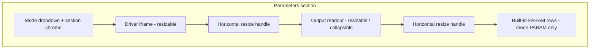
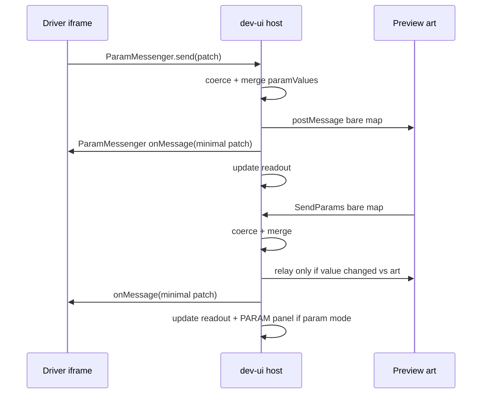

# Parameter drivers — design examination

**Status:** implemented (v1)  
**Related:** [PARAM-SPEC.md](./PARAM-SPEC.md), [VISUALISER.md](./VISUALISER.md), [PARAM-COLOR-PLAN.md](./PARAM-COLOR-PLAN.md)

This document specifies **custom HTML parameter drivers**: per-project panels that replace or augment the built-in Parameters UI for test-driving `//PARAM-*` values (e.g. voice/chat puppeteering, API testers). The dev shell remains the **relay hub** between driver, built-in panel (when used), preview art, and server state.

Project-specific driver design notes (e.g. Grok Voice chat with persona memory) live under that art project's `docs/` folder, not in Construct² docs.

---

## 1. Intent

**Goals:**

- Allow each project to ship one or more **HTML drivers** under `<project>/parameters/` that send and receive the same **bare parameter maps** as today ([PARAM-SPEC.md](./PARAM-SPEC.md) §8).
- Mount the active driver in an **iframe** inside the dev-ui **Parameters** section, with a minimal **output readout** (vertical bars + compact value chips) showing what the driver (or relay) is sending toward the art.
- Keep **bidirectional** flow: driver → art and art → driver/readout, matching existing `SendParams` / `cc_onParam` behaviour.
- **Discover drivers on build** so a mode dropdown can list them without hand-editing dev-ui.

**Motivation (from notes):**

> Per-project replacement panel for parameters. Custom test driving — like the Grok AI chat window.

Projects with many related `PARAM-FLOAT` controls (e.g. voice/face puppeteering) benefit from a driver that bundles sliders, buttons, and API polling in one tailored UI instead of stretching the generic row layout.

**Non-goals for v1:**

- Shipping drivers inside minified `output.*` (drivers are **dev-only**).
- Replacing `//PARAM-*` scanning or `output.params.md`.
- Running drivers in production Electron without an explicit host feature flag.
- Multiple simultaneous drivers (one active at a time).

---

## 2. Relationship to the Parameters panel today

| Topic | Today (P3+) | With parameter drivers |
|--------|-------------|-------------------------|
| Schema | `state.paramSchema` from `param_scan.js` on build | Unchanged |
| Values | `state.paramValues`, `POST /params`, `dev.json` | Unchanged — driver writes go through same path |
| Built-in UI | `#panel-params` rows per [PARAM-SPEC.md](./PARAM-SPEC.md) §7.2 | Shown only in mode **`PARAM`** |
| Art bridge | `applyParamsToIframe` bare `postMessage`; art `SendParams` → coerce → relay | Same wire format; relay also fans out to driver iframe + readout |
| Persistence | `paramValues` in `dev.json`; `PARAM-BUTTON` counts excluded | Add `paramDriverMode`, readout layout (§7); driver UI uses `localStorage` (§5.6) |

The built-in panel is **not removed**; it becomes one mode (`PARAM`) beside **off** and each discovered custom driver.

---

## 3. Parameters section layout

The left column **Parameters** collapsible section has a **toolbar** (mode dropdown; visible even when the section is collapsed) and up to three **stacked regions** in the section body (hidden when the section is collapsed).

**Section collapse:** clicking the Parameters header toggles `#section-params.collapsed`. When collapsed, the entire `.dev-section-body` is hidden — driver iframe, readout, and built-in PARAM rows together. Only the toolbar (mode dropdown + Docs link) stays visible. In driver mode, CSS must not force `display:block` on the body while collapsed (`:not(.collapsed)` on the driver-mode rule).



### 3.1 Mode dropdown (top bar)

| Mode value | Label | Body content |
|------------|-------|----------------|
| `off` | Off | No driver iframe, no built-in rows, **no readout**. Preview may still apply **last** `paramValues` on reload. No new `POST /params` from UI until mode ≠ off. |
| `param` | PARAM | Built-in `#panel-params` (current §7.2 UI) only. No driver iframe, **no readout** (values are the PARAM controls). |
| `<driverId>` | Display name from driver file | Driver iframe + **readout** + **no** built-in rows (driver replaces PARAM UI for editing). |

- **Default mode:** **`param`** (matches today’s always-visible Parameters panel for existing projects).
- **Driver labels:** dropdown shows the **file basename** without `.html` (e.g. `voiceTester` for `parameters/voiceTester.html`). Optional later: `// @param-driver-title Voice tester` in HTML comment.
- **Empty drivers folder:** dropdown only offers `off` and `param`.

### 3.2 Driver area

- Renders when mode is a **custom driver id**.
- **Iframe** `src` served by dev server, e.g. `GET /parameters/<driverId>.html` (project-relative, no path traversal).
- **Height:** resizable via a **bottom drag handle** (same interaction pattern as the main `#divider` between left/right panes). Min height ~120px; max ~70% of `#left-scroll`.
- **Injection:** before driver document executes, the host **must** inject **`window.ParamMessenger`** via runtime bootstrap (§5) — not bundled inside driver HTML. Drivers **must** verify injection before use (§5.5).
- Implementation options (pick one in build):
  1. **Wrapper document** that loads `param_messenger.js` then sets `iframe.src` to the driver URL, or
  2. **`srcdoc`** / inline bootstrap script inserted by the route handler.

Drivers are plain HTML/CSS/JS; they may use CDNs in dev only. Authoring reference: **`parameters/DRIVERS_README.txt`** (§6.5).

### 3.3 Output readout

Purpose: **minimal mirror** of values the relay is sending toward the art (after coerce), not a full duplicate of the PARAM panel.

- **Shown only** when a **custom driver** is active (hidden in **`off`** and **`param`**).
- Placed **below** the driver iframe when a **custom driver** is active (same band as the driver; not shown in **`off`** / **`param`**).
- **Ranged floats/ints** (`PARAM-FLOAT`, `PARAM-INT`): one **vertical bar** per parameter, fixed width, in a single horizontal row (no names on bars). Fill = normalized `(value - low) / (high - low)`. **Tooltip** on hover: `name`, value, range, description from schema (native `title` on the bar; the green fill uses `pointer-events: none` so hover reaches the bar).
- **Other types:** compact **chips** in a row below the bars (string/number/boolean/choice hex preview). **Tooltip:** name + value + description.
- **Layout:** readout **wrap + panel** use **`width: max-content`** with **`max-width: 100%`** so horizontal space matches bars + chips instead of stretching across the whole Parameters column. **Height** defaults to content (`height: auto`) until the user drags the resize handle, which persists **`paramReadoutHeight`** in `dev.json` (§7).
- **Colours:** small swatch chip (reuse `param_color.js` readout helpers where possible).
- **`PARAM-BUTTON`:** omit from readout (momentary); or flash indicator — **v1: omit**.
- **Resize:** thin **bottom-edge drag handle** (row); height persisted in `dev.json` (§7).
- **Collapsed state:** click the readout header (or thin bar) toggles expand/collapse; collapsed shows a strip labeled **Outputs**; expand restores previous height. Open/closed state **persisted** in `dev.json`.
- Readout listens to **`paramValues`** updates (WS + local), not raw uncoerced driver spam.

### 3.4 Built-in PARAM body

- Visible only when mode = `param`.
- Scan errors and empty-state copy unchanged.

---

## 4. Relay hub (driver ↔ dev-ui ↔ art)

The editor **does not** let the driver `postMessage` the art iframe directly. All traffic goes through dev-ui so coercion, `dev.json`, WS sync, and nested visualiser bridging stay consistent.



### 4.1 Driver → host

- Driver calls `ParamMessenger.send(partialMap)` with the same **bare** shape as [PARAM-SPEC.md](./PARAM-SPEC.md) §8 (`{ mouthOpen: 0.5, speak: 1 }`).
- **`send` may run at high frequency** (up to **~60 fps**, e.g. audio meters). Host always **coerces** and merges into `state.paramValues`, but:
  - **`POST /params`:** `persist: false` on the hot path; debounced or throttled `persist: true` to `dev.json` (e.g. on pointer-up / blur / 500 ms idle) so `dev.json` is not rewritten every frame.
  - **Art iframe:** forward via `postMessage` **only for keys whose coerced value differs** from the last value known to be held by the art (per-key diff against `iframeParamLastSent` or equivalent). Unchanged keys are skipped even if `send` repeats at 60 fps.
  - **Driver callback:** `onMessage` receives a **minimal** patch `{ paramId: value, … }` containing only keys that changed in that transaction (after coerce). Use `getSchema()` / `getValues()` when the driver needs the full picture (§5).

### 4.2 Art → host → driver

- Unchanged listener: bare map from `#vis` only, coerce, `updateParamsUI`, relay to art.
- **Additionally:** notify the active driver iframe via `onMessage` with a **minimal** changed-key patch when art pushes (`SendParams`) or when mode `param` edits values.

### 4.3 Built-in PARAM mode + driver

- Only one editor active; no dual-send. Switching mode **does not clear** `paramValues`.

### 4.4 Nested preview / visualiser

When preview uses nested iframes ([`visualise_param_bridge.js`](../visualise_param_bridge.js)), relay **art ↔ dev-ui** is unchanged. Driver only talks to dev-ui. No change to bridge unless a driver is later embedded in visualiser (out of scope).

---

## 5. `ParamMessenger` API (driver iframe)

Small script **`param_messenger.js`** (~2–3 KB) installed on `window.ParamMessenger` by the host **before** driver scripts run. Human-readable reference copy lives in each project as **`parameters/DRIVERS_README.txt`** (§6.5).

### 5.1 Construction

```js
if (typeof ParamMessenger !== 'function') {
  document.body.textContent = 'ParamMessenger not injected — open this driver from advBuilder dev-ui.';
  throw new Error('ParamMessenger missing');
}

const messenger = new ParamMessenger({
  onMessage(params) {
    // Minimal map: { speak: 0.5, vol: 1 } — only keys that changed
  },
});
```

`onMessage` is the primary hook for keeping driver UI in sync. It is intentionally easy: one callback, bare `{ paramId: value }` objects, same shape as `send`.

### 5.2 Methods

| Method | Description |
|--------|-------------|
| `send(patch)` | Shallow bare map; host coerces, merges, forwards to art only on **value change** (§4.1). Safe at **~60 fps**. |
| `sendButton(name)` | Sugar for `PARAM-BUTTON`: host increments trigger count and posts. |
| `getValues()` | Returns full current coerced map `{ paramId: value, … }` (sync snapshot). |
| `getSchema()` | Returns **full parameter definitions** for the piece (see §5.3). |
| `destroy()` | Remove listeners when iframe unloads / mode changes. |

### 5.3 `getSchema()` shape

`getSchema()` returns an array of records suitable for auto-building driver UI or validation. Each entry merges scan metadata with **default** and **current** value:

| Field | Source |
|-------|--------|
| `name` | `//PARAM-*` marker |
| `type` | e.g. `PARAM-FLOAT`, `PARAM-CHOICE`, … |
| `description` | trailing comment on marker line (§4.1 PARAM-SPEC) |
| `declaredIn` | file + line (when available) |
| Type-specific | `low`, `high`, `step`, `choices`, colour fields, etc. |
| `default` | schema default from scan |
| `value` | current coerced value from `paramValues` |

Example element:

```js
{
  name: "speak",
  type: "PARAM-FLOAT",
  low: 0, high: 1, step: 0.01,
  default: 0,
  value: 0.42,
  description: "0-1 when ai is speaking"
}
```

Host refreshes `value` on each merge; driver may call `getSchema()` again after `onMessage` if it needs guaranteed consistency.

### 5.4 Host → driver delivery

`ParamMessenger` wraps parent `postMessage` (envelope internal only; **not** the art wire format):

```js
{ source: 'advBuilder-param-host', type: 'message', values: { speak: 0.5 } }
{ source: 'advBuilder-param-host', type: 'schema', schema: [ /* getSchema() rows */ ] }
```

Drivers should use **`onMessage`** rather than listening to `message` directly unless they have special needs.

### 5.5 Runtime injection guard

Drivers **must not** assume `ParamMessenger` exists (e.g. opening `parameters/foo.html` directly in a browser tab).

**Required pattern** at startup:

1. Check `typeof window.ParamMessenger === 'function'`.
2. If missing, show a short inline error and **do not** call `send`.
3. Only construct `new ParamMessenger({ … })` after the check passes.

The host guarantees injection only when loading the driver through **`GET /parameters/:id.html`** (or the wrapper route) inside dev-ui.

### 5.6 Driver-local persistence

**Out of scope for the editor:** UI layout inside the driver, chat history, API keys, last-used presets, etc.

If a driver needs persistence across reloads, it uses **`localStorage`** / **`sessionStorage`** in its own origin (driver iframe). The host does **not** read or write driver-internal keys in `dev.json`.

### 5.6.1 Driver project files (`*.memory.json`)

For **conversation memory** and multi-persona driver state, the host exposes **`ParamMessenger.readDriverStore(filename)`** / **`writeDriverStore(filename, patch)`** (§5.6.1).

**Storage location (v3 — Electron userData):**

| Rule | Detail |
|------|--------|
| **Location** | `<userData>/driver-stores/<projectName>/<driverId>/<basename>.json` when Electron embed is active; legacy fallback `<project>/parameters/` until migration |
| **Migration** | On first Electron open, copy existing `parameters/*.memory.json` → userData, verify, delete from project |
| **Format** | JSON object; host returns `{}` if file missing — index + per-slug payloads |
| **Merge** | Shallow merge per file. **Index:** driver writes full registry array each time. **Payload:** shallow merge per slug file. |
| **Not in `dev.json`** | Same as §5.6 — editor does not edit these keys in the Parameters panel. |
| **Not in repo** | After migration, `*.memory.json` must not live under `<project>/parameters/` |

Example (multi-persona voice driver):

- **Index:** `<driverId>.memory.json` — `{ personas: [{ slug, name, … }, …] }`
- **Payload:** `<driverId>.<slug>.memory.json` — `condensedHistory`, `lastConversation`, `launchCount`, etc.
- **Slug:** generated on **first Start** for a new name; listed in the index; stable thereafter.

**Other drivers:** may use the same store API; path is always per `(projectName, driverId)` under userData.

### 5.7 Origin policy

- Parent validates driver messages: `event.source === driverIframe.contentWindow`.
- Driver validates parent: `event.source === window.parent` and `data.source === 'advBuilder-param-host'`.

---

## 6. Discovery, files, and build pipeline

### 6.1 Layout

```
construct2/
  parameters/               → global drivers (all projects) — see §6.1.1
    spamTester.html         → mode id `spamTester`
<project>/
  parameters/
    DRIVERS_README.txt    → authoring reference (auto-seeded, §6.5)
    voiceTester.html      → mode id `voiceTester`
    grokChat.html         → mode id `grokChat`
  dev.json                → paramDrivers: ["spamTester", "voiceTester", "grokChat"]
  output.params.md        → unchanged
```

- **Convention:** one driver per `.html` file; **no** subfolders in v1.
- **Invalid files:** non-`.html` ignored except `DRIVERS_README.txt`; empty names skipped.
- Drivers may live beside art sources; **not** watched for art rebuild unless listed in watch list (§6.3).

#### 6.1.1 Global drivers

Global drivers live under `construct2/parameters/` and are available to **all projects**. Project drivers in `<project>/parameters/` override global drivers with the same id.

| Rule | Spec |
|------|------|
| Scan order | 1) `construct2/parameters/` 2) `<project>/parameters/` |
| ID collision | **Project overrides global** — one dropdown entry; HTTP serves project HTML when both exist |
| Dropdown order | Global drivers first (sorted), then project-only drivers (sorted) |
| Driver store | Unchanged — per `(projectName, driverId)` in userData; global drivers do not share store across projects |
| `DRIVERS_README.txt` | Stays project-local (auto-seeded as today); optional `construct2/parameters/README.txt` for maintainers |

Project-specific drivers (e.g. `<project>/parameters/voiceChat.html`) remain under `<project>/parameters/`. Generic utilities (e.g. `spamTester.html`) ship globally.

### 6.2 Scan on build

During `performBuild()` (after `scanParamSources`):

1. Read `construct2/parameters/*.html` (sorted basename).
2. Read `<project>/parameters/*.html` (sorted basename); project ids override global ids with the same basename.
3. Set `state.paramDrivers = ['spamTester', 'voiceTester', …]` (merged list).
4. Persist in `dev.json` on save.
5. If current `state.paramDriverMode` is set to a missing id, fall back to `off` or `param` (log once).

No content parsing of driver HTML in v1 (no required manifest).

### 6.3 File watch

Add `<project>/parameters/*.html` and `construct2/parameters/*.html` to advBuilder watch paths so adding a driver triggers rebuild **or** a lightweight `scanParamDrivers()` without full art build — **recommendation:** lightweight scan only (faster iteration).

### 6.4 HTTP route

| Route | Behaviour |
|-------|-----------|
| `GET /parameters/:id.html` | Serve `<project>/parameters/:id.html` if present; else `construct2/parameters/:id.html`; else 404. `id` must match `^[a-zA-Z0-9_-]+$`. |
| `GET /param_messenger.js` | Serve shared messenger from `construct2/` |

### 6.5 `DRIVERS_README.txt` (project authoring reference)

**Filename:** `<project>/parameters/DRIVERS_README.txt`  
(Canonical name; avoids clashing with driver HTML basenames.)

**Purpose:** Single place in the repo to read how to write drivers and use `ParamMessenger` — easy to open beside driver HTML without hunting advBuilder docs.

**Auto-seed:** On first `scanParamDrivers()` / build, if the file is **missing**, advBuilder copies the template from **`construct2/templates/DRIVERS_README.txt`** into the project. Existing files are **never overwritten** (user edits preserved).

**Template contents (critical sections):**

- Prerequisites: run inside dev-ui; injection guard (§5.5).
- `ParamMessenger` constructor + **`onMessage(params => { … })`**.
- **`send(patch)`** — bare map, 60 fps OK, art receives diffs only.
- **`sendButton(name)`**, **`getValues()`**, **`getSchema()`** — with field list (§5.3).
- Wire format pointer to [PARAM-SPEC.md](./PARAM-SPEC.md) §8 (booleans `0`/`1`, no wrappers).
- **localStorage** for driver-only state (§5.6).
- Minimal HTML example (same as §8).
- Link to full design: this document.

Optional: dev-ui link **“Driver docs”** opens `DRIVERS_README.txt` via raw file path or a `GET /parameters/DRIVERS_README.txt` route.

---

## 6.6 Future: Collection / Saved modes

When [COLLECTION-DESIGN.md](./COLLECTION-DESIGN.md) / [SAVED-PIECES-DESIGN.md](./SAVED-PIECES-DESIGN.md) land, **do not** snapshot or freeze custom driver HTML, `paramDriverMode`, or driver `localStorage` into per-piece manifests. Parameter **values** (`paramValues`) may still be saved per workspace rules; driver choice remains a dev-session/editor preference only unless revisited later.

---

## 7. Persistence (`dev.json`)

| Key | Type | Notes |
|-----|------|-------|
| `paramDriverMode` | `"off"` \| `"param"` \| `<driverId>` | Restored on dev-ui load |
| `paramDriverHeight` | `number` | px; driver iframe area (custom modes only) |
| `paramReadoutHeight` | `number` | px; readout area from bottom divider |
| `paramReadoutCollapsed` | `boolean` | default `false` (readout **open** by default) |
| `paramDrivers` | `string[]` | written by scanner; read-only in UI |

`paramValues` persistence unchanged ([`param_persist.js`](../param_persist.js) rules for buttons/colours).

**Not persisted by editor:** driver iframe internal UI state (§5.6).

---

## 8. Example driver skeleton

```html
<!DOCTYPE html>
<html>
<head>
  <meta charset="utf-8" />
  <title>Voice tester</title>
  <style>
    body { font: 12px system-ui; margin: 8px; }
    input[type=range] { width: 100%; }
  </style>
</head>
<body>
  <label>speak <input id="speak" type="range" min="0" max="1" step="0.01" /></label>
  <script>
    if (typeof ParamMessenger !== 'function') {
      document.body.textContent = 'Open from advBuilder dev-ui (ParamMessenger not injected).';
      throw new Error('ParamMessenger missing');
    }
    const speakEl = document.getElementById('speak');
    const m = new ParamMessenger({
      onMessage(params) {
        if (params.speak != null) speakEl.value = params.speak;
      },
    });
    // Optional: build UI from full schema
    // const schema = m.getSchema();
    speakEl.oninput = () => m.send({ speak: +speakEl.value });
  </script>
</body>
</html>
```

Host injects `param_messenger.js` before this script runs. See **`parameters/DRIVERS_README.txt`** for the full API cheat sheet.

---

## 9. UI implementation notes

- Reuse **section chrome** from `#section-params` (`.dev-section-head`); add inner `.param-mode-bar` with `<select id="param-mode">`.
- **Resize handles:** `mousedown` on handle → adjust preceding region height; store in `dev.json` debounced.
- **Readout rendering:** new module `param_readout.js` (dev-ui only) driven by `paramSchema` + `paramValues`; keep DOM small (pool bar elements).
- **Coercion:** always `advParamCoerce.coerceParamMap(schema, patch)` before merge (same as art → host).
- **Accessibility:** readout bars `role="meter"` with `aria-valuenow/min/max`; mode select labeled.

---

## 10. Security

| Risk | Mitigation |
|------|------------|
| Path traversal on `/parameters/:id` | Strict id charset; resolve under `<project>/parameters/` |
| Driver exfiltrates files | iframe `sandbox="allow-scripts allow-same-origin"`; no `allow-top-navigation` |
| XSS in driver HTML | Author-controlled dev-only content; same trust as local HTML |
| Spoofed postMessage | Source checks §5.4; ignore unknown envelopes |

Drivers must **not** receive the art iframe’s `contentWindow`; only parent dev-ui.

---

## 11. Implementation phases

| Phase | Deliverable |
|-------|-------------|
| **D1** | This doc + README index |
| **D2** | `scanParamDrivers`, seed `DRIVERS_README.txt`, `dev.json` fields, `GET /parameters/:id`, messenger script |
| **D3** | dev-ui mode bar, iframe mount, relay hub, `POST /params` from messenger |
| **D4** | Readout component + resize/collapse |
| **D5** | File watch for `parameters/`; global `spamTester` driver |
| **D6** | Docs cross-link in [PARAM-SPEC.md](./PARAM-SPEC.md) §7 (optional appendix) |

---

## 12. Resolved decisions

| Topic | Decision |
|-------|----------|
| Default mode | **`param`** |
| `send()` rate | Up to **~60 fps**; coerce always; **art `postMessage` only when coerced value changes**; `dev.json` not every frame (`persist: false` + debounced commit) |
| Readout | **Custom driver only**; **height + collapsed state** persisted (`paramReadoutHeight`, `paramReadoutCollapsed`) |
| Driver callbacks | **`onMessage({ paramId: value })`** — minimal changed keys only; **`getSchema()`** for full defs + defaults + current values |
| Driver state | **`localStorage` in driver** for UI prefs (not API keys in Electron); **`readDriverStore` / `writeDriverStore`** → userData `driver-stores/` (§5.6.1); editor does not persist either in `dev.json` |
| Driver memory path | **userData** `driver-stores/<project>/<driverId>/` after migration; legacy `<project>/parameters/*.memory.json` until Electron migrates |
| Injection | Drivers **must** check `ParamMessenger` was injected at runtime (§5.5) |
| Collection / Saved | **No** frozen driver snapshots for now (§6.6) |

---

## 13. Revision history

| Date | Change |
|------|--------|
| 2026-05-18 | Initial design; aligned with PARAM-SPEC §8 and dev-ui relay. |
| 2026-05-18 | `onMessage`, `getSchema()`, `DRIVERS_README.txt` auto-seed, injection guard, 60 fps diff-to-art, readout defaults, resolved open questions. |
| 2026-05-18 | Readout: shrink-to-fit width, auto height until resize; bar tooltips (fill `pointer-events: none`); readout resize clamp 40–180px; mode table matches implementation (readout only with custom driver). |
| 2026-05-18 | §5.6.1: driver store API; index + per-slug payload files. |
| 2026-05-18 | §5.6.1: locked full-array index writes. |
| 2026-05-27 | §5.6.1: driver memory → Electron userData; migration from `<project>/parameters/`. |
