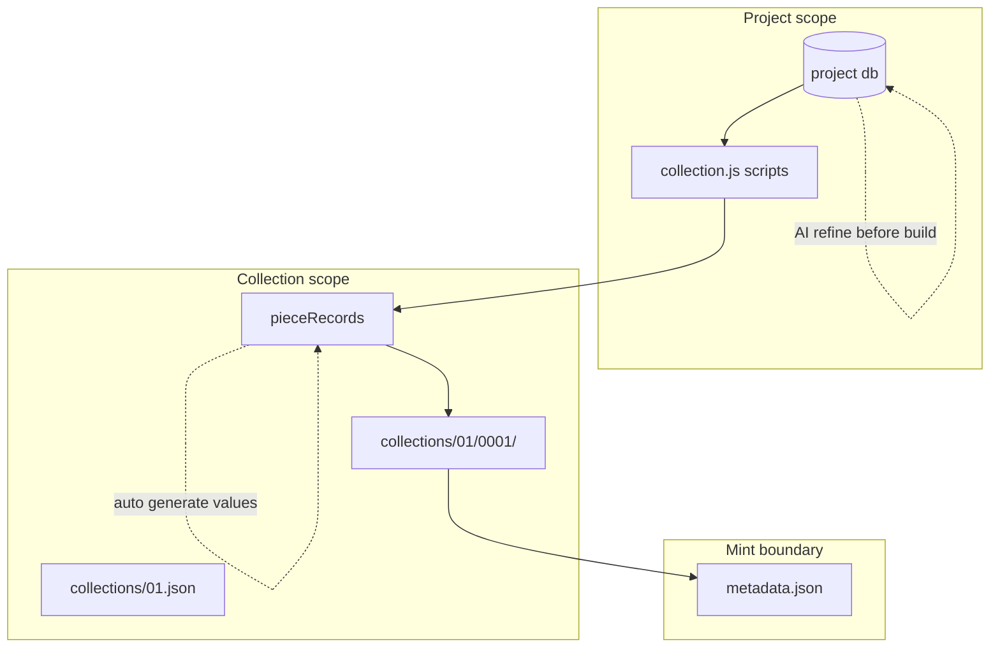
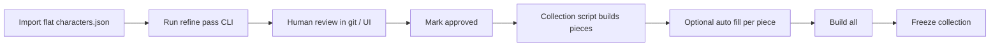

# Project database — character lore & AI refinement

**Status:** design / not implemented  
**Related:** [COLLECTION-SCRIPTS.md](./COLLECTION-SCRIPTS.md), [AUTO-GENERATION.md](./AUTO-GENERATION.md), [COLLECTION-DESIGN-V2.md](./COLLECTION-DESIGN-V2.md)

This document explores how to move project-owned lore (names, primers, nicknames, backstory, custom blobs) out of flat JSON files into a **project-scoped database** that collection build scripts and AI refinement loops can read and update — while staying simple, inspectable, and git-friendly.

---

## 1. Problem

Many collection projects start with lore in a **single nested JSON file** or hand-maintained CSV:

```text
characters.json
  groupA | groupB
    subgroup1 | subgroup2
      "Name": "short description or primer"
```

Collection scripts load this file via `ctx.readJson("characters.json")`, slice rows, and emit piece stubs with `fixedProperties` for each group.

**What works:** deterministic batch builds, no extra dependencies, easy to hand-edit.

**What breaks down as the project grows:**

| Need | Flat JSON pain |
|------|----------------|
| Per-character custom fields (nickname, backstory, voice notes, mint status) | Awkward — either inflate the nested map or fork parallel files |
| AI refinement loops that update one character at a time | Whole-file rewrite; merge conflicts; no history per entity |
| Cross-collection reuse (“this name appeared in 01, refined in 03”) | No stable ID — keyed only by display name string |
| Query (“all erratic malevolent with empty backstory”) | Manual scripting every time |
| Supplemental data for future collections / drivers / metadata | No shared layer between `collection.js`, auto generation, and xAI drivers |

**Goal:** a **project database** — one logical store per art project — where each entity has a stable ID, indexed fields for common lookups, and a **JSON blob** for open-ended custom data. Collection build scripts and AI loops both use the same API.

---

## 2. Design principles

| Principle | Meaning |
|-----------|---------|
| **Project-scoped** | DB lives under `<project>/`, not global advBuilder state. Different projects, different lore stores. |
| **JSON blob per entity** | Fixed columns for things you query often; `data` (or `custom`) for everything else without schema migrations. |
| **Git-friendly by default** | Prefer formats you can diff, hand-edit, and commit. Avoid opaque binary unless scale demands it. |
| **Node-first access** | Collection scripts run in `builder.js` (Node). Browser dev-ui reads via HTTP if needed later. |
| **Mint boundary** | Characters can be refined freely until a collection (or piece) is **frozen** / minted — then lore for that slot is locked or snapshotted. |
| **Compose with auto generation** | DB holds canonical lore; [AUTO-GENERATION.md](./AUTO-GENERATION.md) fills piece-level values at collection time. Loops can write back to DB *and* piece records. |

---

## 3. Entity model (project-generic)

### 3.1 Tables / collections

Start with one logical table; generalize later.

| Entity | Purpose |
|--------|---------|
| **`characters`** | Named entities with primers, traits, or lore fields |
| *(future)* **`locations`**, **`factions`**, **`artifacts`** | Supplemental lore for metadata, drivers, or future collections |

### 3.2 Character record shape

Stable **`id`** (UUID or slug) survives renames. Display **`name`** is what mint metadata uses.

```json
{
  "id": "char_aurora_001",
  "name": "Aurora",
  "theme": "calm",
  "mode": "bright",
  "primer": "a layered field of light and motion across a quiet garden…",
  "nickname": null,
  "backstory": null,
  "status": "draft",
  "version": 3,
  "updatedAt": "2026-06-10T12:00:00.000Z",
  "data": {
    "voiceNotes": "ancient elegance, quiet cosmic wit",
    "ai": {
      "primerScore": 0.82,
      "lastPass": "tighten-primer-v2",
      "history": [
        { "pass": "seed-import", "at": "2026-01-01", "primer": "…" }
      ]
    },
    "mint": {
      "collectionPad2": null,
      "pieceNum": null
    }
  }
}
```

| Field | Indexed? | Notes |
|-------|----------|-------|
| `id` | primary | Never changes |
| `name` | yes | Unique per project (case-sensitive or normalized — pick one) |
| `theme`, `mode` | yes | Maps to PropMaster `Theme` / `Mode` |
| `primer` | no (full text) | ≤200 chars for on-chain; longer drafts OK in `data` |
| `nickname`, `backstory` | optional | Promoted when queried often; else live in `data` |
| `status` | yes | `draft` \| `review` \| `approved` \| `minted` |
| `data` | JSON blob | Custom / experimental fields |

### 3.3 Import from flat JSON

One-time migration script:

1. Walk nested groups → `{ name: primer }` (or your project's shape).
2. Assign `id` (slug from normalized name + disambiguation suffix if collision).
3. Set `status: "draft"`, `version: 1`, empty `data.ai`.
4. Write DB; keep original JSON as read-only archive or delete after verify.

Project-specific import notes belong in that art project's `docs/` folder.

---

## 4. Technology options

All options assume **Construct²** (`builder.js`, Electron) as the host. No cloud DB required for v1.

### 4.1 Comparison matrix

| Approach | Access pattern | JSON blob | Git diff | Query | Setup | Best for |
|----------|----------------|-----------|----------|-------|-------|----------|
| **A. Folder of JSON files** | `readFile` / small index | native | excellent | grep / index file | none | **Recommended v1** |
| **B. Single SQLite file** | SQL + JSON1 | `JSON` column | poor (binary) | excellent | `better-sqlite3` | Many entities, complex queries |
| **C. SQLite + JSON export** | SQL internally | yes | export snapshots | excellent | medium | Hybrid: query locally, commit exports |
| **D. Lowdb / flat JSON DB** | JS API | native | good (one file) | limited | tiny dep | Quick prototype; whole-file writes |
| **E. Embedded LMDB** | key-value | yes | poor | fast KV | heavier | Huge blobs, not lore-sized |
| **F. Turso / libSQL (remote)** | HTTP/SQL | yes | n/a | excellent | account + network | Multi-machine sync later |

### 4.2 Option A — Folder of JSON files *(recommended v1)*

**Layout:**

```text
<project>/
  db/
    manifest.json          # schema version, counts, last migration
    characters/
      aurora.json          # one file per character (id or slug filename)
      lumen-oracle.json
    indexes/
      by-theme-mode.json   # optional derived index for fast script reads
```

**Pros**

- Zero new npm dependencies (matches current `ctx.readJson` pattern).
- Open any file in the editor; full git history per character.
- AI loop writes one file → minimal merge conflict surface.
- Easy backup: copy `db/`.

**Cons**

- “Query all erratic + no backstory” = scan directory or maintain index (cheap at 289 rows).
- No transactions across files (mitigate: write temp + rename).
- Rename requires file rename + index update.

**Construct integration:** extend `ctx` with `ctx.db.characters.query({ theme, mode, status })` and `ctx.db.characters.get(id)`.

### 4.3 Option B — SQLite (`better-sqlite3`)

**Layout:** `<project>/db/project.db`

```sql
CREATE TABLE characters (
  id TEXT PRIMARY KEY,
  name TEXT NOT NULL UNIQUE,
  theme TEXT NOT NULL,
  mode_key TEXT NOT NULL,
  primer TEXT,
  nickname TEXT,
  backstory TEXT,
  status TEXT DEFAULT 'draft',
  version INTEGER DEFAULT 1,
  updated_at TEXT,
  data JSON
);
CREATE INDEX idx_char_theme_mode ON characters(theme, mode_key);
CREATE INDEX idx_char_status ON characters(status);
```

**Pros**

- Real queries, sorting, pagination, “random 16 where status=approved”.
- Single file; atomic updates.
- Scales to tens of thousands of entities.

**Cons**

- Binary file — bad for line-by-line git review (use `project.db` in `.gitignore` + JSON export for commits, or accept opaque diffs).
- Native addon (`better-sqlite3`) — Electron rebuild on Node version bumps.
- Harder to hand-edit without a small UI or CLI.

**When to switch:** >~1k entities, heavy cross-entity queries, or multiple concurrent writers.

### 4.4 Option C — SQLite + periodic JSON export *(recommended v2)*

Use SQLite at runtime for scripts and AI loops; **`npm run db:export`** (or auto on save) writes `db/export/characters/*.json` for git. Import on clone if `.db` missing.

Balances query power with inspectability.

### 4.5 Option D — Lowdb / single `db.json`

One JSON file with `{ characters: [...] }`.

**Pros:** trivial API. **Cons:** every AI pass rewrites a large file (289 entries ≈ fine; 10k ≈ not). Same merge-conflict issues as today, just flatter.

**Verdict:** skip unless prototyping for an afternoon.

### 4.6 Remote DB (Turso, Supabase, PlanetScale)

**Pros:** sync across machines, web dashboards. **Cons:** network, keys, offline work, complexity.

**Verdict:** defer until you need multi-user or cloud agents outside Electron.

---

## 5. Recommended stack

| Phase | Storage | Rationale |
|-------|---------|-----------|
| **v1** | **Option A** — `db/characters/*.json` + optional `indexes/by-theme-mode.json` | Matches Construct² “JSON is source of truth”; 289 files is fine; AI loops touch one file each |
| **v1.5** | Small **`project_db.js`** module in construct2 | Shared query/load/save; used by `collection_scripts.js` and CLI |
| **v2** | **Option C** — SQLite + JSON export | If queries, batch AI, or entity count grow |
| **v3** | Optional sync layer | Only if needed |

**Default recommendation:** **folder of JSON files + thin Node API** — simplest path that solves the blob, per-entity updates, and collection script access problems without new native deps.

---

## 6. Construct² integration

### 6.1 On-disk location

```text
art/<Project>/db/          # per-project DB
```

Project root = same root as `collection.js` and `dev.json` ([COLLECTION-SCRIPTS.md](./COLLECTION-SCRIPTS.md)).

### 6.2 `ctx.db` helpers (collection scripts)

Extend [`buildScriptContext`](../collection_scripts.js):

```javascript
// ctx.db.characters.all()
// ctx.db.characters.get(id | name)
// ctx.db.characters.query({ theme, mode, status, limit, offset })
// ctx.db.characters.update(id, patch)   // scripts that refine in-place (optional)
```

**Read-only by default** for collection build scripts that only assemble piece lists. Separate **`run-db-script`** or CLI for AI write loops (avoid accidental lore mutation from a mis-click in Script menu).

### 6.3 Updated collection build script (sketch)

Replace `ctx.readJson("characters.json")`:

```javascript
function buildHalf(halfIndex, ctx) {
  const stubs = [];
  for (const groupKey of ["groupA", "groupB"]) {
    for (const subKey of ["sub1", "sub2"]) {
      const chars = ctx.db.characters.query({
        group: groupKey,
        subgroup: subKey,
        status: ["approved", "draft"],
        sort: "name",
      });
      const slice = chars.slice(halfIndex * 16, halfIndex * 16 + 16);
      for (const c of slice) {
        stubs.push({
          displayName: c.name,
          values: {
            name: { value: c.name, use: true },
            description: { value: c.primer, use: true },
          },
          fixedProperties: {
            Group: ctx.capitalize(groupKey),
            Sub: ctx.capitalize(subKey),
          },
          data: { characterId: c.id },
        });
      }
    }
  }
  return stubs;
}
```

Piece records can store `characterId` in a custom field (or `pieceRecord.data`) so auto generation and metadata know which DB row to update.

### 6.4 HTTP API (optional, for dev-ui)

| Method | Path | Purpose |
|--------|------|---------|
| `GET` | `/project-db/characters` | List + filter query params |
| `GET` | `/project-db/characters/:id` | One record |
| `PATCH` | `/project-db/characters/:id` | Update fields / merge `data` blob |
| `POST` | `/project-db/import/characters` | One-time migration from flat JSON |

Browser UI for browsing lore is **not required for v1** — VS Code + JSON files may be enough. Add a simple table view later if editing 289 files feels slow.

### 6.5 Relationship to collections



| Layer | Holds |
|-------|-------|
| **Project DB** | Canonical character lore, AI history, cross-collection truth |
| **Collection JSON** | Which characters in *this* drop, piece seeds, overrides, auto prompts |
| **Built output** | Snapshot at build time — primer/name copied into metadata |

**Rule of thumb:** refine in DB until happy → run collection script → optional auto pass on piece → **Build all** → freeze before mint.

---

## 7. AI self-improvement loops

Reuse existing xAI infrastructure ([AUTO-GENERATION.md](./AUTO-GENERATION.md) — Electron secrets, `auto_generate.js`, prompt templates). DB loops are **batch Node scripts** or a future **`POST /project-db/refine`** — not a replacement for per-piece auto in the Values panel.

### 7.1 Loop types

| Loop | Input | Output | Writes to |
|------|-------|--------|-----------|
| **Tighten primer** | `name`, `theme`, `mode`, current `primer`, collection brief | ≤200 char primer | `primer`, `data.ai.history` |
| **Generate nickname** | name, primer, backstory | short nickname | `nickname` or `data.nickname` |
| **Expand backstory** | name, theme, mode, primer | 1–3 paragraph backstory | `backstory` |
| **Rename review** | full record + peer examples from same theme/mode | suggested name + rationale | `data.ai.nameSuggestions` (human approves) |
| **Consistency pass** | batch of 9 (one theme/mode grid) | adjusted primers for tone match | multiple rows |
| **Pre-mint gate** | characters linked to pieces in open collection | `status: approved` or flag | `status`, `data.mint.readyAt` |

### 7.2 Process flow (recommended)



1. **Import** — seed DB from existing JSON.
2. **Refine pass** — CLI: `node scripts/refine-characters.js --pass tighten-primer --theme calm --mode bright`.
3. **Review** — git diff per character file; reject bad passes (restore from `data.ai.history`).
4. **Approve** — set `status: "approved"` on rows good for mint.
5. **Collection script** — pull approved (or draft) rows into piece list.
6. **Auto generation** — piece-level tweaks via existing Values auto ([collection brief + peer examples](./AUTO-GENERATION.md)).
7. **Build all** — metadata uses merged values; optional copy-back to DB `data.mint`.
8. **Freeze** — lock collection; mark linked characters `minted`.

### 7.3 Prompt & scoring pattern

Store each AI pass in `data.ai`:

```json
{
  "ai": {
    "passes": {
      "tighten-primer-v2": {
        "at": "2026-06-10T12:00:00Z",
        "model": "grok-3-mini",
        "promptVersion": 2,
        "inputHash": "abc…",
        "output": "…",
        "scores": { "length": 1, "tone": 0.9, "noTraitLeak": 1 }
      }
    },
    "activePass": "tighten-primer-v2"
  }
}
```

**Self-improvement** = re-run pass with updated prompt version; compare scores; keep best in `data.ai.activePass`; promote to top-level `primer` when approved.

Use the same JSON contract as auto generation: `{ "value": "…" }` or `{ "primer": "…", "nickname": "…" }` for multi-field passes.

### 7.4 Batching & cost

Follow [AUTO-GENERATION §12.1](./AUTO-GENERATION.md#121-bulk-first-pass-generation-create-n-pieces): chunk by theme/mode (9–32 rows), not 289 single calls.

| Batch | Calls (approx) |
|-------|----------------|
| 9 characters (one theme/mode group) | 1 |
| 289 full tighten pass | ~32 (9 groups × ~3 passes if chunked) |

Add **`--dry-run`** and **`--max-calls`** on CLI.

### 7.5 Human-in-the-loop vs full auto

| Mode | When |
|------|------|
| **Suggest only** | Writes to `data.ai.suggestions`; human promotes |
| **Auto-apply** | Writes `primer` directly if validation passes (length, banned words, score threshold) |
| **Mint gate** | Never auto-apply `name` changes after `status: approved` without explicit flag |

Start with **suggest only** for names; **auto-apply** for primer tightening with hard validators.

---

## 8. Validation rules (on-chain safe)

| Field | Rule |
|-------|------|
| `primer` | ≤200 characters; no literal `Theme`/`Mode` in text if metadata policy forbids |
| `name` | Unique; length per metadata.js placeholder rules |
| `nickname` | Optional; shorter than name |
| `status` transitions | `draft` → `review` → `approved` → `minted` (no skip without flag) |

Run validators in refine CLI and before collection script export.

---

## 9. Multi-project & supplemental data

### 9.1 Project boundary

Each art project owns `db/`. Entities in one project do not automatically appear in other projects unless you add an **import/export** tool.

### 9.2 Shared construct module

```text
construct2/
  project_db/
    index.js           # load, query, save
    json_backend.js    # v1 file backend
    sqlite_backend.js  # v2 optional
    migrate.js         # flat JSON importer
  scripts/
    refine-characters.js
```

Projects only depend on the API — swap backend without changing `collection.js`.

### 9.3 Supplemental entities (later)

Same pattern: `db/factions/*.json`, link from `character.data.factionId`. Collection metadata or xAI drivers read via `ctx.db.factions.get()`.

---

## 10. Migration plan

| Step | Action |
|------|--------|
| 1 | Add `<project>/db/` layout + `manifest.json` |
| 2 | Implement `project_db` JSON backend + importer from flat JSON |
| 3 | Add `ctx.db` to collection script context |
| 4 | Update collection scripts to read DB (keep JSON fallback until verified) |
| 5 | Add `refine-characters.js` CLI with one pass: `tighten-primer` |
| 6 | Document pass prompts in `db/prompts/tighten-primer.txt` (versioned) |
| 7 | Optional: HTTP list/get/patch for dev-ui browser |
| 8 | Deprecate direct edits to legacy flat JSON |

---

## 11. Trade-off summary

| You want… | Choose… |
|-----------|---------|
| Easiest start, hand-editable, git diffs | **JSON folder (A)** |
| Complex queries, many entities | **SQLite (B)** |
| Both | **SQLite + export (C)** |
| Fastest throwaway prototype | Lowdb — then migrate off |
| Multi-machine real-time sync | Remote SQL — not yet |

**For large lore grids (hundreds of entities, AI refinement before mint):** **Option A + `project_db.js` + refine CLI**, reusing xAI from auto generation. Revisit SQLite when entity count or query complexity grows.

---

## 12. Open questions

1. **Stable IDs:** slug from name (`aurora`) vs UUID (`char_8f3a…`)? Slugs are readable; UUIDs survive renames without file renames.
2. **Rename policy:** Can AI rename characters after `approved`? Recommend: suggestions only until manual merge.
3. **Piece ↔ DB link:** Store `characterId` on `pieceRecord` vs match by `name` at build time?
4. **Mint snapshot:** Copy full character JSON into `collections/<pad2>/<pad4>/character.snapshot.json` at build for audit?
5. **UI priority:** Is VS Code + git diff enough for v1, or do you want a Construct² lore panel early?

---

## 13. Related files

| File | Role |
|------|------|
| [collection_scripts.js](../collection_scripts.js) | Script runner, `ctx` |
| [auto_generate.js](../auto_generate.js) | xAI single-field generation |
| [AUTO-GENERATION.md](./AUTO-GENERATION.md) | Per-piece auto prompts & batch strategy |
| [COLLECTION-SCRIPTS.md](./COLLECTION-SCRIPTS.md) | `collection.js` contract |

---

## 14. Next implementation slice (smallest useful increment)

1. **`project_db/json_backend.js`** — read/write `db/characters/<slug>.json`, build index.
2. **`scripts/import-characters.js`** — one command to populate from existing flat JSON.
3. **`ctx.db.characters.query`** in collection scripts.
4. **Collection script** switched to DB with `--fallback-json` flag.
5. **`refine-characters.js --pass tighten-primer --dry-run`** on one group.

That delivers accessible storage, collection script access, and the first AI loop without SQLite, HTTP UI, or schema churn.
