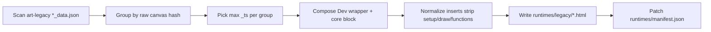
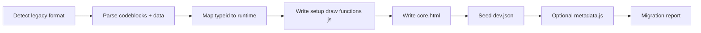
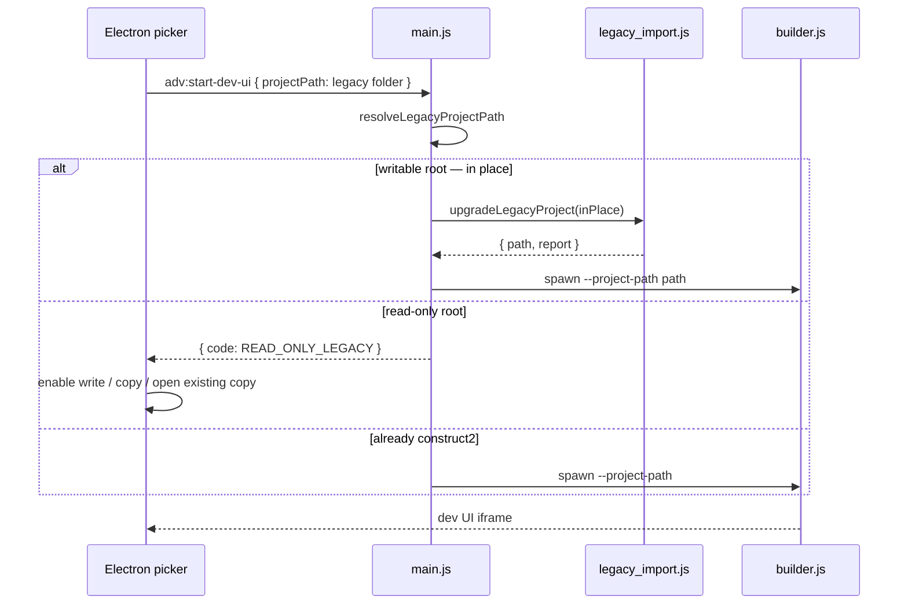

# Construct² — Projects startup screen & legacy import

**Version:** 1.2  
**Date:** June 2026  
**Status:** Workspace + multi-root + unified project tree UI **implemented**; lazy legacy in-place upgrade + read-only policy **implemented**; Phase E5 (runtime dropdown + selection model) **implemented**; shell UX polish (in-app dialogs, window state, Explorer integration) **implemented**  
**Related:** [STAGING.md](../STAGING.md) §4.2, [CORE.md](./CORE.md) §6, [PROJECT-ORGANIZATION.md](../../../art/docs/PROJECT-ORGANIZATION.md) §7, [NEXT-WORK-PLAN.md](./NEXT-WORK-PLAN.md) (Tracks A–C complete)

---

## 1. Executive summary

The Electron startup screen uses a **unified project tree**: multi-root workspace, fuzzy search, pins, a two-column details panel, context menus, drag-drop, and shared start-page / dev-rail chrome. Legacy projects from `art-legacy/` appear in the same list; opening dev UI runs an **in-place upgrade** on writable roots (read-only roots require explicit enable-write or copy — no silent mirror to `art/`).

This document specifies:

1. **Workspace model** — persisted multi-root configuration, pins, expanded root
2. **Unified tree UI** — accordion roots, recents, search, details panel, dev rail
3. **Builder path resolution** — absolute project path via CLI, env, or IPC
4. **Project templates** — `templates/projects/` scaffolds per runtime
5. **Legacy import** — migrate Construct v1 `*_data.json` projects; in-place upgrade + re-convert
6. **Lazy legacy open** — conversion on first **Open dev UI** (writable roots) or explicit user choice (read-only)
7. **Runtime picker** — dev UI `<select>`; shared cores vs project `core.html` without overwriting disk (**implemented** — §4.9)

**Non-goals (v1):** nested discovery beyond one level per root, git integration, cloud sync.

---

## 2. Historical baseline (pre–Phase A)

*Superseded by §4 unified tree. Kept for context.*

| Piece | Location | Behavior |
|-------|----------|----------|
| UI | `electron/renderer/index.html` | Flat list + Open dev UI / Stop |
| Discovery | `electron/main.js` | Scans `construct2/../../art` only |
| Heuristic | `setup.js` or `dev.json` | Skips `docs`, hidden dirs |
| Selection | In-memory | Not persisted across restarts |
| Dev server | `adv:start-dev-ui` | `node builder.js <name>` — name only |

**Partial templates today:** `templates/metadata.js.default`, `collection.js.default`, `DRIVERS_README.txt` — seeded **after** open via HTTP, not at project creation.

**Runtimes today:** `runtimes/cc-v3.23.html` (3.23) and `runtimes/cc-v3.22.html` (3.22, hidden in the dropdown). Older `runtime: "cc-v3"` aliases 3.23.

---

## 3. Workspace model

### 3.1 Config file

**Path:** `{userData}/workspace.json` (Electron `app.getPath("userData")`).

CLI scripts use `ADVBUILDER_USER_DATA` when set (same folder Electron passes to the builder child).

### 3.2 Schema

```json
{
  "version": 1,
  "roots": [
    {
      "id": "art",
      "path": "/Users/you/Art",
      "label": "Active art",
      "enabled": true,
      "readOnly": false
    },
    {
      "id": "legacy",
      "path": "/Users/you/Art-legacy",
      "label": "Legacy archive",
      "enabled": true,
      "readOnly": true
    }
  ],
  "recentProjects": [
    { "name": "AsciiCore", "rootId": "art", "path": "/Users/you/Art/AsciiCore", "openedAt": "2026-06-18T12:00:00.000Z" }
  ],
  "pinnedProjects": {
    "art": [{ "name": "AsciiCore", "path": "/Users/you/Art/AsciiCore" }]
  },
  "expandedRootId": "art",
  "lastSelected": { "rootId": "art", "name": "AsciiCore", "path": "/Users/you/Art/AsciiCore" }
}
```

### 3.3 Defaults on first launch

When no `workspace.json` exists and the app runs from a dev checkout (`construct2/../../art` exists), pre-seed:

- `art` → `../../art` (resolved absolute)
- `legacy` → `../../art-legacy` (resolved, `readOnly: true`)

Otherwise start with an empty `roots` array; user adds folders via **Add folder…**.

### 3.4 Path guards

- A project path must resolve **under** an enabled root (`path.relative` — no `..` escape).
- `readOnly` roots: list + open dev UI allowed when writable or after explicit enable-write / copy; **no silent mirror** to `art/` (see §7.8.5).
- `pinnedProjects`: per-root ordered pin list; paths validated on load; missing folders dropped.
- `expandedRootId`: which root accordion is open in the unified tree (single-expand).

### 3.5 Environment overrides (CLI parity)

| Variable | Purpose |
|----------|---------|
| `ADVBUILDER_PROJECT_PATH` | Absolute path to open project (highest priority) |
| `ADVBUILDER_ART_ROOT` | Root directory when using `node builder.js <name>` |
| `ADVBUILDER_USER_DATA` | Workspace + secrets directory |

---

## 4. Startup screen UX (unified project tree)

The picker is a **single scrollable tree** shared by the start page and the dev rail. UI modules live outside the monolithic `index.html` shell:

| Module | Role |
|--------|------|
| `electron/renderer/project_tree.js` + `project_tree.css` | Accordion roots, back bar, pins, recents, search results, context menus, drag-drop; auto-hiding scrollbars |
| `electron/renderer/project_search.js` | Tiered fuzzy scorer (debounced, chunked) |
| `electron/renderer/project_details.js` | Start-page right panel (source list badges: `(lib)`, effective core label; Explorer actions) |
| `electron/renderer/app_dialog.js` | In-app confirm dialog (`showAppConfirm`) — HTML `<dialog>`, not native `confirm()` |
| `project_inspect.js` | Main-process metadata aggregation for details panel |
| `source_inventory.js` | Canonical source list + transitive `//import<>` inventory for inspect panel (`absPath` per file) |

### 4.1 Layout

**Start page** (`#view-picker`):

```
.picker-body
├── .tree-panel (~320px)     → #project-tree-start
│   ├── [quick search]
│   ├── [ recent ]           ← last 10 opens
│   ├── [ art/ ]             ← root folder tile
│   │   ▌ [ pinned project ]   ← gradient back column (no glyph)
│   │   ▌ [ project ]
│   └── [ art-legacy/ ]
└── .details-panel (flex 1)  → #project-details (two columns: identity left, files/outputs right)
```

**Dev rail** (`#projects-rail`): same `ProjectTree` class in `mode: 'dev'` — tree only, no details panel. One shared `#tree-actions` bar moves between start panel and rail.

| Mode | Click behaviour | Extra chrome |
|------|-----------------|--------------|
| **Start** | 1st click = select + details; 2nd click (or Open dev UI) = open | New, Add root; pin in details panel |
| **Dev rail** | 1 click = switch project (restart builder) | Slim back bar when a root is expanded |

**Accordion:** only one expanded root at a time. **Back bar:** narrow gradient column (`.project-tree-back-col`) left of project rows collapses the expanded root — no chevron glyph; hover brightens the strip toward the list. **Pins:** per-root ordered list at top of expanded group (separator before unpinned). **Recents:** `recent/` pseudo-folder, first in tree, max 10.

**Pin affordance:** pinned rows show **pinned** in the top-right corner of the project button (small, 60% opacity). Details panel title row has **Open**, **Open in Explorer** (folder icon), and **Pin/Unpin** inline after the project name.

**Scrollbars:** project tree, details panel, dev-ui left scroll / modals / piece list, and visualiser shell scroll regions (`.raw-pre`, `.preview-scroll`, `.analysis-body`, `.expert-pre` in [`visualise_views.js`](../visualise_views.js)) use the same auto-hiding thin scrollbar — transparent until hover, focus, or active scroll (`is-scrolling` class via `.thin-scroll`).

### 4.2 Quick search

- Case-insensitive tiered scorer: exact prefix → substring → loose subsequence; floor score 0.35.
- Debounce 120ms; score in chunks of ~50 projects via `requestAnimationFrame`.
- Search mode replaces tree body with flat ranked results (root label in meta); clearing restores accordion.

### 4.3 Details panel

Populated via `adv:get-project-details` → `project_inspect.js` → [`source_inventory.js`](../source_inventory.js):

| Column | Sections |
|--------|----------|
| **Left** | Identity, Flags, Collections, Legacy provenance |
| **Right** | Source files — canonical codeblocks (`cert.js`, `setup.js`, …), transitive `//import<>` modules (project + `construct2/lib/`, shown with `(lib)` tag), effective core label when a shared runtime is selected; build outputs (`output.output.html`, metadata JSON) |

**Source files list:** derived from the same inventory as builder watch, param scan, and collection `_source/` snapshots — not a separate hardcoded subset. Each row is a **button**; click opens Explorer with that file selected (`adv:reveal-in-explorer` with `absPath` + `mode: "select"`). Lib imports outside the project folder are allowed when under `construct2/lib/`. `dev.json` is **not** listed here (provenance/flags only). Legacy `*_data.json` may appear when present.

**Open in Explorer:** folder button (and context menu **Open in Explorer**) opens the **project folder** (`shell.openPath`), not the parent directory.

Provenance includes `dataFile`, `dataFileMtime`, `upgradedAt`, and **legacy data newer than last upgrade** when `*_data.json` mtime exceeds last convert.

Read-only projects (demos and legacy) show a **Duplicate** button in the details header (and tree actions). That copies into the writable root and opens the copy. Legacy read-only roots also keep **Enable write on root**.

### 4.4 Context menus

Native Electron menu via `adv:show-context-menu`. Destructive or branching actions in the shell use **in-app HTML confirms** (`showAppConfirm` in `app_dialog.js`) — not `window.confirm()` — so keyboard focus stays in the renderer on Windows after re-convert, remove-root, convert-all-legacy, and collision-rename flows.

**Project:** Open dev UI · Open in Explorer (project folder) · Open in browser (`output.output.html`) · Open legacy in browser · Re-convert from legacy · Duplicate to my projects (read-only) · Pin/Unpin

**Root folder:** Convert all (legacy) · Open in Explorer · Remove root · Enable write (if readOnly)

### 4.5 Drag and drop

OS folder drops on the tree scroll area:

| Hover target | Action |
|--------------|--------|
| Collapsed root tile | Copy project into that root |
| Expanded project area | Copy into expanded root |
| Neutral / empty zone | Add folder as workspace root |

Validation: `isConstruct2ProjectDir` or `isLegacyProjectDir` only. Collision → in-app confirm dialog (skip / rename / cancel). Copy only, never move.

### 4.6 Header / footer actions

Primary chrome: **New project…**, **Add root…**. Import / Batch import dialogs remain available but are de-emphasized (power-user / bulk path). **Open dev UI** and **Stop server** removed from top bar — close dev UI from the embedded frame only.

All shell `<dialog>` elements (new project, import, batch import, confirm) share themed styling: darkened blurred `::backdrop` and drop shadow under the panel.

### 4.7 IPC channels

| Channel | Purpose |
|---------|---------|
| `adv:get-workspace` | Load `workspace.json` |
| `adv:patch-workspace` | Merge patch (roots, recent, pins, `expandedRootId`, `lastSelected`) |
| `adv:pick-folder` | Native directory dialog |
| `adv:list-projects` | `{ roots: [{ id, label, path, readOnly, projects[] }] }` — `kind: construct2 \| legacy` |
| `adv:list-templates` | Template manifest |
| `adv:create-project` | Scaffold new project |
| `adv:preview-legacy-import` | Parse legacy; migration report |
| `adv:import-legacy-project` | Explicit import to writable root |
| `adv:list-legacy-candidates` | Scan legacy root |
| `adv:batch-import-legacy` | Bulk import selected paths |
| `adv:convert-legacy-project` | Resolve + convert legacy path |
| `adv:start-dev-ui` | `{ projectPath }` — in-place upgrade or read-only policy (§7.8) |
| `adv:get-project-details` | Read-only aggregation for details panel |
| `adv:reveal-in-explorer` | Explorer integration: `{ path, mode: "folder" }` opens project directory; `{ absPath, projectPath, mode: "select" }` reveals a file (incl. lib imports) |
| `adv:reveal-root-in-explorer` | Open root folder |
| `adv:open-project-output` | Open `output.output.html` in default browser |
| `adv:open-legacy-browser` | Open legacy HTML from data json |
| `adv:pin-project` / `adv:unpin-project` | Per-root pin list |
| `adv:show-context-menu` | Native context menu (project or root) |
| `adv:add-workspace-root` | Append workspace root |
| `adv:import-project-folder` | Copy project folder into root |
| `adv:duplicate-project` | Copy a project into the default writable root (rename on clash) and return `{ path, name, rootId }` |
| `adv:probe-drop-folder` | Validate drop target |
| `adv:remove-workspace-root` | Remove root (non-destructive) |
| `adv:enable-root-write` | Set `readOnly: false` on root |
| `adv:reconvert-legacy-project` | Re-import from `*_data.json`; merge dev.json edits |
| `adv:convert-all-legacy-in-root` | In-place upgrade all legacy rows in writable root |
| `adv:get-projects-root` | **Deprecated** — first enabled root (compat) |
| `adv:list-runtimes` | `{ path }` → manifest list + `currentId` + `projectCore` info |
| `adv:set-project-runtime` | `{ path, runtimeId }` → persist selection (does not overwrite `core.html`) |

### 4.8 Legacy projects in the list

Legacy folders under a root (e.g. `art-legacy/`) are listed **alongside** Construct² projects — same row layout, different badge.

| Visual | Meaning |
|--------|---------|
| Yellow **legacy** mark | Folder contains `*_data.json` and is **not** yet a Construct² project (`setup.js` / `dev.json` absent) |
| `dev · setup` flags | Normal Construct² project |
| Orange **review** mark | Imported or legacy typeid flagged `needsReview` (GLSL, unknown typeid) |
| **pinned** (top-right) | Project pinned in this root |

**Tooltip** (hover on project row):

```
Construct legacy project
typeid: Playground.Square-1.0
runtime: Playground Square Canvas v1.0 (embedded)
target: cc-v3.22 after conversion
```

Tooltip fields (from lightweight parse of `*_data.json`, no full import):

| Field | Source |
|-------|--------|
| Human label | `name` in data json, else folder name |
| `typeid` | `typeid` field |
| Runtime family | **Project core** (canvas from `*_data.json`) |
| CC version | `ccVersion` from matched runtime manifest entry, or `embedded` |
| Review note | `needsReview` + `REVIEW_NOTES[typeid]` when set |

**Selection:** right-click selects the row before the menu opens. **Open dev UI** triggers lazy conversion (§7.8) instead of starting the builder on the legacy folder directly.

### 4.9 Dev UI runtime dropdown (Phase E5 — implemented)

Replaces the static top-bar title with a **runtime** `<select>` (`#runtime-select`) in `#seed-zoom-row` of `dev-ui.html`.

- Populated from `runtimes/manifest.json` — **Canvas Core** optgroup (`cc-v3.22` hidden from the list). Legacy shells are not shipped; imported v1 projects use **Project core** from the embedded `*_data.json` canvas.
- **Project core** option when `core.html` exists (labeled **(custom)** when its hash does not match any manifest entry)
- **Selection model:** changing runtime updates `project.json.runtime` and `dev.json.settings.selectedRuntime` only — does **not** overwrite project `core.html`
- **Shared runtime** selected → builds resolve canvas from `construct2/runtimes/<file>` (`project_runtime.js` → `getEffectiveSourceFiles()` in `builder.js`)
- **Project core** selected → builds use on-disk `<project>/core.html`
- Switch triggers rebuild (`POST /project/runtime` → `performBuild()`); `needsReview` legacy runtimes confirm before switch
- Embed mode (`?embed=1`): runtime dropdown in `#seed-zoom-row`; top bar has Projects tab + Close (§4.10)

**HTTP (`builder.js`):**

| Route | Purpose |
|-------|---------|
| `GET /runtimes` | Manifest list, `currentId`, `projectCore` info |
| `POST /project/runtime` | `{ runtimeId }` → persist selection, rebuild |

**Electron IPC:** `adv:list-runtimes`, `adv:set-project-runtime` — same semantics; dev UI uses HTTP while the builder child is running.

**Details panel:** `adv:get-project-details` includes **Active runtime** for Construct² projects (`project_inspect.js` → `summarizeSelectedRuntime()`).

**Collection `_source/`:** build pass snapshots the **effective** core (active selection), not a dormant on-disk `core.html` when a shared runtime is selected. Snapshot includes all transitive `//import<>` targets (project + lib, by project-relative path); stale files are pruned on each successful build pass. See [COLLECTION-DESIGN-V2.md](./COLLECTION-DESIGN-V2.md) §6.8.

**Implementation:** `project_runtime.js`, `builder.js`, `source_inventory.js`, `dev-ui.html`, `project_inspect.js`, `project_runtime.test.js`, `source_inventory.test.js`.

### 4.10 Dev UI embed chrome (Track B — implemented)

When dev UI loads in the Electron iframe (`?embed=1`):

| Feature | Behaviour |
|---------|-----------|
| **Projects tab** | Top-left tab toggles projects rail (`advBuilder:toggleProjectsRail`) |
| **Close** | Top bar, beside embed chrome; closes dev UI (`advBuilder:closeDev`) |
| **Offline badge** | In `#vis-area` over preview; click retries WebSocket |
| **Theme toggle** | `#vis-toolbar` (preview chrome); day/night synced via `advBuilder:theme` + `localStorage` |
| **Section help** | `?` overlay per panel (Collections, Parameters, Values, Properties) |
| **Window title** | `Construct² - art/Project` via `adv:set-window-title` IPC |

### 4.11 Shell persistence & window state

| Feature | Behaviour |
|---------|-----------|
| **Window bounds** | Persisted in `{userData}/window-state.json` — position, size, `isMaximized`, `isFullScreen` |
| **Save policy** | Bounds updated on resize/move only while the window is in **normal** state (not maximized/minimized/fullscreen); follows the [`electron-window-state`](https://github.com/mawie81/electron-window-state) pattern so maximize restores correctly |
| **Windows DPI** | Also saves `contentBounds`; restore prefers `setContentBounds()` on Windows for reliable size across mixed-DPI multi-monitor setups |
| **Validation** | Saved bounds must intersect a connected display; otherwise defaults to 1280×820 |
| **Work-area clamp** | On restore and after `ready-to-show`, bounds are clamped to the target display work area (size capped, position adjusted so the title bar stays reachable) via `clampBoundsToWorkArea()` |

Implementation: `electron/main.js` (`loadWindowState`, `syncWindowState`, `restoreWindowBounds`, `clampBoundsToWorkArea`).

## 5. Builder path resolution

`project_resolve.js` resolves project context at startup:

```
Priority:
1. --project-path <abs>
2. ADVBUILDER_PROJECT_PATH env
3. --root <abs> --project <name>
4. ADVBUILDER_ART_ROOT + argv[0] project name
5. Default: ../art/<name> (argv[0] or first template project)
```

Electron spawn:

```js
spawn(node, ["builder.js", "--project-path", projectPath], {
  env: { ...process.env, ADVBUILDER_PROJECT_PATH: projectPath, ... }
});
```

---

## 6. Project templates

### 6.1 Layout

```
construct2/templates/projects/
  manifest.json
  cc-v3-minimal/
    project.json
    setup.js, draw.js, functions.js, defs.js
    core.html          ← copied from runtimes/cc-v3.23.html at scaffold time
    metadata.js
  cc-v3-ascii/
    ... + AsciiCore import stub in setup.js
  cc-v3-collection/
    ... + collection.js
```

### 6.2 Template manifest

```json
{
  "version": 1,
  "templates": [
    {
      "id": "cc-v3-minimal",
      "label": "Canvas Core v3 — minimal",
      "runtime": "cc-v3.23",
      "description": "Blank 1000×1000 piece with metadata builder stub"
    }
  ]
}
```

### 6.3 Runtimes manifest

```
construct2/runtimes/
  manifest.json
  cc-v3.23.html        ← 3.23 (`cc-v3` is an alias)
  cc-v3.22.html        ← 3.22 (from cc3.html)
```

Alpha does **not** ship extracted v1 shells. `scripts/extract-legacy-runtimes.js` can still write `runtimes/legacy/` locally (gitignored). Import uses the per-project canvas in `*_data.json` as **Project core**.

```json
{
  "version": 1,
  "runtimes": [
    {
      "id": "cc-v3.23",
      "file": "cc-v3.23.html",
      "ccVersion": "3.23",
      "label": "Canvas Core v3.23",
      "aliases": ["cc-v3"],
      "legacyTypeIds": ["CanvasCore.v3-1.0", "Playground.Canvas.v3-1.0", "..."]
    },
    {
      "id": "legacy.playground-square",
      "file": "legacy/playground-square-1.0.html",
      "ccVersion": "1.0",
      "label": "Playground Square Canvas v1.0",
      "legacyTypeIds": ["Playground.Square-1.0"],
      "embedded": true
    }
  ]
}
```

### 6.4 CLI

```bash
node scripts/new-project.js MyPiece --root ../art --template cc-v3-minimal
```

### 6.5 Legacy runtime extraction (Phase E)

Most legacy projects embed a full `canvas` HTML string inside `*_data.json`. Construct² needs **shared runtime shells** so the dev UI dropdown is meaningful and imports do not duplicate 150+ near-identical Playground Square cores.

**Measured inventory** (`art-legacy/`, 220 folders with `*_data.json`):

| Metric | Value |
|--------|------:|
| Projects with `canvas` | 220 / 220 |
| Distinct `typeid` values | 15 |
| Distinct **raw `canvas` shells** (SHA-256) | **14** |
| Projects with `_ts` | 220 / 220 |

Within each `typeid`, every project shares the **same byte-identical** `canvas` string. Canonical source per shell = **max `_ts`** in the group (tie-break: folder name). The exception is **`CanvasCore.Dev2-1.0`**: Dev 2/3/4 share one wrapper canvas but **different `core` codeblocks** — extraction picks **Canvas Core Dev 4** (latest `_ts`) and inlines that `core` block at `//insert<core>`.

**14 extracted shells** (optional local extract only — not in the alpha package):

| File | typeid(s) | Projects |
|------|-----------|--------:|
| `playground-square-1.0.html` | `Playground.Square-1.0` | 151 |
| `curated-square-1.0.html` | `Curated.Square-1.0` | 18 |
| `canvas-core-v3.2.html` | `Curated.Canvas.v3-1.0`, `Playground.Canvas.v3-1.0` | 20 |
| `canvas-core-v3-1.0.html` | `CanvasCore.v3-1.0` | 9 |
| `auth-square-1.0.html` | `Auth.Square-1.0` | 5 |
| `canvas-core-v2-1.0.html` | `CanvasCore.v2-1.0` | 5 |
| `playground-cjam-square-1.0.html` | `Playground.CJam.Square-1.0` | 3 |
| `canvas-core-dev2-1.0.html` | `CanvasCore.Dev2-1.0` | 3 |
| + 6 singletons | Dev, dev.v3, Curated.Canvas.v3.dev, GLSL×2, shader_wars | 1 each |

**Extraction pipeline** (`scripts/extract-legacy-runtimes.js`):



1. Group by **raw SHA-256 of `canvas`** (not typeid alone) — merges Curated/Playground Canvas v3 into one file.
2. Canonical source = max `_ts`; for Dev family, inline latest `core` codeblock at `//insert<core>`.
3. Normalize inserts (`//insert<>`); strip resolved `setup` / `draw` / `functions` bodies to placeholders.
4. Parse `BlockGen.art` banner for label and `ccVersion`.
5. Write `runtimes/legacy/<slug>.html` + `manifest-snapshot.json`; `--write-manifest` patches `runtimes/manifest.json` with `legacyTypeIds`, `canvasHash`, `needsReview`.
6. **Import default (alpha):** write the embedded `*_data.json` canvas to `core.html` and select **Project core**. Shared `cc-v3` / `cc-v3.22` stay as dropdown entries for new work.

**Per-project override:** if a project's embedded canvas hash differs from the canonical shell (manifest.canvasHash), import falls back to per-project embedded core.html.

### 6.6 Runtime picker behaviour (Phase E5 — implemented)

| Project state | Dropdown shows | On change |
|---------------|----------------|-----------|
| Any Construct² project | Manifest runtimes + **Project core** if `core.html` exists | Persist `project.json.runtime`; rebuild with **effective** core |
| Custom `core.html` (hash ∉ manifest) | **Project core (custom)** + shared runtimes | Switch to shared runtime **without** modifying `core.html` |
| Scaffold (`core.html` copied at create) | Same — default selection usually manifest id from `project.json` | User can experiment with shared cores while keeping local copy |
| Legacy not yet converted | N/A until lazy convert | — |
| Post lazy-import | Imported default + alternatives | Persist to `project.json`; same selection model |

**HTTP (`builder.js`)** — parity with Electron IPC:

| Route | Purpose |
|-------|---------|
| `GET /runtimes` | Manifest list + current selection + `projectCore` metadata |
| `POST /project/runtime` | `{ runtimeId }` → persist selection, rebuild (no file swap) |

**Module:** `project_runtime.js` — `getStoredRuntimeId()`, `resolveEffectiveCoreContent()`, `setProjectRuntime()`.

---

## 7. Legacy import (`art-legacy/`)

### 7.1 Legacy on-disk format

```
art-legacy/Properties Example/
  Properties Example_data.json
  Properties Example_master.html
```

- `codeblocks[]` → `functions.js`, `setup.js`, `draw.js`
- `canvas` → `core.html` (insert markers normalized to `//insert<>`)
- `data.piece[]` / `data.collection[]` → `dev.json` `buildValueLevels.default`
- `typeid` → runtime mapping (see §7.3)
- Property syntax `//#<Prop:val>` — no change (PMaster parses legacy)

### 7.2 Migration pipeline



### 7.3 typeid → runtime mapping

| typeid | Target | Notes |
|--------|--------|-------|
| `Playground.Square-1.0` | Embedded `canvas` as `core.html` | v1 runtime; normalize inserts |
| `Playground.CJam.Square-1.0` | Embedded canvas | Same family |
| `Auth.Square-1.0` | Embedded canvas | Auth shell |
| `Curated.Square-1.0` | Embedded canvas | Curated square |
| `CanvasCore.v2-1.0` | Embedded canvas | CC v2 |
| `CanvasCore.v3-1.0` | `runtimes/cc-v3.22.html` or embedded | Match `cc_version` when present |
| `Playground.Canvas.v3-1.0` | `cc-v3.22.html` | CC3 playground |
| `Curated.Canvas.v3-1.0` | `cc-v3.22.html` | |
| `Curated.Canvas.v3.dev-1.0` | `cc-v3.22.html` | |
| `CanvasCore.Dev-1.0` | `cc-v3.22.html` | |
| `CanvasCore.Dev2-1.0` | `cc-v3.22.html` | |
| `CanvasCore.dev.v3-1.0` | `cc-v3.22.html` | |
| `Playground.Square.GLSL-1.0` | **manual** | Flag `needsReview` in report |
| `Playground.Square.GLSL.vertex-1.0` | **manual** | Flag `needsReview` |
| `shader_wars-1.0` | **manual** | Custom; sources only |

### 7.4 Compatibility bridges

| Legacy | Construct² | Bridge |
|--------|------------|--------|
| `//#<Prop:val>` | `//#<<Group>…>` | PMaster legacy parse (unchanged) |
| `/*[piece.x]*/` | `/*[values.x]*/` | Rewritten in migrated sources + core |
| `insert<setup>` | `//insert<setup>` | Normalized in `core.html` |
| `postMetaDataFn` | `metadata.js` | Generated `CreateMetadata` stub |
| Spaces in folder name | `kebab-case` slug | Importer uses `slugifyProjectName` |

### 7.5 Import modes

1. **Lazy on open** (default) — user picks legacy row → **Open dev UI** upgrades **in place** when root is writable (§7.8.5)
2. **Read-only root** — no silent copy; user enables write, copies to writable root, or opens existing converted copy (§7.8.5)
3. **Copy to writable root** (explicit) — **Import legacy…** / **Batch import…** / drag-drop / details-panel **Copy to writable root**
4. **Re-convert** — context menu **Re-convert from legacy** refreshes generated files from `*_data.json` while preserving user `dev.json` edits (Values, Properties, params)
5. **Register in place** (future) — sidecar `construct2.project.json` on legacy folder; builder reads through adapter

### 7.6 Validation

After import:

```bash
cd construct2
node builder.js --project-path ../art/properties-example
```

Compare preview to `*_master.html` (manual golden check for Phase C).

### 7.7 CLI

```bash
node scripts/import-legacy-project.js "../art-legacy/Properties Example" --root ../art --name properties-example
```

### 7.8 Unified discovery & lazy conversion (Phase E)

**Goal:** Legacy projects look like first-class citizens in the picker; conversion is **on demand** when the user opens dev UI — not a separate mental model (“import then find in art”).

#### 7.8.1 Discovery shape

Extend `listProjectsInRoot` (or parallel `listLegacyProjectsInRoot`) so each root returns **both** kinds:

```json
{
  "name": "properties-example",
  "path": "/Users/you/Art-legacy/Properties Example",
  "kind": "legacy",
  "legacy": {
    "dataFile": ".../Properties Example_data.json",
    "displayName": "Properties Example",
    "typeid": "Playground.Square-1.0",
    "runtimeId": "legacy.playground-square",
    "runtimeLabel": "Playground Square Canvas v1.0",
    "ccVersion": "1.0",
    "needsReview": false,
    "convertedPath": null
  },
  "flags": { "legacy": true }
}
```

Construct² project (unchanged apart from `kind: "construct2"`):

```json
{
  "name": "AsciiCore",
  "path": "/Users/you/Art/AsciiCore",
  "kind": "construct2",
  "flags": { "devJson": true, "setupJs": true, "needsReview": false }
}
```

**Detection rule:** directory contains `*_data.json` **and** lacks `setup.js` **and** lacks `dev.json` → `kind: "legacy"`. If both exist (re-imported), prefer `construct2`.

**Converted link:** `workspace.json` may store:

```json
"legacyConversions": {
  "/Users/you/Art-legacy/Properties Example": {
    "path": "/Users/you/Art/properties-example",
    "convertedAt": "2026-06-18T..."
  }
}
```

If `art/properties-example` already exists (by slug), `convertedPath` is pre-filled and tooltip shows **“Converted → art/properties-example”**.

#### 7.8.2 Lazy open flow



**UX during conversion:** status line “Converting …”; on `READ_ONLY_LEGACY` offer enable-write, copy, or open existing upgraded copy; on failure show `report.warnings` / error.

**Writable in-place:** legacy `*_data.json` stays in the original folder; generated files written alongside it.

**Re-convert:** `reconvertLegacyProject()` always refreshes `setup.js`, `draw.js`, `functions.js`, `core.html`, `metadata.js`, `cert.js` (when present in legacy codeblocks), and `settings.legacyImport` from `*_data.json`. Preserves `buildValueLevels`, `propertyLevels`, `paramValues`, `buildValueKeyOrder`, `buildValueCustomKeys` when present. **Collections are rebuilt by default** on re-convert (single collection from legacy `collectiondata[]`, named from project); pass `forceCollections: false` to skip.

#### 7.8.5 Read-only root policy (implemented)

| Root state | Behaviour |
|------------|-----------|
| **Writable** | `upgradeLegacyProject({ inPlace: true })` on first open; `*_data.json` retained |
| **Read-only** | `resolveLegacyProjectPath` returns `{ code: 'READ_ONLY_LEGACY', rootId, path, convertedPath? }` — **no silent mirror** to `art/` |
| **After enable-write** | Same project upgrades in place on retry |
| **Copy path** | `importProjectFolder` copies tree to writable root; open runs in-place upgrade on copy |

Provenance stored in `dev.json.settings.legacyImport` and `legacy-import.report.json`: `dataFile`, `dataFileMtime`, `upgradedAt`, `typeid`, `sourceDir`, `inPlace`.

Details panel flags when legacy data file is newer than `upgradedAt`.

#### 7.8.3 Conversion payload (reuse + extend Phase C)

Existing `importLegacyProject` already writes:

| Legacy source | Construct² file |
|---------------|-----------------|
| `codeblocks.functions` | `functions.js` |
| `codeblocks.setup` | `setup.js` |
| `codeblocks.draw` | `draw.js` |
| `codeblocks.certificate` / `cert` | `cert.js` |
| `canvas` or runtime file | `core.html` |
| `data.piece` / `data.collection` / `data.artist` | `dev.json` `buildValueLevels.default` |
| — | `metadata.js` stub |
| — | `legacy-import.report.json` |

**`collectiondata[]`:** imported via `importLegacyCollectionData` into collections v2 on-disk layout (`collections/NN/*.json`). Legacy rows are grouped into **one project-level collection** (Construct v1 only supported a single collection); `values.collection_name` uses the project name; per-piece names come from row data. Re-convert replaces existing `collections/` by default; lazy upgrade skips when collections already exist unless forced.

**Extra codeblocks:** legacy `certificate` / `cert` blocks are written to `cert.js` during import and re-convert (`resolveCertBlockContent` in `legacy_import.js`).

#### 7.8.4 Relationship to Import / Batch dialogs

| Tool | When to use |
|------|-------------|
| **Open dev UI** on legacy row | Default — single project, lazy convert |
| **Import legacy…** | Pick folder outside workspace roots; custom slug |
| **Batch import…** | Migrate many projects overnight without opening each |

Phase E does **not** remove batch import; it makes the happy path zero-friction.

---

## 8. Phasing & acceptance criteria

| Phase | Scope | Done when |
|-------|-------|-----------|
| **A** | Workspace + multi-root list + builder path + UI refresh | Open a project from `art/`; browse `art-legacy` as read-only root |
| **B** | `templates/projects/` + New project dialog + `new-project.js` | Create blank project and build successfully |
| **C** | `legacy_import.js` + Import UI + `import-legacy-project.js` | Import Properties Example → builds in Construct² |
| **D** | Extra templates, batch import, GLSL review workflow | D1–D3 largely done |
| **E** | Unified legacy list, lazy convert, runtime extraction, collections, runtime dropdown | **Done** (E1–E6) |
| **F** | Unified project tree UI | Single scroll tree, search, pins, details, context menus, DnD — **done** |

### 8.1 Phase D breakdown (done / partial)

| Sub-phase | Scope | Status |
|-----------|-------|--------|
| **D1 — Batch import** | Scan `art-legacy/`; checklist UI; CLI `--batch` | Done |
| **D2 — Review workflow** | `needsReview` badges; richer preview | Done — badges + tooltips in tree |
| **D3 — Extra templates** | `cc-v3.22-minimal` | Done |

### 8.2 Phase E breakdown

| Sub-phase | Scope | Status |
|-----------|-------|--------|
| **E1 — Unified discovery** | Legacy folders in `adv:list-projects`; `kind` + `legacy` metadata; yellow badge + tooltip | **Done** |
| **E2 — Lazy convert on open** | In-place upgrade on writable root; read-only policy | **Done** |
| **E3 — Collection import** | `collectiondata[]` → collections v2 on-disk layout | **Done** |
| **E4 — Runtime extraction** | `scripts/extract-legacy-runtimes.js`; `runtimes/legacy/*`; manifest `legacyTypeIds` | **Done** |
| **E5 — Runtime dropdown** | Dev UI `<select>`; `GET /runtimes`; `POST /project/runtime`; selection model; IPC parity; details panel | **Done** |
| **E6 — Import dialog cleanup** | De-emphasize batch as primary; tree + lazy open as happy path | **Done** |

### 8.3 Phase F — Unified project tree UI (done)

| Sub-phase | Scope | Status |
|-----------|-------|--------|
| **F1 — Schema + IPC** | `pinnedProjects`, `expandedRootId`, inspect/reveal/open/pin/context-menu/add-root/import | **Done** |
| **F2 — Shared tree** | `project_tree.js` accordion, back bar, pins, recents, start + dev rail modes | **Done** |
| **F3 — Search + details** | `project_search.js`, `project_details.js` two-column panel | **Done** |
| **F4 — Context menus + DnD** | Native menus, folder drop copy/add-root | **Done** |
| **F5 — Legacy policy** | Read-only block, reconvert merge, provenance `dataFileMtime`, cert.js + single-collection import | **Done** |
| **F6 — Docs + tests** | This document; `project_search.test.js`, `workspace_pins.test.js`, `project_inspect.test.js`, `legacy_readonly_policy.test.js`, `legacy_collection_import.test.js` | **Done** |
| **F7 — Shell UX** | In-app confirms, window state persistence, Explorer folder/file reveal, auto-hiding scrollbars | **Done** |

---

## 9. Implementation files

| Area | Files |
|------|-------|
| Design | `docs/PROJECTS-STARTUP-DESIGN.md` (this file) |
| Shared | `workspace.js`, `project_resolve.js`, `project_discovery.js` |
| Builder | `builder.js` (uses `project_resolve.js`) |
| Electron shell | `electron/main.js`, `electron/preload.js`, `electron/renderer/index.html`, `electron/renderer/app_dialog.js` |
| Electron tree UI | `electron/renderer/project_tree.js`, `project_tree.css`, `project_search.js`, `project_details.js` |
| Inspect | `project_inspect.js`, `source_inventory.js` |
| Templates | `templates/projects/**`, `runtimes/manifest.json` |
| Scripts | `scripts/new-project.js`, `scripts/import-legacy-project.js` |
| Import | `legacy_import.js` |
| Scaffold | `project_scaffold.js` |
| Runtimes | `runtimes/legacy/**`, `scripts/extract-legacy-runtimes.js`, `project_runtime.js` |
| Tests | `legacy_import.test.js`, `legacy_inplace.test.js`, `legacy_readonly_policy.test.js`, `legacy_collection_import.test.js`, `workspace_pins.test.js`, `project_search.test.js`, `project_inspect.test.js`, `source_inventory.test.js`, `project_runtime.test.js`, `collection_source_snapshot.test.js` |
| Runtime API (E5) | `builder.js` (`GET /runtimes`, `POST /project/runtime`), `dev-ui.html` (runtime `<select>`), `electron/main.js` (`adv:list-runtimes`, `adv:set-project-runtime`) |

---

## 10. Open questions (defaults chosen)

| Question | Default |
|----------|---------|
| Default roots in dev checkout | Pre-seed `art` + `art-legacy` (`art/`, `art-legacy/` labels) |
| Read-only legacy root editing | **No silent mirror**; enable-write, copy, or open existing converted copy |
| GLSL projects | `needsReview: true`; allow open with dev UI warning banner |
| Breaking `adv:list-projects` shape | `kind`, `legacy` fields; tree renderer handles both |
| Slug collision on lazy convert | In-place upgrade in writable root; copy path uses collision dialog |
| Runtime dropdown | Shared cores vs project `core.html`; selection in `project.json` — no disk overwrite (§4.9) |
| `collectiondata` on lazy convert | Imported on upgrade; re-convert rebuilds collections by default (single collection) |
| Deprecate explicit Import dialog | Keep for power users; tree + lazy open is primary path |
| Re-convert dev.json | Preserve Values/Properties/params; refresh generated sources + cert.js from `*_data.json` |

---

*Last updated: 2026-06-20 — Dev UI chrome (vis toolbar, seed/zoom row, Properties Random); tree back column gradient; window work-area clamp; see §4.1, §4.10, §4.11.*
