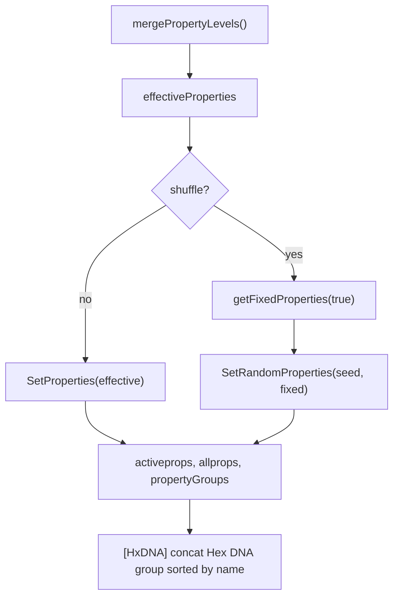

# Properties panel

The **Properties** panel in advBuilder (`dev-ui.html`) edits PropMaster V2 property choices discovered from `//#` markers in art source. It replaces the former split **Properties | Hex DNA | Debug** sections with one panel: a **level bar** (like [VALUES-PANEL.md](./VALUES-PANEL.md)) and **collapsible groups** (`base`, plus artist-defined groups).

---

## Authoring syntax

### Grouped property (v2)

```text
//#<<Hex DNA>chaos_core:iAA>
//#<<Debug>canvas_input:off>
```

| Part | Meaning |
|------|---------|
| `//#<<` | Grouped property opener |
| `Hex DNA` | Display group label (spaces allowed) |
| `>` | End of group segment |
| `chaos_core` | PropMaster **property name** (global key) |
| `:` | Separator before value |
| `iAA` | Choice value |
| `>` | Closing delimiter |

### Legacy property (v2, no group)

```text
//#<Mode:Calm>
//#<Palette_accent:warm>
```

Parsed as **base** group until the artist migrates to grouped syntax. Property name is the full token before the last `:` (supports names like `Wire Style`).

### Grouped property (v1 blocks)

Same shape inside v1 comment prefixes:

```text
//*#<<Hex DNA>iris_struct:aA>
/*#<<Hex DNA>iris_struct:aB>
```

### End markers

Unchanged: `//#` or `//#*/` closes a property block.

### JSON options (weighted random)

Optional JSON blob on the **same line** as a property opener:

```text
//#<<BG_Field>base_field:exp4> {"prob":8}
//*#<quant:smooth> {"prob": 8}
/*#<<Debug>res:500x500> {"prob":2}
```

| Field | Meaning |
|-------|---------|
| `prob` | Relative weight for `SetRandomProperties` (default `1`) |
| Other keys | Passed through on the property node (`property_options`) |

Grouped syntax **must** allow trailing JSON — otherwise the line mis-parses as legacy and can produce a phantom empty property name. Regression tests: `property_parse.test.js`.

Example inside a property branch (colour factory import):

```text
//*#<<Debug>colours:factory2>
  //import<colour_factory.js>
//#*/
```

### Group metadata (convention)

| Group label | Flags (scanner / UI) |
|-------------|----------------------|
| `Debug` | `pinOnRandom: true`, `lockUi: true` — always fixed on Random; lock cannot be toggled off via click |
| `Hex DNA` | `contributesToHxDna: true` — values concatenated into `[HxDNA]` insert (sorted by property name) |

Other group labels have no special flags unless extended later.

---

## Scan model

Each parsed property node carries:

- `property_name` — PropMaster key (e.g. `chaos_core`)
- `property_value` — choice token
- `property_group` — string or `null` (base)

Build output adds:

```json
{
  "allprops": { "accent": ["warm", "cool", "…"] },
  "activeprops": { "accent": "warm", "Mode": "Calm" },
  "propertyGroups": {
    "accent": "Palette",
    "canvas_input": "Debug",
    "Mode": null
  },
  "propertyGroupOrder": ["Hex DNA", "Debug"],
  "propertyGroupFlags": {
    "Debug": { "pinOnRandom": true, "lockUi": true },
    "Hex DNA": { "contributesToHxDna": true }
  }
}
```

`propertyGroupOrder` is **first-seen** order while scanning sources. `null` in `propertyGroups` means **base**.

**UI order:** the Properties panel renders **Debug** first (when the group exists), then **base**, then remaining groups in scan order — without changing `propertyGroupOrder` in build output.

---

## Merge levels (`propertyLevels`)

Stored in `dev.json` (alongside legacy `props.locks`):

```json
{
  "propertyLevels": {
    "viewer": {
      "Mode": { "value": "Calm", "use": true }
    },
    "collection": {},
    "piece": {},
    "override": {}
  },
  "propertiesActiveLevel": "viewer",
  "props": {
    "locks": { "Mode": true }
  }
}
```

| Level | UI label | Purpose | UI |
|-------|----------|---------|-----|
| `viewer` | **Viewer** | Root **single-piece** workspace (locks, mirror of last root build). Legacy JSON key `default` on load. | Active when no collection open |
| `collection` | Collection | `<pad2>.json` `propertyOverrides` — **all pieces** in collection (e.g. debug on for testing) | Active when collection open |
| `piece` | Piece | `pieceRecord.properties` + `fixedProperties` | Active when exactly one piece selected |
| `override` | Override | `dev.json` — per-piece tweaks without changing collection definition; snapshotted to `pieceRecord.overrideProperties` on build | **Disabled** until a collection is open |
| `result` | Result | Merged preview (read-only) | Always |

**Not the same as Values `default`.** Values `default` is project insert defaults and **does** apply to collection piece builds. Properties **viewer** does **not** — see [COLLECTION-DESIGN-V2.md](./COLLECTION-DESIGN-V2.md) §5.0.

**Not the same as Values `override`.** Values **override** still applies to root single-piece builds. Properties **override** is **collection-only**: it lets you override property choices on individual pieces (or batches) without editing the collection manifest; it is **not** merged into root `output.*` builds.

### Single-piece (root `output.*`) build

`fixedMap` for `SetRandomProperties` includes **viewer** only (`use: true` keys) plus lock/Debug rules (see below). **Override is excluded** — implemented via `getRootFixedProperties` when `collectionContext` is closed.

### Collection piece build ([COLLECTION-DESIGN-V2.md](./COLLECTION-DESIGN-V2.md))

Before each build, live **Override** panel entries are snapshotted to `pieceRecord.overrideProperties`. The build uses that snapshot (not live `dev.json` directly):

```javascript
// snapshot first (each build / random / build all)
pieceRecord.overrideProperties = snapshotOverrideProperties(dev.propertyLevels.override);

fixedMap = {
  ...collection.fixedProperties,
  ...pieceRecord.fixedProperties,
  ...flatUseTrue(collection.propertyOverrides),
  ...flatUseTrue(pieceRecord.overrideProperties),
  // viewer excluded
};
SetRandomProperties(pieceRecord.seed, fixedMap);
```

**Result** preview when collection open: `override` → `collection.propertyOverrides` → `piece.propertyOverrides` (viewer excluded). In viewer workspace, **result** merges **viewer** only.

Keys with `use: false` at every included level are **not** in `fixedMap`; at build they are chosen by **seed + weighted random**. On **Random** in the panel, unticked rows stay at merged **result** (see below).

---

## Lock vs use vs Random

| State | Normal build | Random (`POST /random`) |
|-------|--------------|-------------------------|
| **viewer** level (implicit use; legacy `default`) | All keys in viewer bag merge (`use` always on) | Only **locked** / **Debug** → `fixedProperties`; unlocked keys re-roll |
| **use** on at active level (override, etc.) | Value from merge → `SetProperties` | **Ticked + unlocked** → re-roll; written back to this level |
| **use** off at active level | Not in merge; row greyed (shows merged below) | Fixed to **merged** value (no roll) |
| **lock** on | Choice fixed in UI | Always in `fixedProperties` |
| **Debug** group (`lockUi`) | Lock UI always “locked” styling | Always in `fixedProperties` |

**Random** at **viewer**: `fixedProperties` = **locked** + **Debug** only.

**Random** at **override** / **collection** / **piece**:

- **Unticked** (no **use** at this level) → fixed to **merged** value from levels below (same as locked for Random); UI row is **greyed out**.
- **Ticked + locked** → fixed at this level’s value.
- **Ticked + unlocked** → re-rolled; new values written back into this level after build.

Everything not in `fixedProperties` is re-rolled by `SetRandomProperties(seed, fixed)`.

**Normal build** (not Random): `SetProperties(mergePropertyLevels())` then validate — no random roll for keys present in the merge.

After **every successful root build** (including normal edits, group shuffle, and global Random), **Final properties** (`activeprops`) are written back into `propertyLevels` at `propertiesActiveLevel` via `applyActivePropsToActiveLevel`. On global **Random** only, properties that were fixed (locked / Debug / unticked) are skipped so user intent is preserved.

**Why:** PropMaster properties are **hierarchical** — changing one choice can enable, disable, or prune other properties. The UI may show optimistic picks before the build finishes; the post-build sync ensures the panel matches ArtBuilder’s resolved `activeprops` and `allprops`.

**Collection piece builds:** `hydrateCollectionEditor()` resets the **piece** level bag from `pieceRecord.properties` and sets `state.collectionPieceBuildMeta` (broadcast to the client) so choice strips use the latest `lastBuiltAllprops` without reloading the whole collection JSON on every WS `update`.

---

## Build pipeline



1. `mergePropertyLevels(state.propertyLevels)` → flat property map  
2. `resolveArtBuilderValues(fixed, seed)` — Values panel merge unchanged  
3. `ArtBuilder` / PropMaster applies properties  
4. Post-process: `[HxDNA]` = concatenation of **active** values for properties in group **`Hex DNA`**, keys sorted alphabetically  

---

## UI (`dev-ui.html`)

| Control | Behaviour |
|---------|-----------|
| Level bar | `viewer`, `collection`, `piece` (disabled until collection / piece selected), `override` (disabled until collection open), read-only `result`. Switching to an **editable** level triggers a **rebuild** (root only) so the preview matches that level’s effective property merge (`result` does not rebuild). |
| **use** checkbox | Per property, per level — participates in merge when checked (hidden on **viewer**; implicit **use**). On **override** / **collection** / **piece**, unticked rows are **greyed** and non-editable until **use** is on |
| Group accordion | **Debug** first (when present), then **base**, then each remaining label in `propertyGroupOrder`. Expand/collapse state is kept when switching levels |
| **Group Random** | Small button on each group header (hidden on **result** or when no unlocked props in group). **Quick shuffle:** uniform random pick per **unlocked, active** property in that group — client-side only (same as clicking property names), **not** weighted `SetRandomProperties`. Updates UI immediately, then one batch server call + rebuild. Respects locks, Debug `lockUi`, and greyed (unticked) rows at collection/piece/override levels. |
| Choice strip | Nudge, name click shuffle, choice buttons |
| Lock | Click active choice toggles lock (except Debug group) |
| **Random** (Properties section toolbar) | `#btn-props-random` (`.props-toolbar-random`) — left of **?** in the Properties section toolbar; `POST /random` — global weighted shuffle via ArtBuilder (`SetRandomProperties`). In collection + one piece + **piece** level → collection reshuffle (§6.10 in [COLLECTION-DESIGN-V2.md](./COLLECTION-DESIGN-V2.md)). |

---

## HTTP API

### `POST /propertyLevels`

```json
{
  "level": "viewer",
  "patch": { "Mode": { "value": "Calm", "use": true } },
  "activeLevel": "override",
  "rebuild": true
}
```

Response includes `propertyLevels`, `propertiesActiveLevel`, `merged`, `props`.

### `POST /updateProps`

Legacy path; still updates `props.locks` and level patch for the active property when changing choice/lock from the UI.

### `POST /random`

Triggers `performBuild(true)` (shuffle).

---

## `[HxDNA]` replacement

After build, any string output field replaces `[HxDNA]` with the concatenation of **active** values for properties whose group is **`Hex DNA`**, in **sorted property name** order. Unmigrated `HxDNA_*` names in **base** are **not** included unless the property is assigned to the Hex DNA group in source.

---

## Artist migration checklist

1. Replace `//#<HxDNA_name:value>` with `//#<<Hex DNA>name:value>`.
2. Replace `//#<debug_name:value>` with `//#<<Debug>name:value>`.
3. Update v1 blocks: `/*#<HxDNA_…>` → `/*#<<Hex DNA>…>`.
4. Re-open dev UI after migration — old `props.current` keys may not match new names; locks reset for renamed keys.
5. Confirm cert/metadata still show correct `[HxDNA]` after rebuild.

### Example migration (grouped properties)

| File | Change |
|------|--------|
| `functions.js` | All `HxDNA_*` markers → `<<Hex DNA>>` short names |
| `core.html` | `debug_*` → `<<Debug>>` |
| `setup.js` | `debug_*` → `<<Debug>>` |

`defs.js` colour-mode markers use `<<Debug>colours:…>` where active. Legacy `saved/*.html` snapshots are not migrated.

---

## Status

Implemented in **advBuilder** (2025). Classic `.builder` still uses the old split panel until ported ([STAGING.md](../STAGING.md) §7).

---

## Related docs

- [VALUES-PANEL.md](./VALUES-PANEL.md) — flat build inserts (separate from properties)
- [PROPERTY-ANALYSIS.md](./PROPERTY-ANALYSIS.md) — distribution sampler; group hide filters
- [COLLECTION-DESIGN-V2.md](./COLLECTION-DESIGN-V2.md) — collections, `propertyOverrides`, viewer vs collection build
- [COLLECTION-DESIGN.md](./COLLECTION-DESIGN.md) — v1 reference only
- [PARAM-SPEC.md](./PARAM-SPEC.md) §7 — left panel layout

---

## `dev.json` state

| Key | Role |
|-----|------|
| `propertyLevels` | Per-level `{ value, use }` bags |
| `propertiesActiveLevel` | UI level bar selection |
| `props.current` | Last build **activeprops** (legacy mirror) |
| `props.locks` | Per-property lock flags |
| `lastBuild.propertyGroups` | From scan (not persisted separately; rebuilt each build) |
| `collectionPieceBuildMeta` | When one piece selected after a piece build: `{ pieceId, properties, lastBuiltAllprops, … }` — keeps Properties panel in sync with hierarchical build output |

---

## Corner cases

| Scenario | Behaviour |
|----------|-----------|
| **Group Random vs global Random** | Group = instant uniform picks + normal rebuild. Global = weighted PM2 roll + new seed on shuffle. |
| **Hierarchical props** | Optimistic UI may differ from final build; post-build sync overwrites active level from `activeprops`. |
| **Viewer solo random with collection closed** | Root `performBuild` only. Collections stay **green** unless art **source fingerprint** changed (§6.8) — viewer prop/seed edits do **not** orange collection pieces. |
| **Group Random in collection** | At **piece** level → debounced piece rebuild. At **collection** level → patch only (no rebuild until **Build**). |
| **Override level** | Group shuffle uses `/updateProps` path (same as single-prop edits at override when collection closed is N/A). |
| **Result level** | Group Random hidden; read-only. |
| **Debug group** | All props pinned; Random button omitted when nothing shuffleable. |
| **Multi-piece select** | Properties panel disabled; group Random not shown. |

---

## Implementation files

| File | Role |
|------|------|
| `builder.pmaster.v2.js` | `ParseLine` grouped syntax (+ JSON options), `CollectPropertyGroups`, `PROPERTY_GROUP_FLAGS` |
| `builder.pmaster_process.js` | `propertyGroups` on ArtBuilder output; `expandProjectSourcesForBuild` before inserts |
| `import_resolve.js` | `//import` expand, watch graph, scanner bundles |
| `source_inventory.js` | Canonical source names; startup inspect inventory; shared with builder and collection snapshot |
| `builder.js` | `mergePropertyLevels`, `getFixedProperties`, `applyActivePropsToActiveLevel`, `refreshImportWatchPaths`, `maybeInvalidateCollectionsOnSourceChange`, `setCollectionPieceBuildMeta`, `POST /propertyLevels` |
| `dev-ui.html` | Unified panel, level bar, group accordions, **group Random**, `shufflePropertyGroup`, rebuild overlay |
| `collection_ui.js` | Batch build overlay progress, `syncActiveCollectionFromState` |
| `property_parse.test.js` | Parser / group scan / JSON options tests (`npm run test:param`) |
| `import_resolve.test.js` | Import path resolve, chaining, cycle detection (`npm run test:param`) |
| `source_inventory.test.js` | Canonical list parity, inspect inventory (`npm run test:source-inventory`) |
| `visualise_analysis_client.js` | Analysis filters by group label |

---

## Manual verification

1. Unmigrated markers → all properties under **base**.
2. Grouped markers → **Hex DNA** / **Debug** accordions; short names in `allprops`.
3. Root workspace: **override** level greyed out; **result** shows **viewer** merge only.
4. Collection open: **override** selectable; unticked rows greyed on **override** / **collection** / **piece**.
5. **Random** on **viewer**: locked stay; unlocked change; UI updates.
6. **Random** on **override** (collection open): ticked+unlocked change; unticked stay at merged value.
7. **result** shows merged stack; no rebuild when selecting **result**.
8. Group expand/collapse survives level switches.
9. `[HxDNA]` matches sorted Hex DNA group values.
10. Reload — `propertyLevels` and locks persist in `dev.json`.
11. **Group Random** — only unlocked props in that group change; UI instant, then matches build after overlay clears.
12. Close collection → viewer group/global Random → reopen collection — pieces stay green if source unchanged.
