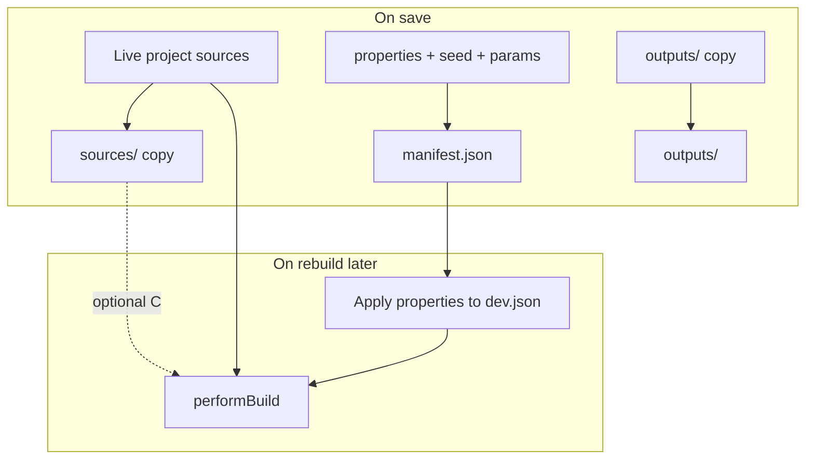

# Saved pieces mode — design examination

**Status:** design / not implemented  
**Related:** [VISUALISER.md](./VISUALISER.md), [COLLECTION-DESIGN.md](./COLLECTION-DESIGN.md), [PROPERTY-ANALYSIS.md](./PROPERTY-ANALYSIS.md)

This document captures requirements, trade-offs, open questions, and a phased path for **saving development snapshots** of a piece in advBuilder. It is separate from **Collection** mode (many mint-oriented pieces); Saved is about **preserving one moment in development** when source code will change later.

---

## 1. Intent

**Goals:**

- Save the current piece to `project/saved/<name>/` with enough material to **view it later** and **attempt a rebuild** with newer source using the same property choices.
- **Saved** visualiser mode to browse and preview saved folders.
- Keyboard shortcuts and a **File** menu: Save piece, Save piece as.
- Sensible default save name; user can rename via dialog.

**Why it exists (from notes):**

> “Long after code has been changed and the piece is no longer buildable.”

So the save must include **runnable output** (archive), not only property JSON.

**Non-goals for v1:**

- Version control / diff UI for source.
- Cloud sync.
- Replacing Collection batch outputs.

---

## 2. Relationship to existing `saved/` folders

Projects may already have a flat folder:

```
<project>/saved/
  MyPiece(good-run).html
  …
```

| Aspect | Legacy `saved/*.html` | Proposed structured save |
|--------|----------------------|---------------------------|
| Layout | Single minified HTML per file | Folder per save with manifest + sources + outputs |
| Properties | Not stored | `manifest.properties` from ArtBuilder; future: `propertyLevels` shape per [PROPERTIES-PANEL.md](./PROPERTIES-PANEL.md) |
| Sources | Not stored | Optional `sources/` snapshot |
| Metadata / utf8 | Embedded in HTML only | Optional `outputs/` copies |
| advBuilder integration | None | First-class mode + API |

**Migration (optional later):** import legacy HTML as `saved/<basename>/outputs/output_min.html` with `manifest.legacy: true` and no rebuild data.

---

## 3. What to save

### 3.1 Minimum viable snapshot

| Artifact | Purpose |
|----------|---------|
| **`manifest.json`** | Name, timestamp, seed, `properties`, `locks`, `paramValues`, build metadata |
| **`outputs/output_min.html`** (or full `output.html`) | Guaranteed viewable art |
| **`outputs/output.utf8link.txt`** (optional) | Address-bar / pool.pm test |

### 3.2 Full snapshot (recommended default)

| Artifact | Purpose |
|----------|---------|
| All of §3.1 | |
| **`sources/`** — copy of canonical codeblocks (`core.html`, `setup.js`, `defs.js`, `functions.js`, `draw.js`, `cert.js`, `metadata.js`) **plus** transitive `//import<>` modules (same layout as collection `_source/`) | Time capsule; diff vs live |
| **`outputs/`** — metadata JSON, errors, params md if present | Complete build record |
| **`manifest.activeprops` / `allprops`** | Rebuild UI parity in dev-ui |

### 3.3 Save without successful build?

| Policy | Pros | Cons |
|--------|------|------|
| **Require lastBuild** | Always have outputs | Cannot save mid-edit after syntax break |
| **Allow save without build** | Save props + sources during WIP | No guaranteed preview until next successful build |

**Recommendation:** **Allow save without build** — always copy **sources** + current `props` / `paramValues` / `seed`; include `outputs/` only if `lastBuild` exists; set `manifest.buildStatus: "none" | "ok" | "partial"`.

---

## 4. Folder layout (draft)

```
<project>/saved/<slug>/
  manifest.json
  sources/
    core.html
    setup.js
    defs.js
    functions.js
    draw.js
    cert.js
    metadata.js
    colour_factory.js   # example //import<> module
    …
  outputs/
    output.output.html
    output.output_min.html
    output.metadata.json
    output.metadata_min.json
    output.metadata.readable.json   ← when CreateMetadata returns multiple files
    output.utf8link.txt
    output.errors.json
    output.params.md
  README.txt          # optional user note
```

### 4.1 `manifest.json` (draft)

```json
{
  "name": "Mode-Calm_seed42",
  "slug": "mode-calm_seed42",
  "createdAt": "2026-05-16T12:00:00.000Z",
  "project": "MyProject",
  "seed": 42,
  "properties": {},
  "locks": {},
  "paramValues": {},
  "activeprops": {},
  "allprops": {},
  "freezeSources": true,
  "buildStatus": "ok",
  "advBuilderVersion": "fork",
  "notes": ""
}
```

**Slug rules:** filesystem-safe; dedupe with `-2`, `-3` if name collides.

### 4.2 Default name generation

Examples (pick one style in implementation):

- `{Theme}-{Mode}_seed{seed}_{YYYY-MM-DD}`
- `{metadata.name}` if last build exists
- `Piece-{NNN}` sequential

Show editable field pre-filled in Save dialog.

---

## 5. Rebuild strategies (core tension)

| Strategy | What it means | When to use |
|----------|---------------|-------------|
| **A. Archive primary** | Saved HTML/utf8 always runnable | Viewing old art forever |
| **B. Rebuild with live sources** | `manifest.properties` + **current** project files → `performBuild` | “Same choices, latest code” |
| **C. Rebuild with frozen sources** | Build using `saved/<slug>/sources/` only | True time capsule |



**Recommendation:**

- **Default save:** A + B data (outputs + manifest + sources copy).
- **Rebuild action:** **B** — load properties into workspace, run normal build against **live** sources.
- **Optional checkbox on save:** “Freeze sources” sets `freezeSources: true`; **C** rebuild uses temp project path pointing at `sources/`.

Document in manifest when **B** rebuild may diverge (e.g. project-specific metadata hooks in `builder.js` changed).

---

## 6. User interface

### 6.1 Visualiser mode: Saved

New radio **Saved** (or separate browser panel):

- List saved folders (name, date, seed, thumbnail if available).
- Select entry → preview `outputs/output_min.html` or utf8 Run tab (reuse patterns from [VISUALISER.md](./VISUALISER.md)).
- Actions: **Open in workspace** (load props/seed into `dev.json`), **Rebuild from manifest**, **Reveal folder** (Electron).

Does **not** batch-build many pieces (see [COLLECTION-DESIGN.md](./COLLECTION-DESIGN.md)).

### 6.2 File menu and shortcuts

Notes suggested:

- Ctrl+S → save with dialog  
- Ctrl+Shift+S → save immediately with last name + number  

**Recommendation (match desktop conventions):**

| Action | Shortcut | Behaviour |
|--------|----------|-----------|
| **Save piece** | **Ctrl+S** | Quick save: use last slug pattern `Name-001`, `Name-002` **or** re-save same slug if “save again” policy |
| **Save piece as…** | **Ctrl+Shift+S** | Always show name dialog |

Implement in [`dev-ui.html`](../dev-ui.html) `keydown` handler; when `?embed=1`, register same shortcuts in Electron `before-input-event` so they work inside the iframe focus.

**File menu** (Electron `Menu` or in-app menu bar):

- Save piece  
- Save piece as…  
- Open saved piece… (picker)  

Browser-only dev-ui: `window.prompt` or custom modal for name (no native menu).

### 6.3 Interaction with single-piece modes

When switching from **Saved** back to **Full** / **Min**:

- Same open question as Collection (restore workspace vs independent state).
- **Recommendation:** **Open in workspace** explicitly loads manifest into `dev.json`; mode switch alone does not auto-restore.

---

## 7. Backend API (sketch)

| Method | Path | Body / response |
|--------|------|-----------------|
| `GET` | `/saved` | List `{ slug, name, createdAt, buildStatus }[]` |
| `GET` | `/saved/:slug` | Full manifest + file listing |
| `POST` | `/saved` | `{ name?, freezeSources?, includeOutputs?, notes? }` → create folder |
| `DELETE` | `/saved/:slug` | Remove folder (confirm in UI) |
| `POST` | `/saved/:slug/rebuild` | Load props into state + `performBuild()` |
| `POST` | `/saved/:slug/restore` | Copy manifest seed/props/params to `dev.json` without build |

**Visualiser:** `GET /visualise?mode=saved` → `renderSavedViewer` (list + preview shell).

---

## 8. Issues and risks

| Issue | Detail | Mitigation |
|-------|--------|------------|
| **Disk size** | Full sources + outputs per save | Optional “outputs only” quick save; prune old saves UI |
| **Project-specific hooks** | Legacy `postMetaDataFn`, HxDNA replace in `builder.js` | Record `manifest.builderHooks: "<project>-v1"`; warn on rebuild |
| **Properties vs params** | Params may not affect built metadata | Save both; document limits in manifest |
| **No build at save** | Missing `outputs/` | Show placeholder in Saved preview; offer “build then save” |
| **Git** | Large binary-ish HTML in repo | Document `.gitignore` entry for `saved/` (artist choice) |
| **Path traversal** | `:slug` from user input | Strict slug validation; resolve under `project/saved` only |
| **Concurrent save** | Double Ctrl+S | Debounce; disable while save in flight |

---

## 9. Phasing (recommended)

| Phase | Scope | Outcome |
|-------|--------|---------|
| **S1** | `POST /saved` — write folder, manifest, sources, outputs | Can save from dev-ui button |
| **S2** | Saved visualiser mode — list + preview | Browse saves |
| **S3** | Restore + rebuild-from-manifest | Same props, new code |
| **S4** | Ctrl+S / Ctrl+Shift+S + File menu in Electron | Fast workflow |

**S5 (later):** diff sources vs live; import legacy flat HTML; export zip.

---

## 10. Open questions

1. **Quick save naming** — increment number on same base name, or always new folder?
2. **Re-save** — update existing slug vs create new version subfolder `saved/name/v2/`?
3. **Include analysis / node_graph** in manifest for reference?
4. **Auto-save** on successful build — desirable or noisy?
5. **Collection vs Saved** — can a collection piece be “saved” as snapshot? (cross-link workflows)

---

## 11. Recommendations (summary)

| Topic | Recommendation |
|-------|----------------|
| Folder layout | Structured `saved/<slug>/` with manifest + sources + outputs |
| Rebuild | Default **B** (live sources + saved properties); optional **C** via freezeSources |
| Shortcuts | Ctrl+S quick save, Ctrl+Shift+S Save As |
| Save without build | Yes — sources + props always; outputs when available |
| Legacy HTML | Optional import path; do not block new format |
| First implementation | **S1 + S2** — save + browse |

---

## 12. Related files (implementation touch list)

| File | Change (future) |
|------|-----------------|
| [`builder.js`](../builder.js) | `savePiece()`, routes, copy helpers |
| [`dev-ui.html`](../dev-ui.html) | Saved mode, shortcuts, save dialog |
| [`visualise_views.js`](../visualise_views.js) | `renderSavedViewer` |
| [`electron/main.js`](../electron/main.js) | Native save dialog; `adv:reveal-in-explorer` (project folder or selected file) |
| Project `.gitignore` | Optional `saved/` entry |

---

*Next step:* resolve quick-save vs Save As naming (§10.1–2), then implement **S1** (POST /saved + folder write).
