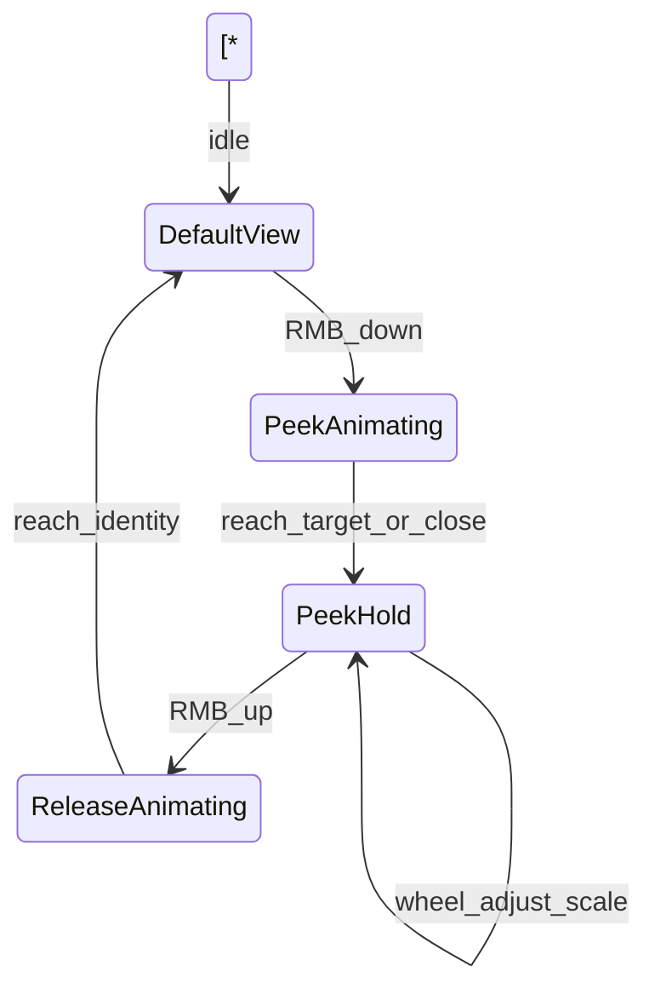
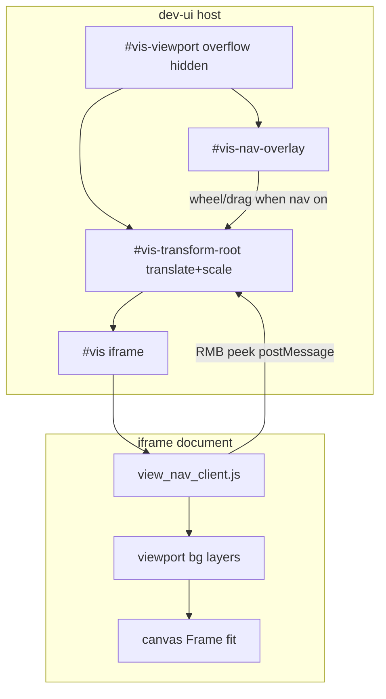

# View navigation controls — specification

**Status:** **Implemented** — F1.11 toolbar pan/zoom, Ctrl-hold, reset, fullscreen; F1.11b RMB peek zoom  
**Phase:** [FINAL-LAUNCH-PREP.md](./FINAL-LAUNCH-PREP.md) F1.11 / F1.11b (Phase 1 platform foundation — preview polish)  
**Related:** [VISUALISER.md](./VISUALISER.md), [VIEWPORT-BACKGROUND.md](./VIEWPORT-BACKGROUND.md), [CORE.md](./CORE.md) §6.2, [UI-COLOUR-REVIEW.md](./UI-COLOUR-REVIEW.md), [VISUALIZER-CONSOLE.md](./VISUALIZER-CONSOLE.md)

Dev-only controls for **panning, zooming, peek inspection, and fullscreen** of the artwork preview inside `#vis-viewport`. The host applies a CSS transform matrix to the preview iframe so the artist can inspect detail without changing built art HTML or canvas core `Frame()` behaviour.

This is **not** left-panel UI zoom (`.zoom-control` in `#seed-zoom-row`), **not** canvas core auto-fit (`Frame()` inside the iframe), and **not** Electron window fullscreen ([PROJECTS-STARTUP-DESIGN.md](./PROJECTS-STARTUP-DESIGN.md) `isFullScreen`).


| Concept                   | Location                              | What it scales                                          |
| ------------------------- | ------------------------------------- | ------------------------------------------------------- |
| **UI zoom**               | `#seed-zoom-row` `.zoom-control`      | Left panel + `#vis-toolbar` chrome                      |
| **Art fit**               | Canvas core `Frame()` inside iframe   | Canvas CSS size within iframe window                    |
| **View nav** (persistent) | `#vis-toolbar` + `#vis-nav-overlay`   | Host transform of preview iframe (toggle / Ctrl-hold)   |
| **Peek zoom (RMB)**       | `#vis` iframe client → host transform | Temporary 2× (adjustable) at pointer; release → default |


---

## 1. Goals

- Pan and zoom the **art preview** inside `#vis-viewport` for inspection during dev.
- **Cursor-anchored zoom** — wheel zoom must keep the point under the mouse fixed in viewport space: the detail beneath the cursor stays visually pinned while scale changes (not zoom toward viewport centre).
- **Toggle pan/zoom mode** — when on, an invisible overlay intercepts pointer and wheel events over the preview; art mouse/touch input is blocked.
- **Ctrl-hold shortcut** — while Control is held, pan/zoom mode is active even if the toggle is off; releasing Ctrl restores prior toggle state.
- **Reset to default view** — frame icon button restores identity transform (scale 1, translate 0,0); art returns to normal `Frame()` fit inside the iframe.
- **Fullscreen preview** — expand the preview column; top-right exit control to leave.
- **Clip at frame edge** — `#vis-viewport` `overflow: hidden` clips transformed iframe content.
- **RMB peek zoom (F1.11b)** — hold right button for a smooth, quick zoom to **2×** at the pointer on the **unzoomed** canvas; release returns to default fit.
- **Wheel during RMB hold** — adjust peek scale (default 2×, same clamp range as nav zoom).
- **RMB drag while held** — move the peek focal point to the cursor position on the unzoomed canvas (repositions at current peek scale).
- **Parallel input** — peek works alongside nav mode; left-click art input unchanged when nav off; left-drag nav unchanged when nav on (except peek owns transform while RMB is down).

---

## 2. Non-goals (current / future)


| Item                                       | Status                                                       |
| ------------------------------------------ | ------------------------------------------------------------ |
| UTF8 / Metadata / Analysis modes           | Out of scope — Full and Min only                             |
| Mint/export behaviour                      | Dev-only; no bake into `lastBuild`, `utf8link`, or metadata  |
| Pinch / trackpad gestures                  | Optional future; v1 = mouse drag + wheel                     |
| Persist pan/zoom per piece or seed         | Session `localStorage` only for nav transform                |
| Persist peek scale default                 | Ephemeral only; 2× is a constant (wheel adjusts per gesture) |
| Replacing canvas core `Frame()`            | Host transform wraps iframe; core auto-fit unchanged         |
| Electron window fullscreen                 | Different feature — window bounds in `window-state.json`     |
| Nested UTF8 Run / Metadata Preview iframes | Future — v1 targets direct `#vis` Full/Min route             |
| Restore pre-RMB nav transform on release   | Rejected — RMB release always returns to identity            |


---

## 3. UI layout

### 3.1 Toolbar placement

Extend `#vis-toolbar` in `[dev-ui.html](../dev-ui.html)` — `.vis-view-controls` group **immediately left of `#theme-toggle`**:

```text
#vis-toolbar
  #visselect                    ← mode tabs (unchanged)
  .vis-toolbar-center           ← #metasize (unchanged)
  .vis-view-controls            ← pan/zoom toolbar
    #vis-nav-mode               ← pan/zoom toggle (hand / move icon)
    #vis-nav-reset              ← frame icon — reset view
    #vis-nav-fullscreen         ← enter fullscreen
  #theme-toggle                 ← existing
```

Style controls to match existing toolbar chrome: reuse `.zoom-control-btn` / `.tab` sizing patterns from `[dev-ui.html](../dev-ui.html)` and `[ui/visualise-shell.css](../ui/visualise-shell.css)`.

**Mode gating:** hide entire `.vis-view-controls` when preview mode is not Full or Min (mirror `viewportBgAppliesToVisMode()` in `[dev-ui.html](../dev-ui.html)`).

### 3.2 Viewport DOM

Transform wrapper so iframe absolute sizing stays intact:

```text
#vis-viewport                     ← position:relative; overflow:hidden (existing)
  #vis-transform-root             ← receives CSS transform matrix
    #vis                          ← existing iframe (absolute fill of root)
  #collection-preview-banner      ← existing overlays unchanged
  #offline-badge
  #overlay                        ← rebuild dimmer (pointer-events:none)
  #vis-nav-overlay                ← full-size; pointer-events when nav active
  #vis-nav-exit-fullscreen        ← visible only in fullscreen; top-right
```

**Overlay styling (shipped):** use class `**nav-capture`** (not `active`) when nav mode is on — the global `.active` rule in `dev-ui.html` would paint a solid background. Overlay must use `background: transparent`.

**Z-index stack (bottom → top):**


| z-index | Element                      | Notes                                       |
| ------- | ---------------------------- | ------------------------------------------- |
| 0       | `#vis-transform-root`        | Art + iframe                                |
| 6       | `#collection-preview-banner` | Existing                                    |
| 10      | `#overlay`                   | Rebuild dimmer; `pointer-events: none`      |
| 11      | `#vis-nav-overlay`           | `nav-capture` when nav mode on              |
| 12      | `#offline-badge`             | Existing                                    |
| 13      | `#vis-nav-exit-fullscreen`   | Above offline badge so exit stays clickable |


### 3.3 Controls


| Control         | ID                         | Behaviour                                                                                                        |
| --------------- | -------------------------- | ---------------------------------------------------------------------------------------------------------------- |
| Pan/zoom mode   | `#vis-nav-mode`            | Toggle `aria-pressed`. When on: overlay `nav-capture` captures drag + wheel; `#vis` gets `pointer-events: none`. |
| Reset view      | `#vis-nav-reset`           | Sets transform to identity; disabled or no-op when already at default.                                           |
| Fullscreen      | `#vis-nav-fullscreen`      | Enters preview fullscreen (see §4.3). Hidden or disabled when already fullscreen.                                |
| Exit fullscreen | `#vis-nav-exit-fullscreen` | Top-right of fullscreen root; leaves fullscreen. Also **Esc** key.                                               |


RMB peek zoom has **no toolbar control** — always available via right mouse button in Full/Min (see §4.5).

---

## 4. Interaction behaviour

### 4.1 Pan/zoom overlay

When nav mode is active (toggle **or** Ctrl held):

1. `#vis-nav-overlay` covers `#vis-viewport` with class `**nav-capture`**, `cursor: grab` / `grabbing` while dragging.
2. **Drag** — update translate `(tx, ty)` on `#vis-transform-root`.
3. **Wheel — cursor-anchored zoom (required):**
  - Zoom in/out around the **current mouse position**, not the viewport centre.
  - The pixel/coordinate on the artwork (or iframe content) under the cursor must **remain under the cursor** after each wheel step — the user can park the pointer on a detail and scroll to inspect that exact spot.
  - Read pointer `(px, py)` relative to `#vis-viewport`.
  - Apply scale delta with min/max clamp: **0.25× – 8×**.
  - Recompute `(tx, ty)` so the content point beneath the cursor is unchanged in viewport coordinates (see §5.1).
  - **Wrong:** scaling about `(0,0)`, viewport centre, or any fixed point other than the cursor — causes visible drift/jump during zoom.
4. `#vis` iframe does not receive events (`pointer-events: none` on iframe; overlay captures).

When nav mode is inactive and Ctrl not held:

- Overlay `pointer-events: none` (no `nav-capture`).
- `#vis` receives mouse/touch normally → art runtime input in canvas core (e.g. `[cc3.23.html](../cc3.23.html)` `CEV` on canvas/window when `//#<debug_canvas_input:on>`).

**While RMB peek is active (§4.5):** nav left-drag and nav wheel are **suspended**; peek owns the transform.

### 4.2 Ctrl-hold modifier

- `keydown` Control (either side): enter **temporary nav mode**; remember prior toggle state.
- `keyup` Control: restore toggle state; if toggle was off, release art input.
- Ignore Ctrl when focus is in text inputs (`input`, `textarea`, `#seedInput`, param fields).
- Ctrl+A/C/V in log console unaffected (console is outside `#vis-viewport`).

### 4.3 Fullscreen

- **Target:** `#right` preview column — mode tabs in `#vis-toolbar` remain visible; left column hidden via class `vis-fullscreen-active` on `#main`.
- Use Fullscreen API (`requestFullscreen` / `exitFullscreen`) on `#right` with fallback: fixed-position `#right` covering viewport if API unavailable.
- Show `#vis-nav-exit-fullscreen` (× or exit-fullscreen icon) anchored top-right inside the fullscreen root.
- **Esc** exits fullscreen (browser default + explicit handler).
- Pan/zoom transform state **persists** across enter/exit fullscreen.
- On mode switch away from Full/Min: exit fullscreen if active and disable nav overlay.

### 4.4 Reset (frame icon)

“Default view” = host transform identity:

```css
transform: translate(0px, 0px) scale(1);
transform-origin: 0 0;
```

Does not reload iframe or call art `Frame()` — only clears host navigation transform.


| Event                            | Reset transform?                                                                             |
| -------------------------------- | -------------------------------------------------------------------------------------------- |
| Click `#vis-nav-reset`           | Yes — also cancels active peek                                                               |
| Switch preview mode (Full ↔ Min) | No — preserve transform                                                                      |
| Switch away from Full/Min        | Yes — clear transform and exit nav mode                                                      |
| Rebuild / `refreshVisualiser()`  | No — preserve if same mode (iframe reload may flash; transform restored from `localStorage`) |
| RMB peek release                 | Yes — always identity (clears nav pan/zoom too)                                              |


### 4.5 Right-button peek zoom (F1.11b)

Temporary **spot magnifier**: hold RMB to zoom in at the pointer; release to return to default view. Runs **in parallel** with nav-mode input (§4.1) without replacing the toggle/Ctrl model.

#### Availability

- **Full and Min only** — same gating as nav controls.
- **Always available** — does not require nav toggle or Ctrl.
- **Requires iframe client** — RMB and wheel-over-canvas inside `#vis` do not reach the parent document; forward via injected script (see §8).

#### Gesture lifecycle




| Phase                | Trigger                     | Transform                                                              | Persistence                            |
| -------------------- | --------------------------- | ---------------------------------------------------------------------- | -------------------------------------- |
| **Idle**             | —                           | Nav transform if nav mode active; else identity                        | `localStorage` nav state               |
| **RMB down**         | `button === 2`              | Animate from current display → peek target                             | Peek owns transform; nav pan suspended |
| **RMB hold + move**  | pointer move while RMB down | Reposition peek anchor to cursor on unzoomed canvas at current `sPeek` | Ephemeral                              |
| **RMB hold + wheel** | wheel while RMB down        | Update peek scale, cursor-anchored at **current peek anchor**          | Ephemeral                              |
| **RMB up**           | release                     | Animate → **identity**; clear nav pan/zoom in memory + `localStorage`  | Reset to default                       |


#### Anchor math (unzoomed baseline)

On RMB down at `#vis-viewport` coordinates `(px, py)`:

1. Compute content point on **identity** canvas (ignore current nav transform):
  - `cx = px`, `cy = py` (because `tx = 0`, `ty = 0`, `s = 1` at unzoomed baseline)
2. Target scale `sPeek = 2` (default; wheel adjusts during hold).
3. Peek translate (cursor-anchored, same invariant as §5.1):
  - `tx = px - cx * sPeek`
  - `ty = py - cy * sPeek`

**Wheel during hold:** recompute with current `(cx, cy)` peek anchor; update `sPeek` with cursor-anchored formula; clamp **0.25× – 8×**.

**RMB drag during hold:** on each move to `(px, py)`, update the peek anchor on the unzoomed canvas (same math as RMB down): set `cx = px`, `cy = py`, then recompute `tx`, `ty` at the current `sPeek` so the point under the cursor stays pinned. Apply immediately (no animation) so the user can quickly scrub the peek location.

#### Animation (implementation constants)


| Constant             | Value                      | Notes                                                                    |
| -------------------- | -------------------------- | ------------------------------------------------------------------------ |
| `PEEK_DEFAULT_SCALE` | `2`                        | Initial target on RMB down                                               |
| `PEEK_ANIM_MS`       | `150`                      | Press and release duration                                               |
| `PEEK_ANIM_EASE`     | `ease-out`                 | CSS transition or rAF lerp                                               |
| Wheel factor         | `1.0015` per `deltaY` unit | Same as nav — reuse in `[view_nav_controls.js](../view_nav_controls.js)` |


- **Press:** interpolate transform from displayed state → peek target.
- **Release:** interpolate → identity (`scale: 1`, `tx: 0`, `ty: 0`); then sync `localStorage` transform fields to defaults. `**navMode` toggle unchanged.**

#### Input routing / parallel behaviour


| Input                | Nav mode OFF                  | Nav mode ON                          |
| -------------------- | ----------------------------- | ------------------------------------ |
| Left click           | Art canvas (iframe)           | Blocked by overlay → pan drag        |
| Left drag + wheel    | Art / scroll                  | Nav pan + nav wheel zoom             |
| **RMB hold**         | Peek zoom (via iframe client) | Peek zoom (iframe client or overlay) |
| **RMB hold + drag**  | Reposition peek focal point   | Reposition peek focal point          |
| **Wheel during RMB** | Adjust peek scale             | Adjust peek scale (not nav wheel)    |
| **RMB release**      | → identity                    | → identity (clears nav pan)          |


**Priority while RMB down:**

1. Peek transform owns `#vis-transform-root`.
2. Suppress browser context menu (`contextmenu` → `preventDefault` in iframe client).
3. Nav left-drag and nav wheel suspended until release.
4. RMB uses a separate mouse button — does not block left-click art when nav off (except during the peek animation itself).

#### Edge cases

- RMB down then pointer leaves viewport → continue peek until `pointerup` / `pointercancel` (listen on `window` during peek).
- Mode switch away from Full/Min during peek → cancel peek, force identity.
- `#vis-nav-reset` during peek → cancel peek animation, identity.
- Rebuild `#overlay` visible → disable peek start (optional; match nav overlay policy).
- `refreshVisualiser()` → cancel peek; identity before reload.

---

## 5. Transform model

Apply CSS `transform` on `#vis-transform-root`:

```text
matrix = translate(tx, ty) × scale(s)
```

- `#vis-viewport { overflow: hidden }` clips art at preview frame edges (existing in `[dev-ui.html](../dev-ui.html)`).
- Art inside iframe continues its own `Frame()` letterboxing (`[cc3.23.html](../cc3.23.html)` sets canvas CSS width/height). Host transform is an **additional** zoom/pan layer for dev inspection.




### 5.1 Cursor-anchored zoom (nav mode — required behaviour)

**User expectation:** Move the cursor to a detail on the canvas, scroll the wheel — that detail stays locked under the pointer while the view scales in or out.

With `transform-origin: 0 0` on `#vis-transform-root`, each wheel event:

1. Pointer `(px, py)` — mouse position in `#vis-viewport` client coordinates (the zoom anchor).
2. Content point under cursor (before scale change): `cx = (px - tx) / s`, `cy = (py - ty) / s`.
3. New scale: `s2 = clamp(s * factor, sMin, sMax)`.
4. New translate so `(px, py)` still maps to `(cx, cy)`:
  - `tx2 = px - cx * s2`
  - `ty2 = py - cy * s2`

**Invariant after every wheel step:** the viewport point `(px, py)` continues to show the same content coordinate `(cx, cy)`.

**Acceptance check:** place cursor on a recognisable feature; zoom in several steps — the feature must not drift relative to the cursor.

### 5.2 Dual transform modes


| Mode               | When                                      | Stored?                            | On end                                              |
| ------------------ | ----------------------------------------- | ---------------------------------- | --------------------------------------------------- |
| **Persistent nav** | Nav toggle / Ctrl-hold; left drag + wheel | `localStorage` `{ scale, tx, ty }` | Persists until reset / mode change / RMB release    |
| **Ephemeral peek** | RMB held                                  | Not stored                         | Release → identity; clears persistent nav transform |


While peek is active, the **displayed** transform is driven by the peek state machine (which may animate from the current on-screen transform toward the peek target). On release, both displayed and persistent state return to identity.

---

## 6. Persistence

`localStorage` key: `advBuilder.visView`

```json
{
  "navMode": false,
  "scale": 1,
  "tx": 0,
  "ty": 0
}
```

- Restore on load when preview mode is Full or Min.
- Ignore stored transform when switching to UTF8, Metadata, or Analysis.
- Do **not** persist in `dev.json` (UI chrome pref — same split as [VISUALIZER-CONSOLE.md](./VISUALIZER-CONSOLE.md) console panel).
- **Peek zoom:** never persisted. On RMB release, write `{ scale: 1, tx: 0, ty: 0 }`; `**navMode` unchanged** (toggle stays on/off as before; transform cleared).

---

## 7. Integration points


| Event                           | Action                                                                                              |
| ------------------------------- | --------------------------------------------------------------------------------------------------- |
| `setMode()` / mode radio change | Gate controls; clear transform if leaving Full/Min; cancel peek                                     |
| `refreshVisualiser()`           | Cancel peek; identity before reload; preserve nav transform only if same mode and peek was inactive |
| RMB peek start/end              | Suspend nav overlay wheel/drag handlers while peek active                                           |
| Console bar drag                | Existing pattern sets `#vis-viewport` `pointer-events: none` — console drag takes priority          |
| Rebuild `#overlay`              | Nav overlay disabled while build dimmer visible; optional — disable peek start                      |
| Viewport BG                     | Independent — BG layers inside iframe; host transform wraps entire iframe                           |
| Collection preview banner       | Unaffected — sits above transform root, below nav overlay when active                               |
| Context menu                    | Block on preview during Full/Min (`contextmenu` in iframe client)                                   |


---

## 8. Module map


| File                                              | Role                                                                                                            | Status      |
| ------------------------------------------------- | --------------------------------------------------------------------------------------------------------------- | ----------- |
| `[dev-ui.html](../dev-ui.html)`                   | DOM, CSS, init hook, `setMode()` integration                                                                    | Implemented |
| `[view_nav_controls.js](../view_nav_controls.js)` | Nav overlay, transform math, Ctrl modifier, fullscreen, peek state machine, `localStorage`, `window.advVisView` | Implemented |
| `[view_nav_client.js](../view_nav_client.js)`     | In iframe: RMB down/up, wheel-while-RMB, `contextmenu` prevent; `postMessage` to parent                         | Implemented |
| `[view_nav_patch.js](../view_nav_patch.js)`       | `patchViewNavClient(html)` — serve-time inject (mirror `[viewport_bg_patch.js](../viewport_bg_patch.js)`)       | Implemented |
| `[builder.js](../builder.js)`                     | `GET /view_nav_controls.js`; chain peek client in `patchVisualiseHtml()`                                        | Implemented |


`**patchVisualiseHtml` chain (with F1.11b):**

```text
injectArtConsoleHook(
  patchViewNavClient(
    patchViewportBgClient(
      patchSendParamsTarget(html)
    )
  )
)
```

Serve-time injection only — persisted `lastBuild` blobs unchanged (same build isolation as [VIEWPORT-BACKGROUND.md](./VIEWPORT-BACKGROUND.md)).

### 8.1 `window.advVisView` API


| Method                | Purpose                                              | Status      |
| --------------------- | ---------------------------------------------------- | ----------- |
| `setNavMode(on)`      | Toggle pan/zoom mode programmatically                | Implemented |
| `resetView()`         | Identity transform                                   | Implemented |
| `getTransform()`      | `{ scale, tx, ty }`                                  | Implemented |
| `appliesToMode(mode)` | Returns true for `full` / `min`                      | Implemented |
| `onModeChange(mode)`  | Called from `setMode()` — gate UI, clear when needed | Implemented |
| `isPeekActive()`      | True while RMB peek engaged                          | Implemented |
| `cancelPeek()`        | Force cancel peek → identity                         | Implemented |


### 8.2 Peek zoom — postMessage protocol

Parent listens on `window.message`; client validates `ev.origin === location.origin`.


| Message                   | Direction       | Payload                                             |
| ------------------------- | --------------- | --------------------------------------------------- |
| `advBuilder:visPeekDown`  | iframe → parent | `{ x, y }` — pointer in iframe viewport coordinates |
| `advBuilder:visPeekMove`  | iframe → parent | `{ x, y }` — pointer move while RMB held            |
| `advBuilder:visPeekWheel` | iframe → parent | `{ x, y, deltaY }` — wheel while RMB held           |
| `advBuilder:visPeekUp`    | iframe → parent | `{}`                                                |


**Coordinate contract:** Client sends `{ x, y }` relative to the iframe document viewport (0…`innerWidth` / `innerHeight`). Parent maps to `#vis-viewport` coordinates:

```text
px = iframeRect.left - viewportRect.left + x
py = iframeRect.top - viewportRect.top + y
```

(Adjust for `#vis-transform-root` offset if needed — use iframe element bounding rect in parent space.)

When nav mode is on, the host overlay handles peek reposition via `pointermove` with `buttons & 2` instead of postMessage.

---

## 9. Testing checklist

### Nav controls (F1.11 — implemented)

- [x] Full mode: toggle nav on → drag pans, wheel zooms around cursor
- [x] **Cursor-anchored zoom:** pointer on a fixed detail → wheel in/out → detail stays under cursor
- [x] Full mode: toggle off → art receives mouse (when piece uses canvas input)
- [x] Ctrl held → temporary nav; release → restores toggle state
- [x] Frame reset returns to default transform
- [x] Fullscreen enter/exit; Esc and top-right button
- [x] Clipping: panned/zoomed art does not paint outside `#vis-viewport`
- [x] Min mode: same behaviour as Full
- [x] UTF8/Metadata/Analysis: controls hidden/disabled; no stale overlay
- [x] Nav overlay uses `nav-capture` not `active` (no green screen)
- [x] Viewport BG moves with iframe transform — no desync

### Peek zoom (F1.11b)

- [ ] RMB hold (nav off): smooth zoom to ~2× at pointer on unzoomed canvas point
- [ ] RMB hold + drag: peek focal point follows cursor on unzoomed canvas
- [ ] RMB hold + wheel: scale changes; anchor point does not drift
- [ ] RMB release: smooth return to default; nav pan cleared
- [ ] RMB peek works while nav mode on (left pan suspended during hold)
- [ ] Left click still reaches art when nav off and RMB not held
- [ ] No context menu on RMB in preview
- [ ] Peek works in Min mode
- [ ] Pointer up outside viewport still releases peek
- [ ] Mode switch / reset cancels peek

### Shared

- [ ] Ctrl ignored when typing in `#seedInput` or param fields
- [ ] Persists nav scale/pan across reload; clears on mode change away from Full/Min
- [ ] Does not interfere with console resize drag or `#divider` column resize

---

## 10. Resolved design decisions


| Decision                        | Choice                                                            |
| ------------------------------- | ----------------------------------------------------------------- |
| Preview modes                   | Full + Min only                                                   |
| Transform target                | `#vis-transform-root` wrapper, not raw iframe style alone         |
| Transform origin                | `0 0` — simplifies zoom-to-cursor math                            |
| Default view                    | Identity host transform (`scale: 1`, `tx/ty: 0`)                  |
| Scale limits                    | 0.25× – 8×                                                        |
| Wheel zoom anchor (nav)         | **Cursor position** — content under pointer stays fixed (§5.1)    |
| Ctrl behaviour                  | Temporary nav while held; restores toggle state on release        |
| Fullscreen scope                | `#right` preview column; hide `#left` via `vis-fullscreen-active` |
| Persistence                     | `localStorage` only (`advBuilder.visView`)                        |
| Nav overlay class               | `nav-capture` not `active`                                        |
| Peek baseline                   | Identity (unzoomed) canvas coordinates                            |
| Default peek scale              | 2×                                                                |
| Peek release                    | Always identity; clears nav pan/zoom; `navMode` toggle unchanged  |
| Peek anchor during wheel / drag | Follows current peek focal point (updated on RMB move)            |
| Peek animation                  | ~150ms ease-out press and release                                 |
| Peek event path                 | Iframe client + host handler (required when nav off)              |
| Build isolation                 | Nav host in dev-ui; peek client injected at serve time only       |


---

## 11. Future enhancements


| Item                                          | Notes                                             |
| --------------------------------------------- | ------------------------------------------------- |
| Pinch / trackpad zoom                         | Two-finger gesture on overlay                     |
| Configurable peek default scale               | `localStorage` pref (currently fixed 2×)          |
| Restore pre-peek nav transform on RMB release | Rejected for v1                                   |
| Fit-to-art button                             | Compute bounds from iframe content                |
| UTF8 Run / Metadata Preview nested iframes    | Apply same transform to nested artwork frame      |
| Keyboard +/- zoom                             | When nav mode active, zoom toward viewport centre |
| Minimap                                       | Overview of panned region                         |


---

*Authoritative for dev-ui preview pan/zoom/peek/fullscreen. F1.11 and F1.11b implemented.*